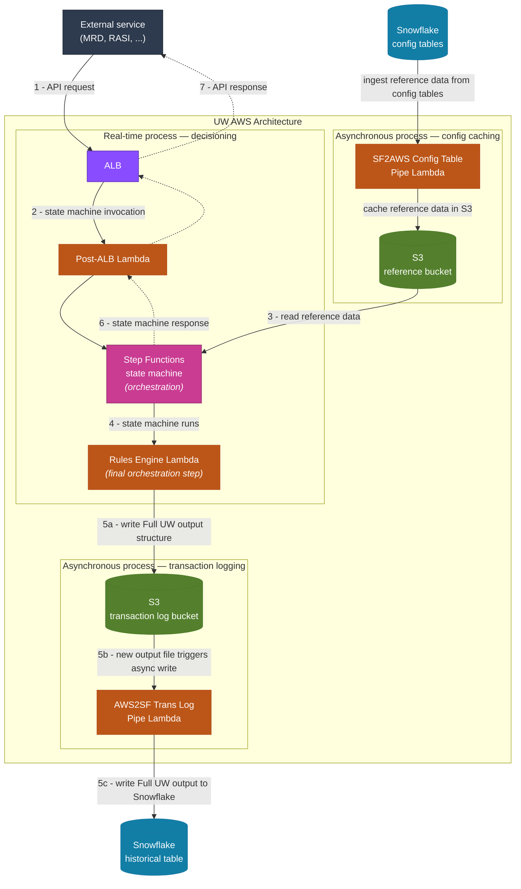
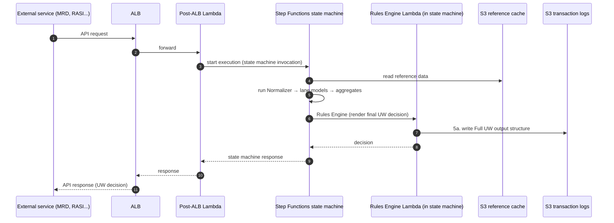
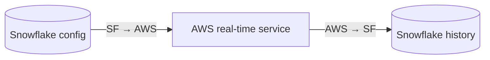

# End-to-end data flow

The diagram is split into three horizontal bands inside the AWS boundary. The numbers below match the
numbered arrows on the diagram.

The **Step Functions state machine** above expands into the layered orchestration described in
[Decisioning lanes & layers](decisioning-lanes.md).

!!! tip "The model team's view of the same flow"
    The [Implementation Support Document](next-steps/implementation-support-doc.md#the-process-flow-section-0)
    describes the request path as ten steps, from MRD collecting the data to the response on screen,
    with the owner and failure handling of each.

## Band 1: Asynchronous config caching (top)

| Arrow                                      | From → To                                                     | What happens                                                  |
| ------------------------------------------ | ------------------------------------------------------------- | ------------------------------------------------------------- |
| _Ingest reference data from config tables_ | Snowflake config tables → **SF2AWS Config Table Pipe Lambda** | Lambda runs each query from its state file against Snowflake. |
| _Cache reference data in S3_               | Lambda → **S3 (reference bucket)**                            | Changed results (by fingerprint) are written as files to S3.  |

This runs independently of any request (scheduled or triggered, **(inferred)**: the trigger is not shown).

## Band 2: Real-time decisioning (middle)

1. **API Request**: an external service (the diagram lists _MRD, RASI, etc._) sends an underwriting
   request (e.g. a merchant application) to the **Application Load Balancer**.
2. **State Machine Invocation**: the ALB forwards to the **Post-ALB Lambda**, which validates/shapes the
   payload **(inferred)** and starts the **AWS Step Functions** state machine.
3. **Read Reference Data**: the state machine reads the cached config from S3 (mappings such as TMX code
   categories, MCC stats).
4. **State Machine runs**: orchestration of the decisioning layers. The normalizer runs first, then
   the three lanes in parallel, then the rules engine. See [lanes & layers](decisioning-lanes.md) for the
   concepts and [Inside the state machine](state-machine.md) for every state and Lambda.
5. **5a. Write Full UW output structure**: the **Rules Engine Lambda** (the final step in the
   orchestration) writes the full UW output structure — inputs, scores and decision — directly to the S3
   transaction-log bucket. _(Updated: this write now originates from the Rules Engine Lambda itself, not
   from the state-machine construct.)_
6. **State Machine Response**: the result returns to the Post-ALB Lambda.
7. **API Response**: the decision goes back through the ALB to the caller.

Because the response returns synchronously, the Step Functions workflow is most likely an
**Express workflow** invoked synchronously **(inferred)**.

## Band 3: Asynchronous transaction logging (bottom)

!!! note "The request is logged too"
    Per the manager, the **API request (step 1)** is also written to a Snowflake table, although the
    diagram doesn't show it. That table is the **input** for data quality monitoring; the 5c historical
    table is the **output**. See [What to monitor](next-steps/what-to-monitor.md).

| Arrow  | From → To                                         | What happens                                                                             |
| ------ | ------------------------------------------------- | ---------------------------------------------------------------------------------------- |
| **5a** | **Rules Engine Lambda** → **S3 (transaction log bucket)** | The Rules Engine writes the **full UW output structure** per decision. _(Updated: previously drawn from the state machine.)_ |
| **5b** | S3 → **AWS2SF Trans Log Pipe Lambda**             | A _new output file_ (S3 event notification) triggers the async write.                    |
| **5c** | Lambda → **Snowflake historical table**           | The full UW output is written to a historical table for analytics, monitoring and model retraining. |

## Data direction summary

- **SF2AWS** = Snowflake **to** AWS (config/reference data, read side).
- **AWS2SF** = AWS **to** Snowflake (transaction logs, write side).
