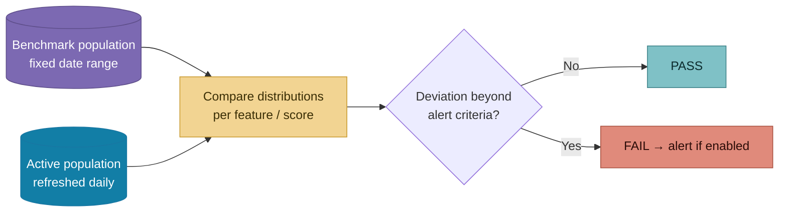

# Feature & score monitoring

The spreadsheet's second tab, **Feature_Scores Monitoring**, drafts the next BRD in the series. It
moves from raw inputs to the **features and scores** the models use and produce, for example FICO Score,
Bank Verification, Phone Health, KYB Verification and IDT Score.

Input monitoring asks _"is this data valid?"_. Feature & score monitoring adds a second question:
_"does this data still look like the data the model was built and validated on?"_ A model can get inputs
that are each perfectly valid and still drift, if the overall mix of values shifts.

## Two populations

The main difference from input monitoring is that **two datasets** are compared:

| Parameter                       | Value   | Meaning                                                                       |
| ------------------------------- | ------- | ----------------------------------------------------------------------------- |
| Benchmark / Base Population     | Date    | A **fixed reference period**, for example the data the model was developed on. |
| Snowflake Path: Benchmark       | (link)  | The Snowflake table holding that reference data.                              |
| Active Population               | Daily   | **Recent production data**, refreshed every day.                               |
| Snowflake Path: Active          | (link)  | The Snowflake table holding that recent data.                                 |
| Scheduled                       | Yes     |                                                                                |
| Reporting Freq (Scheduled = Y)  | Weekly  |                                                                                |
| Alert Freq                      | Hourly  |                                                                                |

!!! note "What the two Snowflake Paths are"
Each one is a table's full name in Snowflake, `DATABASE.SCHEMA.TABLE`: the data the comparison reads.
This tab needs **two** because it compares two populations. Both are still "Link" placeholders in the
draft. They will most likely both point at the historical table of model-service output, possibly the
same table with different date filters **(inferred)**. Full explanation:
[What "Snowflake Path" means](input-monitoring.md#what-snowflake-path-means).



## Check types

This tab has the same nine check types as [input monitoring](input-monitoring.md#the-check-types), plus
two **stability indices**:

| Check type                                   | Applied to                | What it measures                                                                 |
| -------------------------------------------- | ------------------------- | -------------------------------------------------------------------------------- |
| **Feature Stability Indicator (FSI / CSI)**  | Each **feature** (input to a model) | How much one feature's distribution has shifted between benchmark and active. CSI = Characteristic Stability Index. |
| **Population Stability Indicator (PSI)**     | A model **score**         | How much the score distribution has shifted between benchmark and active.        |

In this tab the criteria column is labelled **"Deviation (Alert Criteria)"** rather than "Alert
Criteria". Criteria here describe a **change compared with the benchmark**, not an absolute limit.

## The variable matrix (as drafted)

The **Missing Values** column is hidden behind the dropdown in the screenshot, so it is left out:

| Feature / Score   | Value Length | Deviation        | Alert? | FSI / CSI | Deviation  | Alert? |
| ----------------- | :----------: | ---------------- | :----: | :-------: | ---------- | :----: |
| FICO Score        | No           |                  | No     | **Yes**   | Dec > 10%  | **Yes** |
| Bank Verification | No           |                  | No     | No        |            |        |
| Phone Health      | No           |                  | No     | No        |            |        |
| KYB Verification  | No           |                  | No     | No        |            |        |
| … (row 17)        | **Yes**      | Length ≠ 8 char  | **Yes**| **Yes**   | Inc > 5%   | **Yes** |
| … (row 18)        | No           |                  | No     | **Yes**   | Dec > 5%   | No     |
| … (rows 19–20)    | No           |                  | No     | No        |            |        |
| IDT Score         | No           |                  | No     | No        |            |        |

The variable names give useful context. **Phone Health** most likely comes from the Lexis Neustar
source, and **IDT Score** from the Identity Theft lane aggregate
([`idt-aggregate-cert`](../state-machine.md#all-the-function-names)) **(inferred)**. So this tab covers
both **features** and **model scores**.

## How CSI and PSI are calculated

CSI and PSI use the **same formula**. The only difference is what it is applied to: CSI to one feature,
PSI to a score.

1. Split the **benchmark** values into bins, often 10 bins with equal numbers of records.
2. Use the **same bin edges** to count the **active** values.
3. For each bin, take the share of benchmark records (*E*, expected) and active records (*A*, actual).
4. Add up `(A − E) × ln(A / E)` across all bins.

```text
PSI = Σ over bins of  (A_i − E_i) × ln(A_i / E_i)
```

The result is always **≥ 0**: 0 means no shift, and bigger means more shift. Movement in either
direction raises it. A common industry rule of thumb (not from the BRD):

| PSI / CSI value | Usual reading                    |
| --------------- | -------------------------------- |
| < 0.10          | Stable, no action needed         |
| 0.10 – 0.25     | Moderate shift, investigate      |
| > 0.25          | Significant shift, act           |

### Worked example 1: a small shift (illustrative)

FICO Score in 4 bins. The benchmark is spread evenly; the active population has drifted slightly
upward.

| Bin (FICO)  | Benchmark E | Active A | A − E  | ln(A/E) | (A − E) × ln(A/E) |
| ----------- | ----------: | -------: | -----: | ------: | ----------------: |
| < 620       | 0.25        | 0.20     | −0.05  | −0.2231 | 0.0112            |
| 620 – 679   | 0.25        | 0.25     | 0      | 0       | 0                 |
| 680 – 739   | 0.25        | 0.25     | 0      | 0       | 0                 |
| ≥ 740       | 0.25        | 0.30     | +0.05  | +0.1823 | 0.0091            |
| **Total**   | 1.00        | 1.00     |        |         | **0.020 → stable** |

### Worked example 2: a real shift (illustrative)

Same bins, but the active population has moved a lot. For example, a new marketing channel brings in
more high-score applicants.

| Bin (FICO)  | Benchmark E | Active A | A − E  | ln(A/E) | (A − E) × ln(A/E) |
| ----------- | ----------: | -------: | -----: | ------: | ----------------: |
| < 620       | 0.25        | 0.10     | −0.15  | −0.9163 | 0.1374            |
| 620 – 679   | 0.25        | 0.20     | −0.05  | −0.2231 | 0.0112            |
| 680 – 739   | 0.25        | 0.30     | +0.05  | +0.1823 | 0.0091            |
| ≥ 740       | 0.25        | 0.40     | +0.15  | +0.4700 | 0.0705            |
| **Total**   | 1.00        | 1.00     |        |         | **0.228 → moderate shift** |

!!! warning "How \"Dec > 10%\" fits with CSI"
The draft gives FSI/CSI criteria as **directional percentages**: `Dec > 10%`, `Inc > 5%`. But the CSI
value is never negative and goes up whichever way the data moves. It doesn't "decrease by 10%" in any
meaningful way. These criteria most likely mean something else, such as "the **mean** of the feature
fell by more than 10% compared with the benchmark", or "the share of records in some key bin fell by
10%". Either is a reasonable check, but it isn't CSI. See
[Review notes](review-notes.md#4-clarify-what-the-fsicsi-criteria-measure).

## Value Length on a feature: "Length ≠ 8 char"

Row 17 checks that a value is **exactly 8 characters**. That is typical for codes or dates in
`YYYYMMDD` form **(inferred)**. A sudden change in length usually means an upstream format change, for
example a vendor switching date formats. Such a change can make a feature silently fail to parse.

## What changes from input monitoring

| Aspect                  | Input monitoring                       | Feature & score monitoring                         |
| ----------------------- | -------------------------------------- | -------------------------------------------------- |
| Datasets                | One (the data being checked)           | Two (benchmark + active)                            |
| Kind of criteria        | Absolute ("missing > 30%")             | Change from benchmark ("Dec > 10%"), or index value  |
| Extra check types       | (none)                                 | FSI/CSI, PSI                                        |
| Needs a stable baseline | No                                     | **Yes**: choosing the benchmark period matters     |

!!! tip "Choosing the benchmark period"
The benchmark should be data the model **behaved well on**: usually its development or validation
sample, or a recent stable period. If it's too short, the bins are noisy. If it covers an unusual time
(seasonal peaks, an incident), every comparison against it is skewed. Record the chosen date range
with each result so a PSI value can be traced back.

Next: [Implementation guide](implementation.md).
