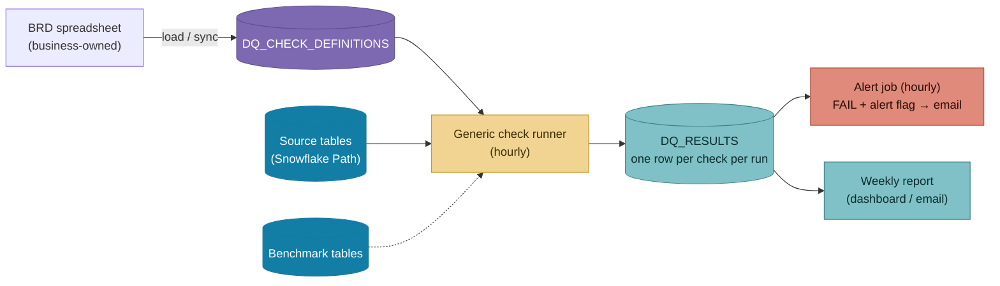
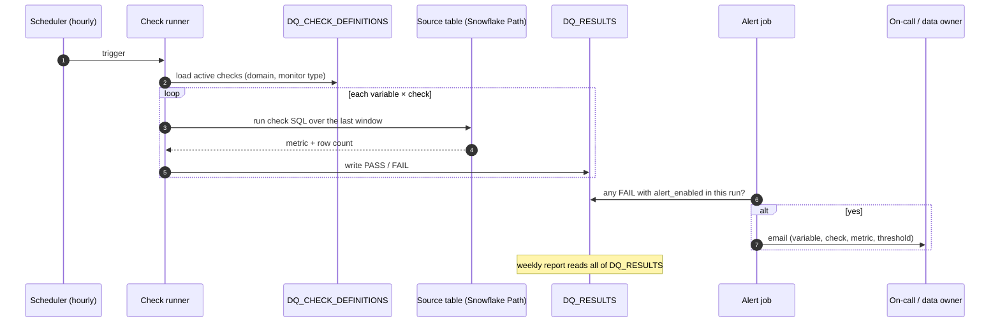

# Implementation guide

!!! tip "The full blueprint"
    This page is a short summary of the options. The detailed, phased design (architecture, data model,
    Phase 1 sprint plan, reference code, operations and roadmap) is in the
    [DQ Framework Blueprint](../dq-framework/index.md).

The BRD defines **what** to monitor. It deliberately leaves **how** to a later part (_Reusable Monitoring
Architecture_). Everything on this page is therefore **(suggestion)**: a way to build what the BRD
describes, using the same config-driven pattern the
[feature store pipeline](../feature-store/index.md) already uses.

!!! warning "Code on this page is a sketch"
The examples show the shape of the solution. Check the Great Expectations and Snowflake syntax
against the versions your team actually installs before running anything.

## The core idea: the spreadsheet *is* the config

The requirements spreadsheet is already a configuration table: a variable, a check type, a threshold,
and an alert flag. Store that as a **Snowflake table** and write **one generic runner** that reads it.
Then adding a check, or extending monitoring to Risk Monitoring or Clover Capital, means **inserting
rows, not writing code**. That directly meets the BRD's requirement of "no separate build for each".

The feature store already works this way: `Transaction Array Definitions` and `Feature Definitions` are
config tables that drive generic code.



### Config table: `DQ_CHECK_DEFINITIONS`

One row per **variable × check**, a direct translation of the spreadsheet:

```sql
create table DQ_CHECK_DEFINITIONS (
    check_id        number autoincrement,
    domain          varchar,   -- 'UW', 'RM', 'CLOVER'          (reuse across business areas)
    monitor_type    varchar,   -- 'INPUT' or 'FEATURE_SCORE'
    source_table    varchar,   -- the BRD's "Snowflake Path": DATABASE.SCHEMA.TABLE to check
    benchmark_table varchar,   -- "Snowflake Path: Benchmark" (feature/score checks only)
    timestamp_col   varchar,   -- column used to select each run's window, e.g. the last hour
    variable        varchar,   -- e.g. 'AVG_TICKET'
    check_type      varchar,   -- 'MISSING_VALUES', 'ACCEPTABLE_RANGE', 'CSI', ...
    params          variant,   -- e.g. {"max_pct": 0.30} or {"min": 0, "max": 10000}
    alert_enabled   boolean,   -- the "Alerts Sent?" column
    severity        varchar,   -- (suggestion) 'HIGH' for the "sensitive fields" the BRD mentions
    active          boolean
);
```

!!! tip "Where the Snowflake Path goes"
The BRD's **Snowflake Path** values become `source_table` (and `benchmark_table` for feature/score
checks), written as `DATABASE.SCHEMA.TABLE`. The runner puts that name after `FROM` in every check. See
[What "Snowflake Path" means](input-monitoring.md#what-snowflake-path-means).

The **Avg Ticket** row of the spreadsheet becomes three config rows:

| variable   | check_type        | params                         | alert_enabled |
| ---------- | ----------------- | ------------------------------ | :-----------: |
| AVG_TICKET | MISSING_VALUES    | `{"max_pct": 0.30}`            | true          |
| AVG_TICKET | FIELD_POPULATION  | `{"min_pct": 0.70, "placeholders": [-999]}` | false |
| AVG_TICKET | ACCEPTABLE_RANGE  | `{"min": 0, "max": 10000, "exclusive": true}` | false |

### Results table: `DQ_RESULTS`

Every run writes one row per check. The weekly report and the alerts both read from this table:

```sql
create table DQ_RESULTS (
    run_ts        timestamp_ntz,
    check_id      number,
    window_start  timestamp_ntz,
    window_end    timestamp_ntz,
    row_count     number,          -- how many records were checked (also catches "no data")
    metric_value  float,           -- e.g. 0.33 for 33% missing, 0.228 for a PSI
    result        varchar,         -- 'PASS' / 'FAIL'
    alerted       boolean
);
```

## Option A: Great Expectations (GX Core)

GX is an open-source Python library. You declare "expectations" about your data (for example, "this
column is not null in at least 70% of rows"), run them against a dataset, and get PASS/FAIL results
plus human-readable HTML reports ("Data Docs"). It can run its checks as SQL directly in Snowflake.

### Mapping BRD check types to GX expectations

| BRD check type      | GX expectation (GX 1.x class name)                         | Notes                                              |
| ------------------- | ---------------------------------------------------------- | -------------------------------------------------- |
| Missing Values      | `ExpectColumnValuesToNotBeNull(mostly=0.70)`               | `mostly` is the share that must pass: "> 30% missing fails" means `mostly=0.70`. |
| Field Population    | `ExpectColumnValuesToNotBeNull` + `ExpectColumnValuesToNotBeInSet(placeholders)` | Two expectations together = "populated with a real value". |
| Acceptable Range    | `ExpectColumnValuesToBeBetween(min_value, max_value, strict_min, strict_max)` | `strict_*` handles the ≤ / < question. |
| Accepted Values     | `ExpectColumnValuesToBeInSet(value_set)`                   |                                                    |
| Expected Format     | `ExpectColumnValuesToMatchRegex(regex)`                    | Dates can also be checked by regex.               |
| Duplicate Values    | `ExpectColumnValuesToBeUnique` / `ExpectCompoundColumnsToBeUnique` |                                            |
| Value Length        | `ExpectColumnValueLengthsToEqual(8)` / `...ToBeBetween`    |                                                    |
| Value Type          | `ExpectColumnValuesToBeOfType` / `...InTypeList`           |                                                    |
| Placeholder Value   | `ExpectColumnValuesToNotBeInSet([-999, 'N/A', ...], mostly=…)` |                                               |
| CSI / PSI           | **No built-in PSI.** Write a custom expectation, or compute it in SQL (below) and check the result. | GX has a KL-divergence expectation, but KL isn't the same as PSI. |
| Volume / Freshness  | `ExpectTableRowCountToBeBetween`; freshness via max timestamp | Covers the "availability" gap.               |

### Sketch: building a GX suite from the config table

```python
import great_expectations as gx

context = gx.get_context()
ds = context.data_sources.add_snowflake(name="uw", connection_string=SNOWFLAKE_URL)
asset = ds.add_table_asset(name="uw_inputs", table_name="UW_INPUTS_LAST_HOUR")
batch = asset.add_batch_definition_whole_table("last_hour")

# one translator per BRD check type: config row → GX expectation
BUILDERS = {
    "MISSING_VALUES":   lambda v, p: gx.expectations.ExpectColumnValuesToNotBeNull(
                            column=v, mostly=1 - p["max_pct"]),
    "ACCEPTABLE_RANGE": lambda v, p: gx.expectations.ExpectColumnValuesToBeBetween(
                            column=v, min_value=p["min"], max_value=p["max"],
                            strict_min=p.get("exclusive", False), strict_max=p.get("exclusive", False)),
    "ACCEPTED_VALUES":  lambda v, p: gx.expectations.ExpectColumnValuesToBeInSet(
                            column=v, value_set=p["values"]),
    "VALUE_LENGTH":     lambda v, p: gx.expectations.ExpectColumnValueLengthsToEqual(
                            column=v, value=p["length"]),
    "PLACEHOLDER":      lambda v, p: gx.expectations.ExpectColumnValuesToNotBeInSet(
                            column=v, value_set=p["placeholders"], mostly=1 - p["max_pct"]),
}

suite = context.suites.add(gx.ExpectationSuite(name="uw_input_monitoring"))
for row in load_config(domain="UW", monitor_type="INPUT"):       # SELECT from DQ_CHECK_DEFINITIONS
    suite.add_expectation(BUILDERS[row.check_type](row.variable, row.params))

result = context.validation_definitions.add(
    gx.ValidationDefinition(name="uw_inputs_hourly", data=batch, suite=suite)
).run()

write_results_to_snowflake(result)                                # → DQ_RESULTS, PASS/FAIL per check
```

## Option B: Snowflake-native

All the data already lives in Snowflake, so the checks can also run **inside Snowflake** with no
separate Python service.

**Plain SQL and Tasks.** Each check type is one SQL template; a scheduled Task runs them hourly:

```sql
-- Missing Values for one variable over the last hour
-- (Snowflake allows reusing the alias "metric" later in the same SELECT)
select 'AVG_TICKET'                                    as variable,
       'MISSING_VALUES'                                as check_type,
       count(*)                                        as row_count,
       count_if(avg_ticket is null) / nullif(count(*), 0) as metric,
       iff(metric > 0.30, 'FAIL', 'PASS')              as result
from <uw_inputs_table>
where event_ts >= dateadd(hour, -1, current_timestamp());
```

```sql
-- PSI for a score: benchmark vs active, with bins taken from the benchmark (sketch)
with bins as (select bin_id, lo, hi, benchmark_share from FICO_BENCHMARK_BINS),
active as (
    select b.bin_id, count(*) / sum(count(*)) over () as active_share
    from <active_scores> s join bins b on s.fico >= b.lo and s.fico < b.hi
    group by b.bin_id
)
select sum((a.active_share - b.benchmark_share)
           * ln(a.active_share / b.benchmark_share)) as psi
from bins b join active a using (bin_id);
-- note: a bin with zero active records makes ln() fail; floor shares at a small epsilon
```

**Data Metric Functions (DMFs).** Snowflake has built-in data-quality metrics that can be attached to
a table and run on a schedule, for example `SNOWFLAKE.CORE.NULL_COUNT`, `DUPLICATE_COUNT`, `ROW_COUNT`
and `FRESHNESS`. You can also write your own. Results go to a system view. DMFs require **Enterprise
edition or higher**; check what your account supports.

```sql
alter table <uw_inputs_table> set DATA_METRIC_SCHEDULE = '60 MINUTE';
alter table <uw_inputs_table> add data metric function SNOWFLAKE.CORE.NULL_COUNT on (avg_ticket);
```

**Alerts.** A Snowflake `ALERT` can check `DQ_RESULTS` every hour and send email through a notification
integration:

```sql
create or replace alert DQ_HOURLY_ALERT
  warehouse = <warehouse>
  schedule  = '60 MINUTE'
  if (exists (
        select 1 from DQ_RESULTS r join DQ_CHECK_DEFINITIONS d using (check_id)
        where r.result = 'FAIL' and d.alert_enabled
          and r.run_ts > dateadd(hour, -1, current_timestamp())))
  then call SYSTEM$SEND_EMAIL('<email_integration>', '<team@company.com>',
                              'DQ check failures', 'See DQ_RESULTS for the last hour.');
```

## Choosing between them

|                                  | Great Expectations                         | Snowflake-native (SQL / DMFs / Alerts)         |
| -------------------------------- | ------------------------------------------ | ---------------------------------------------- |
| Check library                    | Large set of ready-made expectations       | Write SQL templates (DMFs cover the basics)    |
| Where it runs                    | Python job (GitLab CI, Airflow, Lambda, ...) that sends SQL to Snowflake | Entirely in Snowflake |
| Reports                          | Data Docs (HTML) out of the box            | Build a dashboard on `DQ_RESULTS`              |
| PSI / CSI                        | Custom expectation or SQL                  | SQL                                            |
| Extra infrastructure             | A Python runtime and a scheduler           | None beyond Snowflake                          |
| Fit with the team today          | New dependency                             | Matches the Snowflake-native feature store     |

**(suggestion)** Neither option is clearly better. A practical split: use **GX** if the team wants a
standard framework, with its check library and Data Docs, that is reusable across UW, RM and Clover
Capital, which is what the BRD hints at. Use **Snowflake-native** if you want the fewest moving parts.
In both cases, keep the **config table** and **results table** above. They are what make the platform
reusable, whichever engine runs the checks.

## One hourly run, end to end



## A phased plan

1. **Settle the definitions.** Resolve the questions in [Review notes](review-notes.md). In particular,
   define each check type precisely, and decide whether monitoring can block decisions or only runs
   after the fact.
2. **Build the config and results tables** and load the spreadsheet into them.
3. **Start with UW input monitoring** on a few high-value sources (applications, TMX, bureau). Add
   **volume and freshness** checks, which catch vendor outages, the most damaging failure.
4. **Run it quietly for a few weeks**, writing results with alerts turned off. Use real FAIL rates to
   tune thresholds, so the first alerts aren't noise.
5. **Turn on alerts** for the fields marked sensitive.
6. **Add feature & score monitoring** once benchmark periods are agreed.
7. **Extend to RM and Clover Capital** by adding config rows with a new `domain`.
