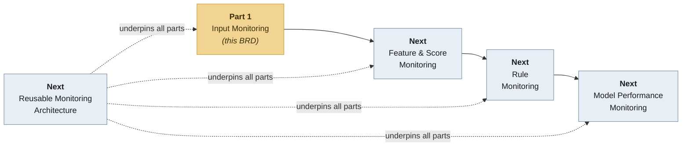
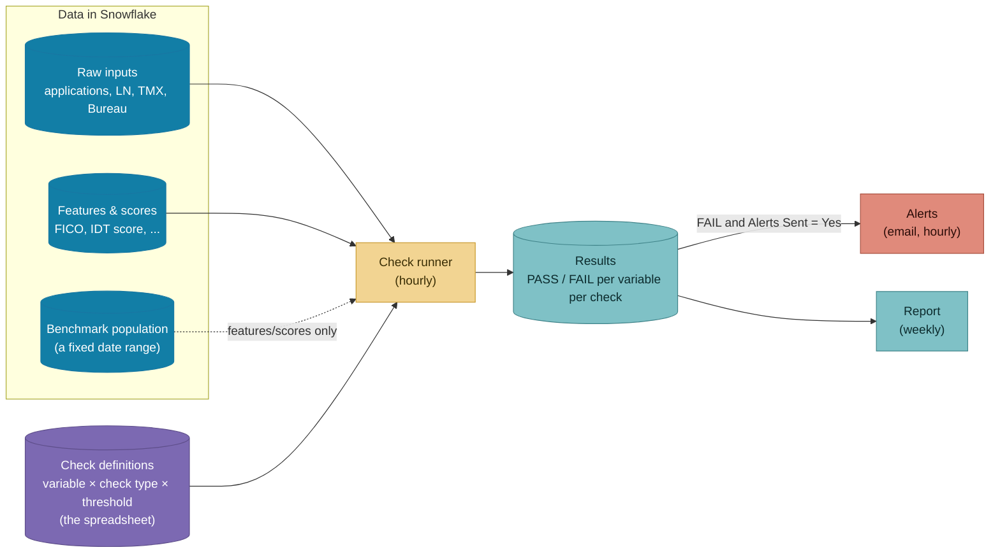

# Data Quality Monitoring: overview

This section explains a draft **Business Requirements Document (BRD)** for a proactive **Model & Rule
Monitoring Platform**: a data-quality framework in the spirit of
[Great Expectations](https://greatexpectations.io/). It covers what the BRD asks for, how each type of
check works, and how it could be built.

!!! info "Sources and labels"
This section is based on screenshots of the BRD (_"Model and Rules Performance BRD, Part 1: Input
Monitoring"_, file _Input Data Monitoring BRD_4.1_, **Version 1.0, September 2026**, still marked
`@TEMPLATE`) and its companion requirements spreadsheet (tabs _Input Monitoring_ and
_Feature_Scores Monitoring_). The pages use three labels:

    - Unlabelled statements about requirements come **from the BRD**.
    - **(inferred)**: my reading of something the BRD does not state.
    - **(suggestion)**: an implementation idea that is **not** in the BRD.

!!! tip "What's next"
    The [After the BRD](../next-steps/index.md) section covers what the manager asked for once the BRD
    was written: who fills in the templates, which UW tables to monitor, the report layout and hourly
    alerting.

## The problem the BRD is solving

Today, decisions in **Underwriting**, **Risk Monitoring** and **Clover Capital** are monitored
**reactively**. Problems only come to light when a business stakeholder notices something odd in a
rule, such as a sudden rise in how often a rule fires. The BRD lists five specific gaps:

- Underwriting and risk monitoring are reactive. Problems are found only when the business reports a rise
  in a rule.
- There is no systematic monitoring of **input data, features, scores, or model/rule performance**.
- Business stakeholders see only **rule outcomes**, not the scores or features behind them.
- There is **no feedback loop** connecting model performance back to real account outcomes.
- Monitoring must eventually cover Risk Monitoring and Clover Capital as well as Underwriting,
  **without a separate build for each**.

The goal is to catch bad data **before** it turns into bad decisions, and to build that capability
**once**, in a modular way, so all three business areas can reuse it.

## The BRD series

The BRD is the first in a planned series. Each part covers one layer of monitoring:

Only Part 1 has written requirements so far. The spreadsheet already has a second tab,
**Feature_Scores Monitoring**, so the next part is partly drafted. This section covers both.

## Business objective (Part 1)

| ID        | Objective             | Expected outcome                                                                                                                                                                                    |
| --------- | --------------------- | --------------------------------------------------------------------------------------------------------------------------------------------------------------------------------------------------- |
| **BO-01** | Input Data Monitoring | Potential issues are identified before they affect business outcomes, through proactive alerts and reports. Track **applications, LN (LexisNexis), TMX, Bureau** etc. data for **availability and validity** before it is used by models. |

The data sources named here are the same ones that feed the
[Underwriting decisioning lanes](../decisioning-lanes.md): the internal application (GNF), Lexis Neustar,
Lexis TMX and Experian (the bureau).

## How the platform fits together

The BRD does not include an architecture diagram. That is reserved for the later _Reusable Monitoring
Architecture_ part. Below is how the requirements fit together **(inferred from the parameters in the
spreadsheet)**:

!!! note "Where \"Snowflake Path\" fits in this picture"
The BRD's **Snowflake Path** parameters are the addresses of the three blue boxes on the left. Each is
the full name of a Snowflake table, `DATABASE.SCHEMA.TABLE`, that the check runner reads. The draft
leaves them as "Link" placeholders, so no table has been chosen yet. See
[What "Snowflake Path" means](input-monitoring.md#what-snowflake-path-means).

Four ideas recur throughout the BRD:

1. **Each variable–check pair is configured separately.** For every variable you choose which checks
   apply, the threshold that counts as a failure, and whether a failure sends an alert.
2. **Every result is binary: PASS or FAIL.**
3. **There are two schedules.** Alerts are evaluated **hourly**; a report is produced **weekly**.
4. **Inputs and features are judged differently.** Input checks look only at the data itself. Feature
   and score checks compare an **active** population with a **benchmark** population, to detect drift.

## Input monitoring vs feature & score monitoring

|                    | [Input monitoring](input-monitoring.md)                     | [Feature & score monitoring](feature-score-monitoring.md)                    |
| ------------------ | ----------------------------------------------------------- | ----------------------------------------------------------------------------- |
| **Looks at**       | Raw input fields (Merch ID, Enquiry Date, Avg Ticket, ...)   | Model inputs and outputs (FICO Score, Phone Health, IDT Score, ...)           |
| **Question asked** | "Is this data present and valid?"                           | "Has this data's distribution shifted from what the model was built on?"      |
| **Compared with**  | Nothing; only the data itself                               | A **benchmark/base population** from a chosen date range                      |
| **Typical checks** | Missing values, field population, acceptable range, format  | Same checks, plus **CSI/FSI** and **PSI** stability indices                   |
| **Data window**    | Hourly alerts, weekly report                                | Active population **daily**; hourly alerts, weekly report                     |

## Where this connects to the rest of the site

- **Where the BRD came from:** the [monitoring kickoff](../kickoff/index.md) meeting. See
  [From kickoff to BRD](../kickoff/brd-mapping.md) for what the draft covers and what it still misses.
- **Underwriting:** the inputs to monitor are the source data behind the
  [lane primitives](../state-machine.md#all-the-function-names). Snowflake is
  [not on the real-time path](../index.md), so this monitoring would most likely run on data **after**
  it has been logged to Snowflake, not as a check that blocks a live decision. Whether it should block
  decisions is an open question. See [Review notes](review-notes.md#1-blocking-check-or-after-the-fact-monitoring).
- **Risk Monitoring:** the [feature store](../feature-store/index.md) outputs are natural targets for
  feature monitoring. Its `-999` sentinel value is exactly what the **Placeholder Value** check type is
  for.

## Pages in this section

- [Input monitoring](input-monitoring.md): the Part 1 requirements, each check type explained, and a
  worked example.
- [Feature & score monitoring](feature-score-monitoring.md): the drift checks (benchmark vs active),
  with CSI and PSI worked out step by step.
- [Implementation guide](implementation.md): how to build it with Great Expectations or natively in
  Snowflake.
- [Review notes & open questions](review-notes.md): gaps in the draft worth raising.
