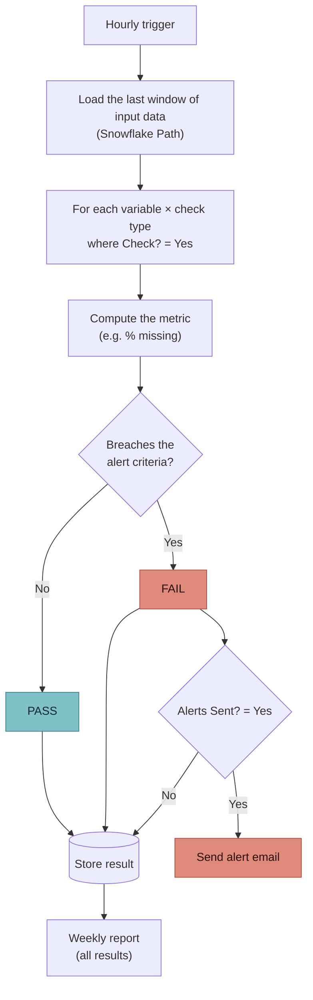

# Input monitoring (BRD Part 1)

Input monitoring checks the **raw data coming in**: application fields and responses from LexisNexis,
TMX and the bureau. The question for every field is: _is this data present and valid?_

## Ground rules from the BRD

- Input monitoring covers **raw data only**.
- It checks the **quality of the input itself**. There is **no comparison** between a benchmark/base
  population and the active population. That comparison belongs to
  [feature & score monitoring](feature-score-monitoring.md).
- Every check on every variable produces **PASS or FAIL** against its configured criteria.
- The reporting frequency is decided (see below). The **alert channel** (email) and **alert frequency**
  are still under discussion. The draft suggests a set of **sensitive or important fields** whose alerts
  could be sent at the end of the day or on another schedule. (That sentence is cut off in the
  screenshot.)

## Required parameters

These are set once for the monitoring job:

| Parameter                     | Value     | Meaning                                                    |
| ----------------------------- | --------- | ---------------------------------------------------------- |
| Snowflake Path                | (link)    | **Which data to check**: the Snowflake table or view the checks run against. [Explained below](#what-snowflake-path-means). |
| Scheduled                     | Yes       | The checks run on a schedule, not on demand.               |
| Reporting Freq (Scheduled = Y)| Weekly    | A summary report is produced every week.                   |
| Alert Freq                    | Hourly    | Failures are evaluated, and alerts sent, every hour.       |

### What "Snowflake Path" means { #what-snowflake-path-means }

!!! abstract "In short"
**Snowflake Path is the address of the data the checks run against**: one table or view in
Snowflake, written as its full three-part name `DATABASE.SCHEMA.TABLE`. It answers the question
_"which data are we checking?"_. Despite the word "path", it is **not** a folder or a file location.

**The three parts.** Snowflake organises data as database → schema → table, and a table's full name
joins all three with dots. A real example from the [feature store](../feature-store/step1-arrays.md):

| Part        | Example                  | Think of it as                         |
| ----------- | ------------------------ | -------------------------------------- |
| Database    | `GBS_PROD_CRANALYTICS`   | the top-level container                |
| Schema      | `CRAGGR`                 | a group of related tables inside it    |
| Table       | `CR_AGG_RMI_INFO`        | the actual data                        |
| **Path**    | `GBS_PROD_CRANALYTICS.CRAGGR.CR_AGG_RMI_INFO` | all three joined |

**What the BRD actually says.** In the draft, every Snowflake Path value is just the word **"Link"**:
a hyperlink placeholder, most likely meant to open the table in Snowflake's web UI **(inferred)**. **No
real table has been named yet.** Until it is, the checks have nothing to run against.

**How many paths, and what they should point to:**

| BRD tab              | Parameter                     | Should point to                                                                  |
| -------------------- | ----------------------------- | -------------------------------------------------------------------------------- |
| Input Monitoring     | Snowflake Path                | The raw input data. Per the [kickoff](../kickoff/discussion.md#2-input-data-layer-1), the **A1** dataset on Day 1, then **one table per source** (LexisNexis, GNF, application, ...) on Day 2 **(inferred)**. For **UW**, the 1:1 named the **API request table** ([details](../next-steps/what-to-monitor.md)). |
| Feature_Scores       | Snowflake Path: **Benchmark** | The **reference** population: features and scores from a fixed past period.     |
| Feature_Scores       | Snowflake Path: **Active**    | **Recent** production features and scores, refreshed daily.                      |

For features and scores, both paths will most likely point into the Snowflake **historical table**
loaded from the model service's JSON output ([step 5c](../data-flow.md#band-3-asynchronous-transaction-logging-bottom)).
In that case Benchmark and Active could be **the same table filtered to different date ranges**
**(inferred)**.

**What the path alone doesn't tell you.** To run hourly checks, each path also needs:

- **A timestamp column**, to select "the last hour" of records.
- **The environment**: sandbox (e.g. `AP_SBX_...`) or production. These are different databases.
- **Read access** for whatever role runs the checks.

In SQL, the path is simply what goes after `FROM`:

```sql
select count(*)                                   as row_count,
       count_if(avg_ticket is null) / count(*)    as pct_missing
from   <DATABASE>.<SCHEMA>.<TABLE>                -- ← the Snowflake Path
where  <event_ts> >= dateadd(hour, -1, current_timestamp());
```

In the [implementation guide](implementation.md#config-table-dq_check_definitions) it is stored in the
`source_table` and `benchmark_table` columns of the config table.

## The check types

The spreadsheet offers nine check types in a dropdown. The BRD does not define them, so the definitions
below are **(inferred)**. Each one should be confirmed and written into the BRD itself (see
[Review notes](review-notes.md#2-define-every-check-type-precisely)).

| Check type            | What it asks                                                       | Typical criteria                     | Example                                                       |
| --------------------- | ------------------------------------------------------------------ | ------------------------------------ | ------------------------------------------------------------- |
| **Missing Values**    | What share of records have this field **null**?                    | FAIL if missing **> X%**             | `Avg Ticket` null in > 30% of records                        |
| **Field Population**  | What share of records have a **real, usable** value (not null, not blank, not a placeholder)? | FAIL if populated **< X%** | `Enquiry Date` usable in < 70% of records                   |
| **Acceptable Range**  | Are numeric or date values inside the allowed bounds?              | FAIL if outside `[min, max]`         | `Avg Ticket` must be > $0 and < $10,000                       |
| **Accepted Values**   | Is the value one of an allowed list?                               | FAIL if not in the set               | Account status in `{01, 02, 03, 13}`                          |
| **Expected Format**   | Does the value match a pattern?                                    | FAIL if it doesn't match the regex/format | Date is `YYYY-MM-DD`; ID is all digits                   |
| **Duplicate Values**  | Is a value that should be unique repeated?                         | FAIL if duplicates > X               | The same application ID appears twice in an hour              |
| **Value Length**      | Is the string length as expected?                                  | FAIL if length ≠ N (or outside range)| Merchant ID must be N characters                              |
| **Value Type**        | Is the data type correct?                                          | FAIL if the type is wrong            | Numeric field arriving as text                                |
| **Placeholder Value** | Is the field filled with a "fake" default?                         | FAIL if placeholder share > X%       | `-999`, `9999`, `N/A`, `UNKNOWN`, `1900-01-01`                |

!!! tip "Placeholders hide missing data"
A field filled with `-999` is not null, so a **Missing Values** check passes it. The data is still
effectively missing. That is why **Field Population** and **Placeholder Value** exist alongside Missing
Values. The [feature store](../feature-store/step2-features.md) uses `-999` this way, so any monitoring
of its outputs must count `-999` as "not populated".

## The variable matrix (as drafted)

The spreadsheet is a grid: **one row per variable, three columns per check type**:

- **Check?** (Yes/No): whether this check applies to the variable.
- **Alert criteria**: the threshold that makes it FAIL.
- **Alerts Sent?** (Yes/No): whether a FAIL sends an alert, or only shows up in the report
  **(inferred)**.

What the screenshot shows so far (the `…` rows are still placeholders in the draft):

| Variable      | Missing Values | Criteria | Alert? | Field Population | Criteria | Alert? | Acceptable Range | Criteria             | Alert? |
| ------------- | :------------: | :------: | :----: | :--------------: | :------: | :----: | :--------------: | -------------------- | :----: |
| Merch ID      | Yes            | > 30%    | No     | No               |          |        | Yes              | `(<=0 >=15)`         | Yes    |
| Enquiry Date  | Yes            | > 30%    | No     | Yes              | < 70%    | Yes    | No               | `(<=2025 >=2026)`    |        |
| Avg Ticket    | Yes            | > 30%    | Yes    | Yes              | < 70%    | No     | Yes              | `(<=$0 >=$10000)`    | No     |
| … (4 rows)    | some No        |          |        | mixed            | < 80%    | No     | No               |                      |        |
| Client ID     | Yes            | > 30%    | No     | Yes              | < 80%    | No     | No               |                      |        |

### How to read a row

Take **Avg Ticket**:

- **Missing Values: Yes, > 30%, alert Yes.** If more than 30% of records in the window have no
  Avg Ticket, the check FAILs **and** an alert goes out.
- **Field Population: Yes, < 70%, alert No.** If fewer than 70% have a real value, it FAILs, but this
  only shows up in the weekly report.
- **Acceptable Range: Yes, `(<=$0 >=$10000)`, alert No.** Read as: a value **≤ $0 or ≥ $10,000** is out
  of range. That reading is **(inferred)**: the notation lists the *failing* boundaries.

Some criteria in the draft are ambiguous. For example, `(<=0 >=15)` on Merch ID, a range check on an ID
field. Those are covered in [Review notes](review-notes.md#3-tighten-the-alert-criteria).

## Worked example: one hour of application data

**Illustrative.** In one hour, 200 applications arrive. The checks configured for **Avg Ticket** and
**Enquiry Date** run against those 200 records:

| Variable     | Check            | Measured                                      | Criteria  | Result   | Alert?            |
| ------------ | ---------------- | --------------------------------------------- | --------- | -------- | ----------------- |
| Avg Ticket   | Missing Values   | 66 null of 200 = **33%**                       | > 30%     | **FAIL** | **Yes → email**   |
| Avg Ticket   | Field Population | 120 usable of 200 = **60%** (66 null + 14 `-999`) | < 70% | **FAIL** | No (report only)  |
| Avg Ticket   | Acceptable Range | 3 values ≥ $10,000                            | ≤$0 or ≥$10,000 | **FAIL** (if any one value counts) | No |
| Enquiry Date | Missing Values   | 10 null of 200 = **5%**                        | > 30%     | PASS     | (n/a)             |
| Enquiry Date | Field Population | 190 usable of 200 = **95%**                    | < 70%     | PASS     | (n/a)             |

Two things this example shows:

- **Only one email goes out** this hour (Avg Ticket, Missing Values), even though there are three
  FAILs. The other two wait for the weekly report.
- The Acceptable Range result depends on a rule the BRD hasn't set yet: does **one** bad value make the
  check FAIL, or does it take more than some percentage? With 3 out of 200 (1.5%), the answer flips
  from FAIL to PASS depending on that rule.

## What happens on each run



## Coverage gap: "availability" isn't checked yet

Objective BO-01 asks for **availability and validity**. Every check type above is about **validity**:
whether the values are good. None is about **availability**: whether the data arrived at all. If a TMX
outage means **zero** TMX responses arrive in an hour, there is nothing to measure "% missing" against,
and every check can quietly pass. **(suggestion)** Add two more check types:

- **Volume:** row count in the window compared with what's expected. For example, FAIL if TMX
  responses drop below 50% of the same hour last week.
- **Freshness:** time since the newest record. For example, FAIL if no bureau data has arrived for 2
  hours.

Next: [Feature & score monitoring](feature-score-monitoring.md).
