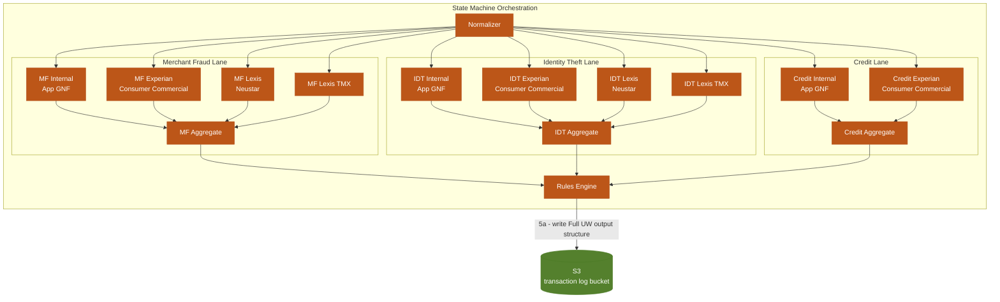

# Decisioning lanes & layers

Inside the state machine ("State Machine Orchestration") the work is organised in **layers** (top to
bottom) and **lanes** (left to right).

**Layers** map to the rows above: the **Normalizer** is the _Normalization Layer_; the per-source
boxes are the _Primitive Model Layer_; the per-lane _Aggregate_ boxes are the _Composite Model Layer_
("score of scores"); and the **Rules Engine** is the _Rules Engine Layer_, which takes **all** lane
scores into account.

!!! note "The Rules Engine performs the 5a write"
As the final step in the orchestration, the **Rules Engine Lambda** writes the full UW output structure
directly to the S3 transaction-log bucket (step **5a**) — see the
[end-to-end data flow](data-flow.md#band-3-asynchronous-transaction-logging-bottom). _(Updated: this
write previously came from the state-machine construct.)_

## The four layers

| Layer                     | Definition from the diagram                                                                             | Plain English                                                                                                   |
| ------------------------- | ------------------------------------------------------------------------------------------------------- | --------------------------------------------------------------------------------------------------------------- |
| **Normalization Layer**   | All cleaning, scaling and feature generation that is shared across models & rules.                      | Turn the raw request + reference data into a clean feature set once.                                            |
| **Primitive Model Layer** | Source-specific models. Model-specific encoders and normalization sit with primitive model images.      | One model per data source; each brings its own encoders.                                                        |
| **Composite Model Layer** | Also known as "score of scores"; uses scenario-specific model objects (depending on sources available). | Combine the per-source scores into one lane score, picking the right model for whichever sources returned data. |
| **Rules Engine Layer**    | Final set of rules that takes into account all scores and data to render a final UW decision.           | Business rules produce approve / decline / refer etc. **(outcome values inferred)**.                            |

## The three lanes

The three lanes (Merchant Fraud, Identity Theft, Credit) are the columns in the diagram above. Each
lane runs its own set of source models and rolls them up into a lane aggregate:

| Source model                   | Merchant Fraud (MF) | Identity Theft (IDT) |      Credit      |
| ------------------------------ | :-----------------: | :------------------: | :--------------: |
| Internal App GNF               |         ✅          |          ✅          |        ✅        |
| Experian Consumer / Commercial |         ✅          |          ✅          |        ✅        |
| Lexis Neustar                  |         ✅          |          ✅          |                  |
| Lexis TMX (ThreatMetrix)       |         ✅          |          ✅          |                  |
| **Aggregate**                  |    MF Aggregate     |    IDT Aggregate     | Credit Aggregate |

!!! note "Confirmed by the state-machine definition"
In the PDF the Rules Engine is drawn under the IDT lane. The real Step Functions graph confirms what the
legend implied: all three aggregates feed **one** Rules Engine (`uw-rules-engine-cert`), and it runs
only after every lane has finished. The lanes **do** run in parallel, in a `Parallel` state named
`ScoreLanes`. The source models inside each lane run in parallel too. See
[Inside the state machine](state-machine.md) for every state and Lambda name.

## What the data sources are

!!! tip "The full list"
    The [Implementation Support Document](next-steps/implementation-support-doc.md#the-data-sources-section-0)
    lists every source MRD collects (application, TINCheck, GNF, RNF, Mastercard MATCH, LexisNexis with
    Emailage and ThreatMetrix, Neustar, Experian bureau and BIZ ID; Equifax to replace Experian bureau),
    the component models per source, and the score-of-scores combinations.

- **Internal App GNF**: features from the application data and Fiserv's **Global Negative File** (GNF,
  negative history on merchant accounts). The internal **Restricted Name File** (RNF) is used too.
- **Experian Consumer / Commercial**: credit bureau data on the owner (consumer) and the business (commercial).
- **Lexis Neustar**: LexisNexis / Neustar identity and phone/contact verification signals.
- **Lexis TMX**: LexisNexis ThreatMetrix device and digital-identity signals. The **TMX code categories**
  config table in the transcript maps raw TMX codes into categories used by these models.
