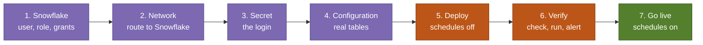

# Step by step

The order matters: each step can be checked before the next one starts. Run all commands from
`dq-framework/`.



## 1. Snowflake

On the **production** Snowflake account, with an admin:

1. Make a new key pair for production. Don't reuse the sandbox key.

    ```bash
    mkdir -p keys/prod && cd keys/prod && openssl genrsa 2048 | openssl pkcs8 -topk8 -nocrypt -out dqf_prod.p8 \
      && openssl rsa -in dqf_prod.p8 -pubout -out dqf_prod.pub && cd ../..
    ```

2. Run `sql/01_setup.sql` with the production names (database, schema, warehouse, role, user) and the
   new public key. Leave out the line that grants the role to your own user if that is not allowed.
3. Grant read access on each monitored table:

    ```sql
    grant usage on database <DB> to role DQF_ROLE;
    grant usage on schema <DB>.<SCHEMA> to role DQF_ROLE;
    grant select on table <DB>.<SCHEMA>.<TABLE> to role DQF_ROLE;     -- each table / view in the configuration
    ```

4. Note the account identifier: `select current_organization_name() || '-' || current_account_name();`.
5. Get the hosts the network team must allow: `select system$allowlist();`.

**Check:** from your laptop, put the production values in a copy of `.env`, then run `make check`.

## 2. Network

The Lambda runs in private subnets and needs outbound HTTPS (443) to:

| Destination | Through |
| --- | --- |
| Snowflake (the hosts from `system$allowlist()`, including the OCSP host) | NAT gateway or proxy; or Snowflake **PrivateLink** if the account uses it |
| Secrets Manager, S3, SNS | NAT, or VPC endpoints: Secrets Manager (interface), S3 (gateway), SNS (interface) |

Lambda logs go to CloudWatch without a VPC route, so no endpoint is needed for them.

If the Snowflake account uses **PrivateLink**, use its PrivateLink account identifier in the secret
(the `…privatelink…` form your Snowflake admin gives you).

!!! note "Without a VPC"
    If the account allows Lambdas outside a VPC and Snowflake accepts connections from the internet,
    leave `SUBNET_IDS` empty. The Lambda then reaches everything directly, and this step is skipped.
    Many company accounts do not allow this.

**Check:** step 6's `check` action is the real test.

## 3. The secret

Write the login to a temporary file. The private key goes in as one line, with `\n` for line breaks:

```bash
python3 - <<'EOF' > secret.json
import json
print(json.dumps({
    "account": "ORGNAME-ACCOUNTNAME", "user": "DQF_SVC", "role": "DQF_ROLE", "warehouse": "DQF_WH",
    "database": "DQF_DB", "schema": "DQF", "auth": "keypair",
    "private_key": open("keys/prod/dqf_prod.p8").read()}))
EOF
aws secretsmanager create-secret --name dqf/snowflake --secret-string file://secret.json \
    [--kms-key-id <your KMS key ARN>]
rm secret.json
```

Note the secret's **ARN** from the output. If you used your own KMS key, pass its ARN to the
deployment as `SECRET_KMS_KEY_ARN`.

**Check:** `aws secretsmanager describe-secret --secret-id dqf/snowflake` shows the secret's details without
the value.

## 4. The configuration

Point the `sources` in `config/dq_config.yaml` at the real tables, adjust the checks, limits and
business rules, then:

```bash
make validate    # every problem, with where it is
.venv/bin/dqf run hourly --no-alerts     # optional, from the laptop with the production .env
```

The copy in the image is only a fallback. The Lambda reads the copy in S3, which `deploy.sh` uploads.
To deploy an Excel workbook instead, set `CONFIG_FILE=config/dq_config.xlsx`.

## 5. Deploy, with schedules off

```bash
STACK=dqf \
SNOWFLAKE_SECRET_ARN=arn:aws:secretsmanager:<region>:<account>:secret:dqf/snowflake-AbCdEf \
RESULT_TABLE=DQF_DB.DQF.DQ_RESULT \
ALERT_EMAIL=dq-alerts@yourcompany.com \
SUBNET_IDS=subnet-aaa,subnet-bbb \
SECURITY_GROUP_IDS=sg-ccc \
SCHEDULES=DISABLED \
infra/deploy.sh
```

Optional settings, if your account needs them:

| Variable | When |
| --- | --- |
| `PERMISSIONS_BOUNDARY_ARN` | New IAM roles must carry a boundary policy |
| `SECRET_KMS_KEY_ARN` | The secret uses your own KMS key |
| `TAGS="CostCenter=1234 Owner=risk-analytics"` | Tags are mandatory |
| `REPO=team/dqf` | A required ECR repository name |
| `SKIP_BUILD=1 IMAGE_URI=<uri>` | Your CI pipeline builds and pushes the image; the script only deploys |
| `AWS_REGION` | A region other than your CLI default |
| `REPORT_URL=<address>` | The Streamlit report's address, linked from every alert. See [Hosting the report](report.md) |

The script:

1. builds the image (`linux/amd64`) and pushes it to ECR;
2. deploys `infra/cloudformation.yaml` with `Target=aws`;
3. uploads `dq_config.yaml` to the stack's bucket;
4. prints the test commands.

If your team deploys only through a pipeline, the pipeline needs to do the same three things: build the
`Dockerfile`, deploy the template with these parameters, and copy `dq_config.yaml` to S3.

## 6. Verify

Run these in order. Each one tests one more part.

```bash
F=dqf-run
invoke() { aws lambda invoke --function-name $F --cli-binary-format raw-in-base64-out --payload "$1" /dev/stdout; }

# a) Login, network, secret, configuration. Runs no checks, writes nothing, sends nothing.
invoke '{"action": "check"}'

# b) A real run, stored in the results table, without alerts
invoke '{"schedule": "hourly", "send_alerts": false}'
invoke '{"schedule": "daily", "send_alerts": false}'

# c) The alert path: confirm the SNS subscription email first, then
invoke '{"action": "test_alert"}'
```

| Step | Good result | If it fails |
| --- | --- | --- |
| a | `"ok": true`, with the Snowflake account, user and role, and the configuration counts | `snowflake: FAILED … timeout`: network (step 2). `JWT token is invalid`: the key (step 1). `AccessDenied` on the secret: the ARN or the KMS key. `config: FAILED`: S3 access or a problem in the configuration |
| b | Counts of checks; rows appear in the results table | A check with `ERROR`: a missing `SELECT` grant or a wrong column |
| c | An email from AWS Notifications | No email: the subscription is not confirmed, or a mail filter is holding it |

The Lambda's log: `aws logs tail /aws/lambda/dqf-run --since 15m`.

## 7. Go live

```bash
SCHEDULES=ENABLED SKIP_BUILD=1 IMAGE_URI=<the image from step 5> \
STACK=dqf SNOWFLAKE_SECRET_ARN=... RESULT_TABLE=... ALERT_EMAIL=... SUBNET_IDS=... SECURITY_GROUP_IDS=... \
infra/deploy.sh
```

(The same command as step 5, plus `SCHEDULES=ENABLED`. It reuses the image instead of building a new one.)

**Optional history.** To give the reports and the alert logic a starting history, backfill from the
laptop with the production `.env`: `.venv/bin/dqf backfill hourly 24` and `.venv/bin/dqf backfill daily 7`.
This sends no alerts.

From now on the Lambda runs at 20 past every hour and at 01:30 UTC every day.
