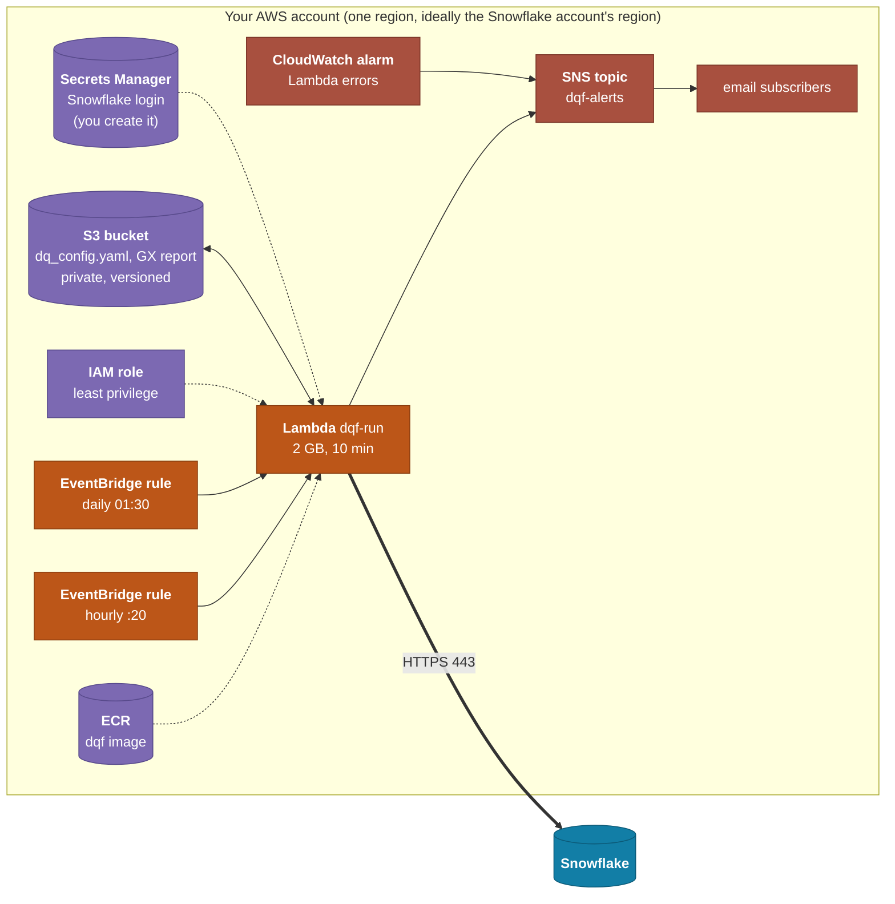

# Lift and shift to AWS

This section is the plan for moving the framework from the laptop and LocalStack into a real AWS
account. Two things keep the move small:

- **There is nothing to rewrite.** The code, the configuration and the CloudFormation template that run in
  LocalStack today are the ones that go to AWS. One template parameter changes:
  `Target=localstack` becomes `Target=aws`.
- **Most of the work is asking for access.** The steps are networking, a Snowflake service user, and
  permission to deploy. Ask for these early, because they take days; the deployment itself takes
  minutes.

| Page | |
| --- | --- |
| This page | What changes, what gets created, and what to ask for |
| [Step by step](deploy.md) | The deployment, in order, with commands and checks |
| [Hosting the report](report.md) | Keeping the Streamlit report running for the team, and linking it from the alerts |
| [After go-live](operate.md) | Changing rules and code, watching it, costs, rollback, troubleshooting |

## What changes between LocalStack and AWS

| | LocalStack (today) | AWS |
| --- | --- | --- |
| Code | `src/dqf/` | **Same** |
| Configuration | `config/dq_config.yaml`, sample table | Same file; its `sources` point at the **real tables** |
| Template | `infra/cloudformation.yaml`, `Target=localstack` | **Same file**, `Target=aws` |
| Lambda package | Mounted folder (LocalStack has no ECR) | **Container image** in ECR, built from the `Dockerfile` (the dependencies are ~490 MB, over the 250 MB zip limit) |
| Snowflake login | Secrets Manager in LocalStack, filled from `.env` | Secrets Manager in AWS, created once by hand |
| Snowflake user | `DQF_SVC` on the sandbox account | A service user on the **production** account |
| Network | Laptop → internet → Snowflake | Lambda → (VPC, NAT or PrivateLink) → Snowflake |
| Alerts | SNS (read from a queue) and SMTP to Gmail | **SNS → email subscribers**. No SMTP password anywhere |
| Schedules | Off; invoked by hand | EventBridge: hourly at :20, daily at 01:30 UTC |
| Error alarm | Not created | CloudWatch alarm on Lambda errors → the same SNS topic |
| GX report | LocalStack S3 | The stack's private S3 bucket, `data_docs/` |
| Streamlit report | `make app` on the laptop | **Streamlit in Snowflake**, not AWS ([Hosting the report](report.md)); the alerts link to it |

## What gets created

`infra/deploy.sh` creates or uses these. If your team uses Terraform or deploys through the console
instead of CloudFormation, this list is what to create; the settings are in the template.

| Resource | Name | Notes |
| --- | --- | --- |
| ECR repository | `dqf` | Created by `deploy.sh` if missing; scan on push |
| Lambda function | `<stack>-run` | Container image, x86_64, 2048 MB, 600 s timeout |
| IAM role | generated | Read the one secret; read the bucket; write only `data_docs/`; publish only to the topic; logs; VPC access if in a VPC. Optional permissions boundary and KMS key |
| S3 bucket | `<stack>-config-<account>-<region>` | The configuration and the GX report. Public access blocked, versioned |
| SNS topic | `<stack>-alerts` | Plus an email subscription if `ALERT_EMAIL` is set |
| EventBridge rules | hourly, daily | Can be deployed off (`SCHEDULES=DISABLED`) |
| CloudWatch alarm | on the Lambda's `Errors` | A run that crashes (not a check that fails) alerts the same topic |
| Secrets Manager secret | `dqf/snowflake` | **Created by you**, once, not by the template |

## What to ask for, and from whom

Send these requests first. Everything else depends on them.

| # | Request | Usually from | Why |
| --- | --- | --- | --- |
| 1 | An AWS account / environment and a **region** (preferably the Snowflake account's region) | Cloud platform team | Where it runs |
| 2 | Permission to deploy CloudFormation with **IAM role creation**, ECR, Lambda, S3, SNS, EventBridge, CloudWatch, and to create one secret. Or: a pipeline that does it | Cloud platform team | `deploy.sh` needs these. Ask whether a **permissions boundary** is required on new roles and whether **tags** are mandatory |
| 3 | **Private subnets** with outbound HTTPS to Snowflake (NAT, a proxy, or Snowflake PrivateLink), plus a security group allowing outbound 443 | Network team | The Lambda must reach Snowflake. Give them the output of `select system$allowlist();` from Snowflake: the exact hosts and ports |
| 4 | Access from those subnets to **Secrets Manager, S3 and SNS** (through the NAT, or VPC endpoints) | Network team | A Lambda in a VPC has no AWS API access by default |
| 5 | A Snowflake **service user** (key pair), a **role** with `SELECT` on the monitored tables, a **warehouse**, and a schema for the **results table** | Snowflake admins | Run `sql/01_setup.sql` with production names. If the account uses network policies, allow the NAT's egress IPs for this user |
| 6 | The **real table names** for the A1 record (and the full response table), and for each feature-store view | Data owners | For the `sources` in `dq_config.yaml` |
| 7 | An **email address** for alerts (a distribution list is better than a person) | Your team | The SNS subscription. Some company mail filters hold AWS confirmation emails: tell IT to expect one |

!!! tip "Ask for the network first"
    Reaching Snowflake from inside a VPC (item 3) is the step most likely to be slow. The AWS2SF Lambda
    already reaches Snowflake from AWS, so ask to reuse its subnets and security group. That is
    usually the fastest route.

## Ready-to-go checklist

Before you run the deployment, you should have:

- [ ] AWS CLI logged in to the target account and region (`aws sts get-caller-identity`)
- [ ] Docker running on the machine that builds the image (or a CI pipeline that builds it)
- [ ] The production Snowflake user, role, warehouse and results schema, and the private key file
- [ ] `SELECT` granted on every table in the configuration
- [ ] Subnet IDs and a security group ID with a route to Snowflake and to Secrets Manager, S3, SNS
- [ ] `dq_config.yaml` updated to the real tables, and `make validate` passing
- [ ] An alert email address
- [ ] If required: the permissions boundary ARN, the KMS key ARN, the mandatory tags

Then follow [Step by step](deploy.md).
