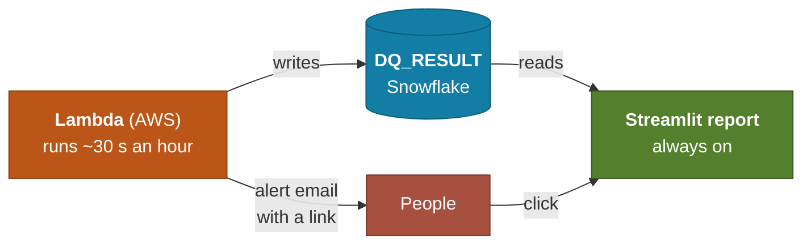

# Hosting the report

The Streamlit report is **not part of the Lambda**. The Lambda runs for about 30 seconds each hour and
stops; a report has to keep running so people can open it at any time. The two share only the results
table in Snowflake:



## What it shows

| Part | What is on it |
| --- | --- |
| Sidebar | The schedule (hourly or daily) and the window, plus filters: result, level, source, check type, field |
| Cards | Checks in the window (record and file level), passed, warnings, failed, could not run, alerts sent |
| **Executive Summary** | Results (donut), record vs file level, fields needing attention; then every window side by side and a field-by-window heatmap of what did not pass |
| **Types of Checks** | Results per check type, with what each type checks |
| **All Check Results** | Every check in the window: result, measured value, limit, bad rows, alert on and sent |
| **Fail Details** | Per check not passing: what is wrong in words, the query to see the rows, the check across windows; then the alerts sent |

**Record level** checks judge every row; the check fails when the share of bad rows is above its limit.
**File level** checks compute one number for the whole window: row count (`VOLUME`), hours since the
newest row (`FRESHNESS`), and drift (`PSI`, `CSI`).

Clicking a slice, bar or heatmap cell filters every tab; clicking a window opens it. Clicks need
Streamlit 1.35+ and Altair 5+, which `make report-publish` pins for Streamlit in Snowflake.

## Where to host it

| Option | Runs on | Login and access | Cost | Verdict |
| --- | --- | --- | --- | --- |
| **Streamlit in Snowflake** | Snowflake | Company Snowflake sign-in; access by Snowflake role. No keys: the app uses its own session | Warehouse time only while someone has it open | **Recommended** |
| ECS Fargate or App Runner | A container in AWS | Needs the key from Secrets Manager and a sign-in in front (ALB + company SSO) | Runs, and costs, all the time | Only if it must be in AWS |
| A laptop (`make app`) | Your machine | Your `.env` | — | Development only |

**Streamlit in Snowflake is the easiest option.** The report reads only Snowflake, so hosting it there
needs no servers, no network work, no secrets and no sign-in setup. Everyone who can open Snowsight
with the right role can open it. The app file already supports it: in Snowflake it uses the app's own
session instead of a key.

## Publishing it to Streamlit in Snowflake

1. **Once, as ACCOUNTADMIN:** run `sql/03_report_app.sql` in Snowsight. It lets `DQF_ROLE` create a stage
   and a Streamlit app in `DQF_DB.DQF`.
2. **From `dq-framework/`:**

    ```bash
    make report-publish
    ```

    This uploads `app/streamlit_app.py` (and an `environment.yml` with its packages) to the stage
    `DQF_DB.DQF.DQF_APP`. It then creates or updates the app `DQF_DB.DQF.DQ_REPORT`, owned by `DQF_ROLE`,
    and prints its address:

    ```text
    https://app.snowflake.com/<org>/<account>/#/streamlit-apps/DQF_DB.DQF.DQ_REPORT
    ```

3. **Let the team open it** (as ACCOUNTADMIN or the schema owner):

    ```sql
    grant usage on database DQF_DB to role <TEAM_ROLE>;
    grant usage on schema DQF_DB.DQF to role <TEAM_ROLE>;
    grant usage on streamlit DQF_DB.DQF.DQ_REPORT to role <TEAM_ROLE>;
    ```

    The app runs with its owner's rights (`DQF_ROLE`), so viewers do not need access to the results
    table itself.

Re-run `make report-publish` after changing the app.

For production, do the same on the production Snowflake account.

## Linking it from every alert

Every alert email has an **Open the data quality report** button when `DQF_REPORT_URL` is set.

| Where | Set |
| --- | --- |
| Laptop runs | `DQF_REPORT_URL=…` in `.env` (default `http://localhost:8501`) |
| LocalStack | The same `.env` value; `make local-deploy` passes it to the Lambda |
| AWS | `REPORT_URL=…` for `infra/deploy.sh` (the template's `ReportUrl` parameter) |

The link opens the report **on the run the email is about**: the email adds
`?schedule=hourly&window=2026-10-17 12:00`, and the report selects that schedule and window. A
Snowsight address keeps its route after `#`, where extra parameters would be lost, so for Streamlit in
Snowflake the link opens the report on the latest run. The email names the window, and the report's
sidebar lists every window.

## If it has to run in AWS

If policy requires the report in AWS rather than Snowflake, run the same file in a container:

- **Image:** `python:3.12-slim` with `streamlit`, `pandas` and `snowflake-connector-python`, plus
  `app/streamlit_app.py`. Run it with `streamlit run streamlit_app.py --server.port 8501 --server.headless true`.
- **Login:** the same `SNOWFLAKE_*` settings, with the private key from Secrets Manager. Write it to a
  file at start-up, or extend the app to read the secret.
- **Hosting:** ECS Fargate (one task) behind an internal Application Load Balancer with company SSO
  (OIDC), or App Runner with private access.
- **Link:** set `REPORT_URL` to the load balancer's address. Deep links then work, because there is
  no `#` route.

This is more to build and run than Streamlit in Snowflake, and nothing in it is automated yet.
