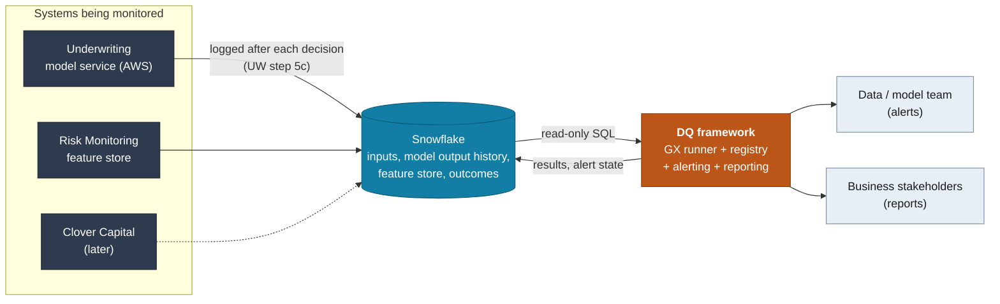
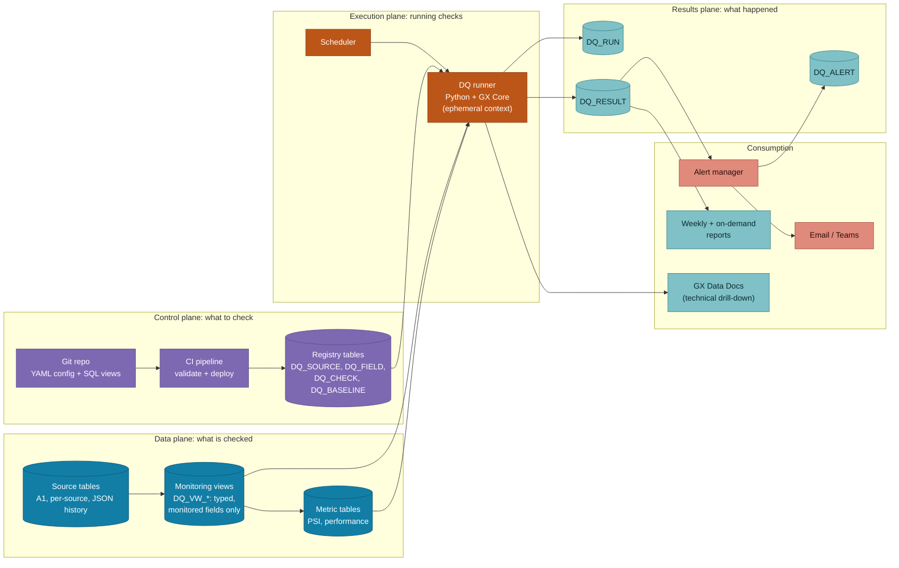
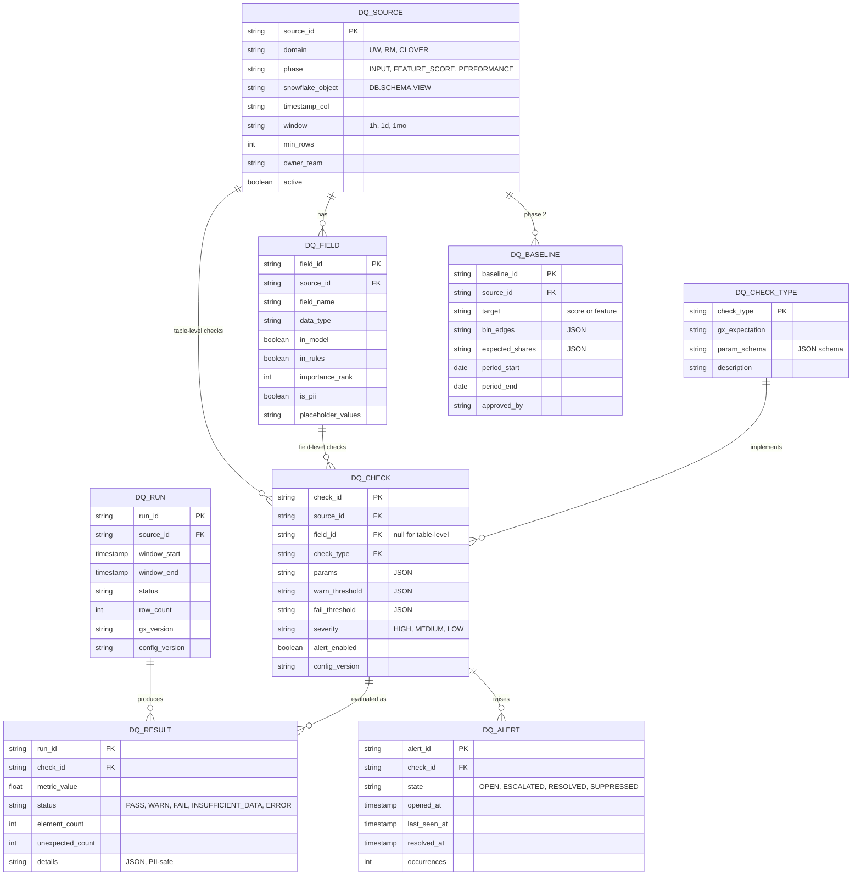
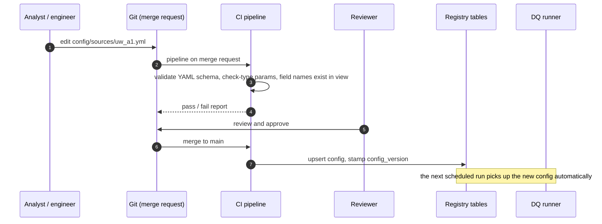

# Architecture

This page describes the target architecture shared by all three phases: the components, the data model,
how configuration is managed, where the framework runs, and the architecture decisions behind it.

## System context

The framework sits **beside** the systems it monitors and never inside them. It reads from Snowflake
and writes its own results back to Snowflake.

**Recommendation:** monitoring stays **after the fact**. The kickoff pointed at the model service's JSON
output as the data to monitor, and that output only exists once a decision has been made. Keeping
monitoring outside the decision path also means it can never add latency to, or break, a live decision.
This resolves [BRD review note #1](../data-quality/review-notes.md#1-blocking-check-or-after-the-fact-monitoring).

## Logical architecture

The framework is split into five groups of components, each with one job:

| Component | Responsibility | Built in |
| --- | --- | --- |
| **Git repo** | Source of truth for check config (YAML), monitoring views (SQL), and framework code. | Phase 1 |
| **CI pipeline** | Lint and test code; validate config against the schema; apply database migrations; load config into the registry. | Phase 1 |
| **Registry tables** | The deployed config: what to check, where, how, and who owns it. The runner reads these tables, never the YAML. | Phase 1 |
| **Monitoring views** (`DQ_VW_*`) | A stable data contract per source: typed columns, an event timestamp, keys, and monitored fields only. This is what a BRD "Snowflake Path" should point to. | Phase 1, more each phase |
| **Metric tables** | Pre-computed metrics GX checks cannot calculate itself: PSI/CSI (Phase 2), AUC/KS/bad rates (Phase 3). | Phases 2–3 |
| **Scheduler** | Triggers runs: hourly (P1), daily (P2), monthly (P3). | Phase 1 |
| **DQ runner** | Reads the registry, builds GX expectation suites, runs them against Snowflake, classifies the results, writes them. | Phase 1 |
| **Results tables** | An append-only history of every run and every check result. Everything downstream reads from here. | Phase 1 |
| **Alert manager** | Opens, de-duplicates, escalates and resolves alerts, and routes notifications by severity. | Phase 1 |
| **Reports** | The weekly scheduled report and an on-demand "generate report". | Phase 1 (basic), extended later |

## Data model

All framework tables live in one schema, called `DQ_FRAMEWORK` here. The database name is a **Decision
needed**: the team's sandbox for development, and a production database for go-live.

Key design points:

- **`DQ_FIELD` is the reference table the kickoff asked for.** It lists each source's fields, whether
  each is used in the model or rules, and its importance rank. "Top 5 fields per source" is then just a
  filter on `importance_rank`.
- **Separate WARN and FAIL thresholds** let a check warn early and only alert when it truly fails.
- **`INSUFFICIENT_DATA` is its own status.** When a quiet hour has too few rows, the check says so
  instead of reporting a misleading PASS or FAIL. This addresses
  [review note #6](../data-quality/review-notes.md#6-small-windows-make-noisy-percentages).
- **Results are append-only and versioned.** Every result can be traced to the exact config and GX
  version that produced it.
- **`details` never stores personal data.** For fields flagged `is_pii`, only counts are kept, never
  sample values.

## Configuration management

!!! note "Updated after the 1:1"
    The manager asked for the **Excel template** to be the input, read by the code as a data frame. For
    the MVP, read the Excel directly. For production, keep Excel as the intake form and convert it into
    the YAML below. See [Excel template vs YAML config](../next-steps/mvp-build.md#excel-template-vs-yaml-config).

**Recommendation:** check configuration is written as **YAML in Git**, reviewed through merge requests,
validated in CI, and only then loaded into the registry tables. The BRD spreadsheet stays as the
business-friendly way to *propose* checks. A YAML change in Git is what makes them live.

Why not let people edit the tables directly? Because a reviewed merge request gives an audit trail, a
safe way to roll back, and automatic validation for free. Those are the governance properties a monitoring
system needs. It also keeps threshold changes visible: no one can quietly raise a threshold to silence
an alert.

## Runtime and deployment

**Decision needed:** where the runner runs. The runner is a small Python container that sends SQL to
Snowflake, so it needs little compute.

| Option | Pros | Cons | Fit |
| --- | --- | --- | --- |
| **GitLab scheduled pipeline** | Already used by the team (feature store, UW models); fastest to start | Not built for hourly production schedules; weak alerting if a run fails | **MVP / shadow mode** |
| **AWS Lambda + EventBridge Scheduler + SNS** | **The manager's direction (1:1).** Serverless; hourly schedule; SNS email; the team already has an email Lambda and an AWS → Snowflake Lambda (AWS2SF) to copy | 15-minute limit; GX + connector need a **container image**; needs a service account and a network path to Snowflake | **Chosen for the MVP and production** |
| **AWS ECS Fargate + EventBridge Scheduler** | Production-grade scheduling, retries, CloudWatch logs; UW already runs on AWS; Secrets Manager for keys | Needs infrastructure-as-code and an AWS account path | **Recommended for production** |
| **Airflow / MWAA** | Rich scheduling and dependency management | Heavy to stand up just for this | Only if the team already has Airflow |
| **Inside Snowflake (Snowpark)** | No external runtime | GX is not designed to run inside a Snowflake procedure; package support is uncertain | Not recommended |

**Decision (after the 1:1):** run the hourly checks in **AWS Lambda**, scheduled by **EventBridge**, and
send alerts through **SNS**, as the manager directed ([details](../next-steps/mvp-build.md#hourly-alerting-on-aws)).
Package the runner as a **container image** so that the same code can move to **ECS Fargate** if a run
ever needs more than Lambda's 15 minutes. Running from a laptop or a GitLab schedule is still fine while
you wait for approvals.

**Environments:** `sandbox` (development and shadow mode against sandbox copies) → `prod`. Config files
carry an environment overlay, so the same check definitions point at different databases.

!!! danger "Use versioned migrations, not drop-and-recreate"
The feature store's DDL deploy **drops and recreates** its schema, which has wiped in-flight progress
before (see the [backfill runbook](../feature-store/backfill-runbook.md)). The DQ framework holds
**history** (results and alert state) that must never be lost. Use versioned, forward-only migrations
(for example with a tool such as `schemachange`). Never drop results tables in a deploy.

## Security and access

| Concern | Approach |
| --- | --- |
| **Authentication** | A Snowflake **service user with key-pair authentication**, the same pattern the feature store uses. The private key is kept in AWS Secrets Manager (production) or masked GitLab CI variables (MVP), and never in the repo. |
| **Least privilege** | Role `DQ_RUNNER_ROLE`: `SELECT` on the monitoring views only, read/write on `DQ_FRAMEWORK`. No access to raw source tables beyond what the views expose. |
| **Personal data** | Monitoring views expose only monitored fields. `is_pii` fields keep **counts only**, never sample values, in results, alerts or Data Docs. |
| **Separation of duties** | Config changes need an approved merge request. The runner role cannot change config tables, only CI's deploy role can. |

## Cost and performance

- **Push the work down to Snowflake.** GX's Snowflake datasource runs metrics as SQL inside Snowflake.
  Only aggregates come back to the runner.
- **Read only one window of data per run.** Each run reads one hour (Phase 1), never the whole table.
  The monitoring views should be **clustered or filtered by the event timestamp**, so Snowflake skips
  the data outside the window.
- **Read only the needed columns.** Views expose monitored fields only, which keeps each query small.
- **Use a small warehouse.** Start on an X-Small warehouse with a short auto-suspend. Keep it separate
  from heavy warehouses such as `MSDESCI_EXT_HEAVY`, so other teams' jobs never starve monitoring, and
  vice versa.
- **Watch the cost of the checks themselves.** Track run duration and credits per run in `DQ_RUN`.

## Monitoring the monitor

A monitoring system that fails silently is worse than none, because the team believes it is protected.

- **Heartbeat:** a separate check (a Snowflake alert) fires if no `DQ_RUN` has completed for a source
  in the last two expected intervals.
- **Run health:** an `ERROR` result (a check that could not execute) is itself an alert. It is never
  treated as a pass.
- **Reported metrics:** run duration, checks executed, errors, and alert counts per week. See
  [Operations](operations.md#service-levels-and-kpis).

## Architecture decisions

| # | Decision | Status | Rationale |
| - | --- | --- | --- |
| ADR-01 | **GX Core** is the validation engine | Agreed (kickoff) | Named by the manager; a mature expectation library; Data Docs included. |
| ADR-02 | Config and results live in **Snowflake tables**; GX runs in an **ephemeral context** | Recommendation | One system of record; GX's own file-based stores would drift from it; results can be queried with SQL. |
| ADR-03 | **Git YAML** is the config source of truth, deployed by CI | Recommendation | Audit trail, review, validation, rollback. |
| ADR-04 | Runtime: **AWS Lambda (container image) + EventBridge**, alerts via **SNS** | Decided (manager, 1:1) | See the options table above; ECS Fargate is the fallback if runs outgrow 15 minutes. |
| ADR-05 | A **custom stateful alert manager**, not GX's built-in notification actions | Recommendation | GX actions fire on every failing run, which causes alert storms. Alerts need memory of what is already open. |
| ADR-06 | **Metrics, then expectations** for PSI and performance metrics | Recommendation | GX has no PSI/AUC/KS expectations. Compute metrics in SQL or Python, then let GX judge them. |
| ADR-07 | Monitoring is **after the fact** and non-blocking | Recommendation | Matches the JSON-output source; no risk to live decisions. |
| ADR-08 | GX validates **curated monitoring views**, not raw payloads | Recommendation | A stable data contract, typed columns, PII control, and cheap queries. |
| ADR-09 | **Versioned migrations**, never drop-and-recreate | Recommendation | Results and alert history are permanent records. |
