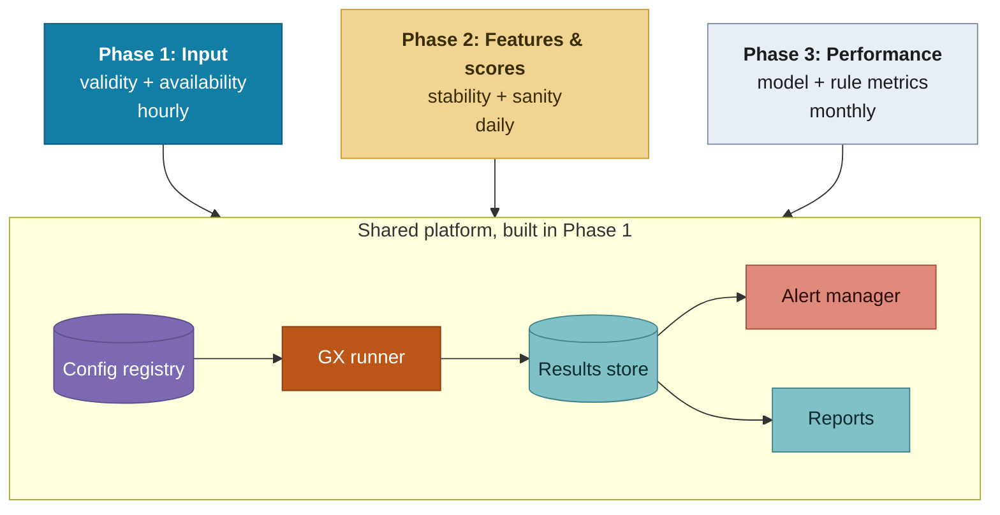

# Data Quality Framework blueprint

This section is the **architecture and delivery plan** for a modular data quality framework built on
**Great Expectations (GX Core)**. It covers the three monitoring phases agreed in the
[kickoff](../kickoff/index.md) and drafted in the [BRD](../data-quality/index.md):

1. **Input Monitoring:** is the raw data present and valid? **This is the current priority.**
2. **Features & Scores Monitoring:** has what the models see and produce shifted?
3. **Model & Rule Performance Monitoring:** are our decisions still separating good from bad?

!!! warning "Status: proposed design"
Nothing on these pages has been approved yet. It is a blueprint for the team and reviewers to react
to. Three labels are used throughout:

    - **Recommendation**: the proposed approach, with the reasoning.
    - **Decision needed**: a choice the team or a stakeholder must make before or during the build.
    - **(inferred)**: something not confirmed by the sources (BRD, kickoff, system docs).

## What the framework must achieve

These goals come from the kickoff meeting and the BRD:

| Goal                                   | What it means in practice                                                                 |
| -------------------------------------- | ----------------------------------------------------------------------------------------- |
| **Proactive detection**                | We find data and model problems before the business reports an "uptick in a rule".        |
| **Build once, reuse everywhere**       | The same platform serves Underwriting, Risk Monitoring and Clover Capital.                |
| **Configuration, not code**            | A new data source, field or check is a **config change**, never a code change.            |
| **Alerts people trust**                | The right person gets an alert, at the right time, and not too many of them.              |
| **Stakeholder reporting**              | A scheduled weekly report, plus a report anyone can generate on demand.                   |

## Design principles

These eight principles drive every decision in the blueprint:

1. **Configuration over code.** A reference registry (source → fields → checks) drives everything. The
   [feature store](../feature-store/index.md) already works this way, which the kickoff called out as the
   model to follow.
2. **Monitor what matters.** Only fields **used in a model or a rule**. Start with the **top 5 per
   source**, then widen. TMX alone sends ~2,000 fields, of which ~50 are used.
3. **Validate contracts, not raw payloads.** GX reads curated, typed **monitoring views** that expose
   just the monitored fields, never raw JSON or vendor dumps.
4. **GX is the engine; Snowflake is the system of record.** Configuration, results and alert state
   live in Snowflake tables. GX runs in an ephemeral context built fresh from that config on every run.
5. **Push the work down to Snowflake.** GX turns checks into SQL that Snowflake executes. Only
   aggregates come back, so no bulk or personal data leaves Snowflake.
6. **Never in the decision path.** Monitoring runs on data **after** it is logged. A monitoring outage
   can never slow or block an underwriting decision.
7. **Alerts are a product.** Alerts carry state: one notification when a problem starts, one when it
   ends, and nothing in between. They are routed by severity and kept within a volume budget.
8. **Everything versioned and auditable.** Config lives in Git and is reviewed before release. Each
   result records the config version and GX version it ran with.

## One platform, three phases

Each phase adds new **metric producers** on top of the same platform. The runner, results store, alerting
and reporting are built once, in Phase 1.

| | Phase 1: Input | Phase 2: Features & scores | Phase 3: Performance |
| --- | --- | --- | --- |
| **Question** | Did a data source break or change? | Is the model seeing or producing something unusual? | Are decisions still good? |
| **Data** | A1 dataset (Day 1), then one table per source (Day 2) | Model service JSON output in the Snowflake history table | Decisions joined to account outcomes (closed / terminated) |
| **Cadence** | Hourly | Daily | Monthly |
| **Typical checks** | Missing values, ranges, new categories, no-hit rate, volume, freshness | PSI / CSI, score sanity, final-score reconciliation, rule hit-rate drift | AUC, Gini, KS, % bads captured, rule bad rates |
| **GX pattern** | Expectations run directly on each hour's data | Metrics computed first, then checked by expectations | Metrics computed first, then checked by expectations |
| **First value** | Week 6 (shadow mode) | Week ~14 | First mature outcome cohort |

## Timeline at a glance

Roughly **six months** end to end, consistent with the kickoff's "four to six months". Phase 3 data
preparation starts early because outcomes take months to mature. See the [roadmap](roadmap.md).

| Weeks   | Work                                                                                   |
| ------- | -------------------------------------------------------------------------------------- |
| 1–10    | **Phase 1: Input monitoring.** Shadow mode by week 6, alerts live by week 10.          |
| 5–24    | Phase 3 groundwork: find outcome data, define "bad", build the outcome-labelling job.   |
| 9–16    | **Phase 2: Features & scores.** Can start once the new model's JSON output is in Snowflake. |
| 15–24   | **Phase 3: Performance metrics**, as soon as mature outcome cohorts exist.             |

## Reading order

| Page                                                  | Read it for                                                              |
| ----------------------------------------------------- | ------------------------------------------------------------------------ |
| [Architecture](architecture.md)                       | Components, data model, runtime, security, and the key decisions.       |
| [Phase 1: Input monitoring](phase-1-input.md)         | **The detailed design and sprint plan to start with.**                   |
| [Reference implementation](reference-implementation.md) | Repository layout and code sketches for the runner, checks and alerts. |
| [Phase 2: Features & scores](phase-2-features-scores.md) | Baselines, PSI/CSI, score sanity, rule activity.                      |
| [Phase 3: Model & rule performance](phase-3-performance.md) | Outcome labelling, performance metrics, rule performance.           |
| [Operations & alerting](operations.md)                | Alert lifecycle, routing, runbooks, service levels.                      |
| [Roadmap & governance](roadmap.md)                    | Timeline, responsibilities, risks, open decisions, first two weeks.      |
