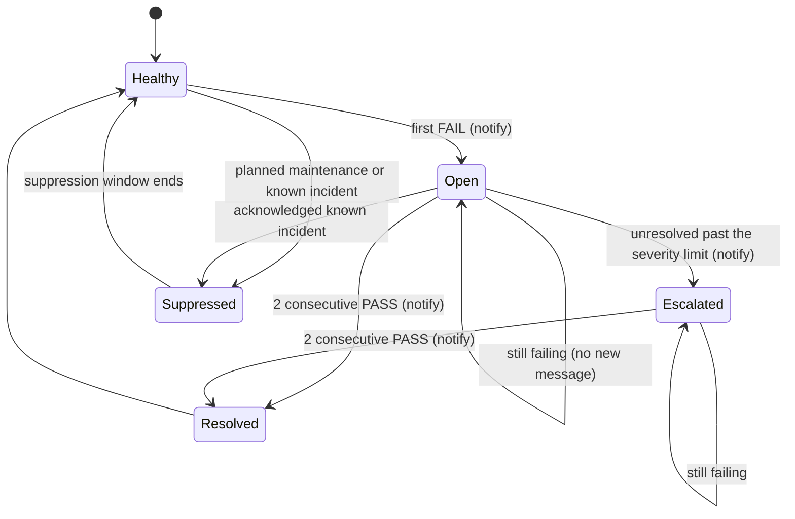

# Operations & alerting

A monitoring platform succeeds or fails on its alerts. Too many, and people stop reading them. Too vague,
and nobody knows what to do. This page answers the kickoff's three open questions, **when to alert, who
to alert, and how many alerts**, and describes how the platform is run day to day.

## Severity and routing

Every check has a severity in its config. Severity decides **how** and **how fast** people hear about a
failure.

| Severity | Use for | On FAIL | Escalates after | Example |
| --- | --- | --- | --- | --- |
| **HIGH** | Failures that will change decisions now | **Immediate** notification to the source owner | 4 hours unresolved | A source stops arriving (FRESHNESS); no-hit rate spikes; final-score PSI ≥ 0.25 |
| **MEDIUM** | Real problems that can wait for working hours | Included in an **hourly digest** to the team channel | 24 hours unresolved | New enumeration in a key field; duplicate applications; rule hit rate ×2 |
| **LOW** | Quality debt | **Weekly report only** | Not escalated | A few out-of-range values in a minor field |
| *(WARN, any severity)* | Early warning | Weekly report and dashboards; **never** notifies | (none) | Missing values at 15% against a 30% FAIL threshold |
| *(ERROR)* | The check itself couldn't run | Platform channel (framework owners) | 2 hours | A SQL error after an upstream schema change |

**Who:** every source has an `owner_team` and an `alert_route` in its config. Routing goes to a **team**,
never to one named person, so alerts still reach someone during holidays. **Recommendation:** start
with **email to a team distribution list**, as the BRD proposes, delivered through an **SNS topic** from
the hourly Lambda ([design](../next-steps/mvp-build.md#hourly-alerting-on-aws)). Add a Teams channel once
alert volume is stable.

## Alert lifecycle { #alert-lifecycle }

Alerts are **stateful**. A check that keeps failing produces **one** alert, not one per hour.



| Rule | Why |
| --- | --- |
| Notify on **state changes** only (opened, escalated, resolved) | One problem means one thread of messages, not 24 a day |
| Resolve after **2 consecutive passes** | Stops a check that flips between PASS and FAIL from spamming |
| **Suppression windows** (`DQ_SUPPRESSION`: source, check, start, end, reason, who) | Planned vendor maintenance or a known incident doesn't page anyone, and the record of it is kept |
| Every alert is recorded in `DQ_ALERT` with timestamps | This is how detection time and time-to-resolve are measured (KPIs below) |

## What an alert says

Every notification should let the reader act **without opening another tool first**:

```text
[DQ][HIGH][OPENED] uw_a1_input · EXPERIAN_HIT_STATUS · NO_HIT_RATE

What:      No-hit rate 14.2% in window 09:00–10:00 (FAIL threshold 11.0%;
           trailing same-hour median 6.0%)
Since:     09:00 (first failing window)  ·  occurrences: 1
Impact:    Bureau component score missing for more applications → IDT/MF/Credit
           lanes fall back to their "no bureau" scenario models
Check:     check_id uw_a1_input.EXPERIAN_HIT_STATUS.NO_HIT_RATE · config v3f9a2c
First steps: runbook https://<docs>/dq-framework/operations/#runbooks (NO_HIT_RATE)
Owner:     uw-data-eng   ·   Escalates at 13:00 if unresolved
```

## Alert budget

**Recommendation:** treat alert volume as a **budget**: at most about **5 HIGH alerts per week** across
all sources to begin with. If shadow mode shows the budget would be exceeded, **tune the thresholds or
lower the severity before go-live**, not after. Track the budget weekly. If it is persistently
exceeded, review the checks rather than accepting the noise.

## Runbooks

One entry per check type: what the failure usually means, and what to look at first.

| Check type | Usually means | First steps |
| --- | --- | --- |
| **FRESHNESS / VOLUME** | Pipeline or vendor outage; a load job failed; a schedule changed | Check the loader (for UW: the AWS2SF Lambda logs); check the vendor status; compare with the same hour last week |
| **SCHEMA / VALUE_TYPE** | An upstream column was renamed, dropped or retyped | Compare the view with the source table definition; find the upstream release; update the view (a migration), not the checks |
| **MISSING_VALUES / FIELD_POPULATION / PLACEHOLDER** | Mapping broke, a vendor stopped sending a field, or defaults are being written | Find when it started (`DQ_RESULT` history); check whether it hits all records or one channel; contact the source owner |
| **NO_HIT_RATE** | Bad request data sent to the vendor (formatting, IDs), a vendor issue, or a population shift | Sample no-hit requests for formatting problems; check the vendor status; compare by channel or region |
| **NEW_ENUMERATION / ACCEPTED_VALUES** | A new code introduced upstream | Confirm with the data owner. If legitimate, add it to the allowed values (a merge request) **and** tell the modelling team how the model handles unseen categories |
| **ACCEPTABLE_RANGE / TREND** | A unit change (cents vs dollars), a test data leak, or a real population shift | Look at the extreme values; check recent upstream changes; if it is a real shift, hand over to Phase 2 analysis |
| **PSI / CSI** (Phase 2) | The population or a feature has shifted against the baseline | Find which bands moved; check related input checks for the root cause; tell the model owner |
| **Rule hit rate** (Phase 2) | A rule input changed, or the population did | Trace the rule's inputs through Phase 1 checks; confirm with the rule owner before the business notices |
| **Performance** (Phase 3) | The model or a rule is losing ranking power | Confirm with confidence intervals; hand over to the model review process |
| **ERROR / heartbeat** | The framework itself is broken | Runner logs; Snowflake query history; credentials; recent config deploys |

## Change management

| Change | How |
| --- | --- |
| New source, field or check | Merge request to `config/`; starts in **shadow mode** (`alert_enabled: false`) for 2 weeks |
| Threshold change | Merge request **with justification** (the evidence from `DQ_RESULT`); reviewed by the check owner |
| Turning alerts on | Merge request after the shadow period shows the check stays within the alert budget |
| New baseline (Phase 2) | Modelling team approves; new `baseline_id`; the old one is kept |
| Performance definition (Phase 3) | Reviewers approve; new `label_version`; old labels are kept |

## Service levels and KPIs { #service-levels-and-kpis }

These numbers show whether the framework is doing its job. They are reported in the weekly report.

| KPI | Definition | Target (proposed) |
| --- | --- | --- |
| **Run completeness** | Scheduled runs completed ÷ scheduled runs | ≥ 99% |
| **Run timeliness** | Hourly runs finished by :30 past the hour | ≥ 95% |
| **Coverage** | Fields used in a model or rule that have at least one active check ÷ all such fields | Top 5 = 100% at go-live; all fields by the end of Phase 1 |
| **Detection lead time** | Alert time − incident start time | ≤ 2 hours (inputs); **before** the business reports it |
| **Alert precision** | Alerts the owner marks actionable ÷ all alerts | ≥ 80% |
| **Alert volume** | HIGH alerts per week | ≤ ~5 (the budget) |
| **MTTA / MTTR** | Mean time to acknowledge / to resolve, from `DQ_ALERT` | Tracked from go-live; targets set after 1 month |
| **Business-first incidents** | Data incidents the business noticed before an alert | Trending to **zero**, the headline goal from the kickoff |
