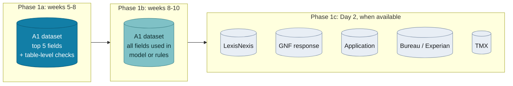
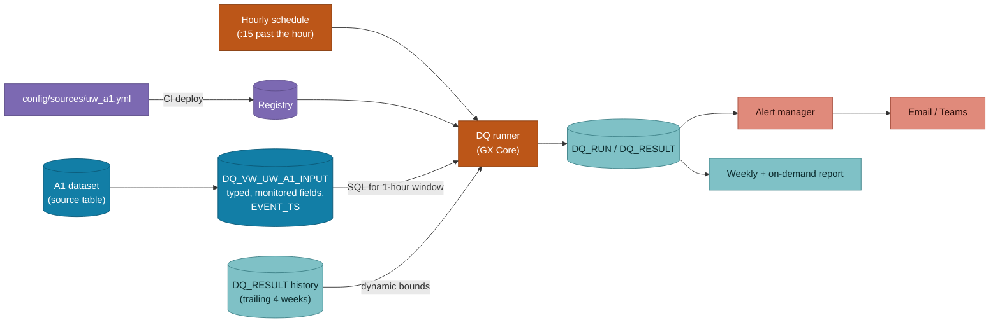
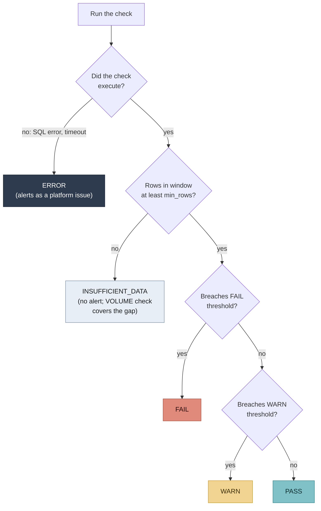
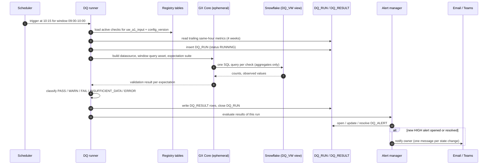
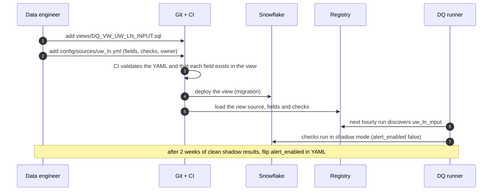

# Phase 1: Input monitoring

**Priority: start here.** Phase 1 builds the shared platform (registry, runner, results, alerts,
reports) and uses it to monitor **raw input data**: the fastest early-warning signal the team has.

## Objective and success criteria

> Detect a broken or changed input data source **within two hours**, before the business notices it
> through a rule.

| Success criterion | Target (proposed) |
| --- | --- |
| Coverage | 100% of the **top 5 fields per source** by go-live; all fields used in the model or rules by end of phase |
| Detection time | Injected faults are detected in the **first run** after they appear (at most ~2 hours) |
| Alert precision | At least **80%** of HIGH alerts are actionable (measured during and after shadow mode) |
| Alert volume | At most ~**5 HIGH alerts per week** across all sources (alert budget, tuned in shadow mode) |
| Modularity | Onboarding a new Day 2 source takes **config changes only**, with no code changes |
| Reliability | At least **99%** of scheduled runs complete; a missed run raises a heartbeat alert |

## Scope



!!! note "Added after the blueprint"
    A stakeholder email adds **reconciliation** (compare MRD's raw data with the input payload) and
    stresses **no-activity alerts** after A1 received no applications from 10 October. It also says
    A1 is today's API structure and **A2** follows in the January timeframe. See
    [Requirements update](../next-steps/requirements-update.md).

**In scope:** the **A1** dataset on Day 1, then per-source tables on Day 2. Only fields **used in a
model or a rule**, starting with the **top 5 per source by importance**. Both validity checks (is each
value OK?) and **availability** checks (did the data arrive?). Lightweight **trend** checks on a few key
fields. Hourly alerting, a weekly report, and an on-demand report.

**Out of scope for Phase 1:** formal distribution drift (PSI/CSI) and score monitoring (Phase 2), and
performance metrics (Phase 3).

!!! tip "How this settles the input-drift question"
The kickoff asked for drift analysis on inputs such as average ticket and annual sales. The BRD moved
benchmark comparisons out of Part 1 ([the conflict](../kickoff/brd-mapping.md#the-one-real-conflict-drift-on-input-data)).
**Recommendation:** Phase 1 includes **simple trend checks**: compare this window's median and
no-hit rate with the same hour over the last four weeks. Formal PSI/CSI on a frozen baseline stays in
Phase 2. Inputs get an early drift signal, and formal drift is not built twice.

## Before the build: what we need (week 1–2)

| # | Input needed | From | Why |
| - | --- | --- | --- |
| 1 | The **Snowflake path** of the A1 dataset, per environment | Data engineering | The source of every Phase 1 check ([what a path is](../data-quality/input-monitoring.md#what-snowflake-path-means)) |
| 2 | A1's **timestamp column** and **load cadence** (streaming, hourly batch, or daily batch?) | Data engineering | Sets the run window. If A1 loads daily, hourly checks are pointless. **Decision needed** |
| 3 | **Field inventory:** fields used in the model / rules, with an **importance rank** | Modelling team | Scopes the work to the "top 5 per source" |
| 4 | **Vendor response-status fields** (e.g. the Experian hit / no-hit flag) and their values | Data engineering / vendors | Needed for the no-hit-rate check |
| 5 | **Allowed values** for each categorical field | Modelling team / data owners | Needed for new-enumeration checks |
| 6 | **Placeholder conventions** per field (e.g. `-999`, `N/A`, `1900-01-01`) | Data owners | Separates "populated" from "missing" |
| 7 | **Alert recipients and severity** for each source | Manager | Answers "who to alert" |
| 8 | A **service user and role** with read access to the views | Snowflake admins | Lets the runner connect |

## Phase 1 architecture



### The monitoring view: the data contract

Every source gets a view that is the **only** thing GX reads. It renames, types and trims the source
table into a stable contract. If the upstream table changes, only the view changes and the checks don't.
The column names below are **illustrative**: the real ones come from the A1 field inventory.

```sql
create or replace view DQ_FRAMEWORK.DQ_VW_UW_A1_INPUT as
select
    application_id                         as APPLICATION_ID,    -- key
    load_ts::timestamp_ntz                 as EVENT_TS,          -- window column
    merch_id::varchar                      as MERCH_ID,
    client_id::varchar                     as CLIENT_ID,
    try_to_date(enquiry_date)              as ENQUIRY_DATE,
    try_to_number(avg_ticket, 18, 2)       as AVG_TICKET,
    try_to_number(annual_sales, 18, 2)     as ANNUAL_SALES,
    mcc::varchar                           as MCC,
    upper(experian_hit_status)             as EXPERIAN_HIT_STATUS -- e.g. HIT / NO_HIT
from <A1_DATABASE>.<A1_SCHEMA>.<A1_TABLE>;
```

!!! note "Why `try_to_*` and not plain casts"
A hard cast fails the whole query on one bad value. `try_to_number` turns a bad value into `NULL`, so
the **Value Type** and **Missing Values** checks catch it and report it, rather than the run crashing.

## Check catalog

Each BRD check type maps onto a GX expectation. Where GX has no built-in expectation, the framework
adds a **derived 0/1 indicator column** to the window query and checks its mean with a built-in GX
expectation. That way every check reports a measured value (see
[the derived-column pattern](reference-implementation.md#2-check-builders)). The thresholds below are **suggested
starting points**, to be tuned during shadow mode.

### Table-level checks (availability)

| Check type | What it catches | GX implementation | Suggested thresholds |
| --- | --- | --- | --- |
| **VOLUME** | A source silently stops sending, or suddenly sends far too much | `ExpectTableRowCountToBeBetween`; the runner computes the bounds from the trailing median for the same hour of the week | WARN below 70%, FAIL below 50% or above 200% of the trailing median |
| **FRESHNESS** | Data stopped arriving: a pipeline or vendor outage | `ExpectColumnMaxToBeBetween` on a probe query returning minutes since the newest `EVENT_TS` | FAIL if no new data for 2× the load interval |
| **SCHEMA** | An upstream column was dropped, renamed or retyped | `ExpectTableColumnsToMatchSet` + `ExpectColumnValuesToBeOfType` | FAIL on any mismatch |
| **DUPLICATES** | The same application loaded twice | `ExpectCompoundColumnsToBeUnique` (keys) | FAIL if more than 0.1% duplicates |

### Field-level checks (validity)

| Check type (BRD name) | What it catches | GX implementation | Suggested thresholds |
| --- | --- | --- | --- |
| **MISSING_VALUES** | Nulls rising | `ExpectColumnValuesToNotBeNull(mostly=1 - fail_pct)` | WARN above 10%, **FAIL above 30%** (BRD) |
| **FIELD_POPULATION** | Values that are present but useless (null, blank or placeholder) | `ExpectColumnMeanToBeBetween(min_value=…)` on a derived 0/1 "is populated" column (not null, not blank, not a placeholder) | **FAIL below 70% populated** (BRD) |
| **PLACEHOLDER_VALUE** | Defaults like `-999` creeping in | `ExpectColumnValuesToNotBeInSet(placeholders, mostly=…)` | FAIL above 5% |
| **ACCEPTABLE_RANGE** | Out-of-range numbers or dates | `ExpectColumnValuesToBeBetween(min, max, strict_min, strict_max, mostly=…)` | FAIL if more than 1% out of range |
| **ACCEPTED_VALUES** / **NEW_ENUMERATION** | A category value never seen before | `ExpectColumnValuesToBeInSet(allowed_values)`; the details record the new values | WARN on any new value; FAIL if new values exceed 1% of rows |
| **EXPECTED_FORMAT** | IDs or dates in the wrong pattern | `ExpectColumnValuesToMatchRegex(regex, mostly=…)` | FAIL if more than 1% don't match |
| **VALUE_LENGTH** | A code changes length (e.g. "≠ 8 characters") | `ExpectColumnValueLengthsToEqual` / `…ToBeBetween` | FAIL if more than 1% |
| **VALUE_TYPE** | A numeric field arriving as text | `ExpectColumnValuesToBeOfType` + `try_to_*` nulls in the view | FAIL on a type mismatch |
| **NO_HIT_RATE** | The vendor returns "no record" more often (the kickoff's Experian example) | `ExpectColumnMeanToBeBetween(max_value=…)` on a derived 0/1 "is no-hit" column; the limit is the trailing same-hour median + the allowed increase | WARN at +3 percentage points, **FAIL at +5 points** above trailing |
| **TREND** (lightweight) | The median of a key field drifts (avg ticket, annual sales) | `ExpectColumnMedianToBeBetween`, with bounds from the trailing 4-week median | WARN at ±20%, FAIL at ±35% |

!!! info "Why some checks compare against the past"
A fixed threshold such as "no-hit rate above 12%" either fires constantly or never, because normal
rates vary by hour and by day of the week. **Relative** checks (volume, no-hit rate, trend) compare each
window with the **same hour of the week over the last four weeks**. Those trailing values come from
`DQ_RESULT` history, which the framework already stores. Until four weeks of history exist (a cold
start), these checks only produce **WARN**, never FAIL.

## How a result becomes a status

GX gives a single pass or fail per expectation. The framework turns that into five statuses:



GX evaluates the **FAIL** threshold (through `mostly` or the bounds). The framework reads the observed
metric GX returns (for example `unexpected_percent`) and compares it with the **WARN** threshold itself.
GX doesn't need to know about two thresholds.

## Configuration example

The YAML for the A1 source. Field names and the top-5 list are **illustrative** until the modelling team
provides the real inventory.

```yaml
source_id: uw_a1_input
domain: UW
phase: INPUT
snowflake_object: DQ_FRAMEWORK.DQ_VW_UW_A1_INPUT
timestamp_col: EVENT_TS
window: 1h
arrival_lag: 15m          # wait for late rows before checking a window
min_rows: 30
owner_team: uw-data-eng
alert_route: uw-dq-alerts

table_checks:
  - type: VOLUME
    severity: HIGH
    params: {baseline: trailing_same_hour, weeks: 4}
    warn: {min_ratio: 0.70}
    fail: {min_ratio: 0.50, max_ratio: 2.00}
  - type: FRESHNESS
    severity: HIGH
    fail: {max_lag: 2h}
  - type: DUPLICATES
    severity: MEDIUM
    params: {keys: [APPLICATION_ID]}
    fail: {max_pct: 0.001}

fields:
  - name: AVG_TICKET
    in_model: true
    importance_rank: 1
    placeholders: [-999]
    checks:
      - {type: MISSING_VALUES,   severity: HIGH,   warn: {max_pct: 0.10}, fail: {max_pct: 0.30}}
      - {type: FIELD_POPULATION, severity: MEDIUM, fail: {min_pct: 0.70}}
      - {type: ACCEPTABLE_RANGE, severity: LOW,    params: {min: 0, max: 10000, strict: true}, fail: {max_pct: 0.01}}
      - {type: TREND,            severity: MEDIUM, params: {stat: median, weeks: 4}, warn: {max_change: 0.20}, fail: {max_change: 0.35}}

  - name: EXPERIAN_HIT_STATUS
    in_model: true
    importance_rank: 2
    checks:
      - {type: NO_HIT_RATE,     severity: HIGH, params: {no_hit_values: [NO_HIT], weeks: 4}, warn: {max_increase_pp: 3}, fail: {max_increase_pp: 5}}
      - {type: ACCEPTED_VALUES, severity: MEDIUM, params: {allowed: [HIT, NO_HIT, ERROR]}, fail: {max_pct: 0.01}}

  - name: MCC
    in_rules: true
    importance_rank: 3
    checks:
      - {type: NEW_ENUMERATION, severity: MEDIUM, params: {allowed_from: reference_table}, warn: {max_new: 0}, fail: {max_pct: 0.01}}
      - {type: VALUE_LENGTH,    severity: LOW,    params: {length: 4}, fail: {max_pct: 0.01}}
```

## The hourly run, end to end



**Windowing rules:**

- **Closed windows only.** At 10:15 the run checks 09:00–10:00, never the hour still in progress. The
  `arrival_lag` (15 minutes) gives late rows time to land.
- **Idempotent.** A run is identified by source + window + config version. Re-running a window replaces
  that window's results rather than duplicating them, so backfills and retries are safe.
- **Backfill.** The runner accepts `--from` / `--to` to replay past windows. This is used to build the
  initial four weeks of trailing history quickly, instead of waiting for it.

## Onboarding a Day 2 source: config only

This is the modularity test from the kickoff: "if we bring in a new data source, all you should have to
do is update that reference table".



**Acceptance test:** onboarding LexisNexis (or any Day 2 source) involves **no Python changes**.

## Reporting in Phase 1

| Report | Audience | Contents | How |
| --- | --- | --- | --- |
| **Weekly DQ report** | Team + stakeholders | Per source: availability %, checks run, WARN/FAIL counts, open alerts, top recurring failures, trends for the key fields | Scheduled query over `DQ_RESULT` / `DQ_ALERT`, rendered to HTML or email |
| **On-demand report** | Anyone (the kickoff's "generate report" button) | Same as weekly, for any chosen date range | Updated after the 1:1: HTML + Excel for the MVP, **Power BI** for production. Fixed pages: summary → main report → drill-downs ([layout](../next-steps/mvp-build.md#the-reports)) |
| **GX Data Docs** | Engineers | Expectation-level detail and history | Generated by the runner, hosted internally; PII-safe |

## Testing strategy

| Level | What | How |
| --- | --- | --- |
| **Unit** | Each check builder produces the right expectation; the classifier assigns the right status | `pytest` with GX's pandas datasource on small in-memory DataFrames; no Snowflake needed |
| **Config** | Every YAML file validates; every field exists in its view | CI step queries `information_schema.columns` in the sandbox |
| **Integration** | End-to-end run against sandbox views | Scheduled sandbox pipeline; compare results with hand-computed SQL |
| **Fault injection** | **The framework actually catches each failure it is meant to catch** | A sandbox test view applies faults to a copy of the data, and the run must flag each one (table below) |

| Injected fault | Expected detection |
| --- | --- |
| 40% of `AVG_TICKET` set to null | MISSING_VALUES → FAIL |
| 20% of rows set to `-999` | PLACEHOLDER_VALUE / FIELD_POPULATION → FAIL |
| No-hit rate raised by 10 percentage points | NO_HIT_RATE → FAIL |
| A new `MCC` value inserted | NEW_ENUMERATION → WARN / FAIL |
| 80% of rows removed from the window | VOLUME → FAIL |
| No rows for 3 hours | FRESHNESS → FAIL |
| Rows duplicated | DUPLICATES → FAIL |
| `AVG_TICKET` turned to text | VALUE_TYPE / SCHEMA → FAIL |

## Sprint plan

Two-week sprints. Weeks are counted from project start.

| Sprint | Weeks | Goal | Deliverables | Exit criteria |
| --- | --- | --- | --- | --- |
| **0: Discovery** | 1–2 | Remove unknowns | The 8 inputs listed above; ADR-04 (runtime) decided; BRD updated with A1, scope rule, no-hit check | A1 path, cadence and top-5 fields confirmed in writing |
| **1: Foundations** | 3–4 | A platform skeleton that runs | `DQ_FRAMEWORK` migrations; YAML schema + loader; GX runner skeleton (connection, window asset, results writer); CI pipeline; unit tests | `dqf run --source uw_a1_input` writes a `DQ_RUN` in the sandbox |
| **2: Check library** | 5–6 | Real checks on A1, in shadow mode | All Phase 1 check builders incl. custom ones; `DQ_VW_UW_A1_INPUT`; top-5 config; backfill of 4 weeks; hourly GitLab schedule | Fault-injection suite passes; results land hourly with no notifications sent |
| **3: Alerts & reports** | 7–8 | People can act on results | Alert manager (state, de-duplication, escalation); routing; weekly report; Data Docs; runbooks; threshold calibration from shadow data | Simulated alert volume within budget; owners agree on routing |
| **4: Go-live** | 9–10 | Production | Move runner to production runtime; expand to all model/rule fields (1b); enable HIGH alerts; heartbeat; handover | Success criteria above met for 2 consecutive weeks |

## Risks

| Risk | Impact | Mitigation |
| --- | --- | --- |
| A1 loads daily, not continuously | Hourly checks are meaningless | Confirm in sprint 0; set the source `window` to the real cadence |
| Field inventory and importance ranks arrive late | Scope stalls | Start with BRD fields (Merch ID, Enquiry Date, Avg Ticket, Client ID); swap in the real top 5 later (config only) |
| Too many alerts at go-live | People ignore alerts | Shadow mode, two-level thresholds, alert budget, and stateful de-duplication |
| No-hit status field missing in A1 | Key kickoff check can't run | Derive it in the view from vendor response fields, or defer it to Day 2 per-source tables |
| GX API changes between versions | Breakage on upgrade | Pin the exact GX version; upgrade deliberately with the test suite |
| Runner fails silently | False sense of safety | Heartbeat alert and ERROR-as-alert ([monitoring the monitor](architecture.md#monitoring-the-monitor)) |

Next: the [reference implementation](reference-implementation.md) shows how the runner, check builders
and alert manager fit together in code.
