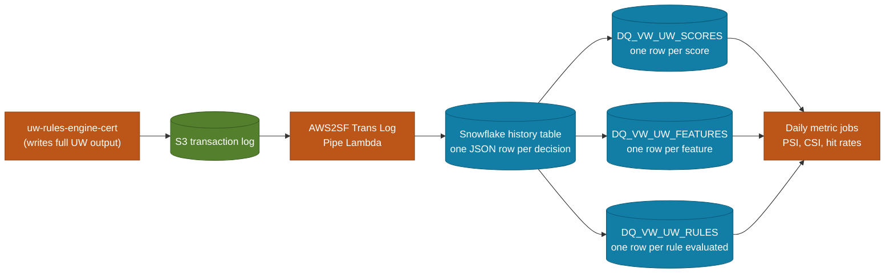
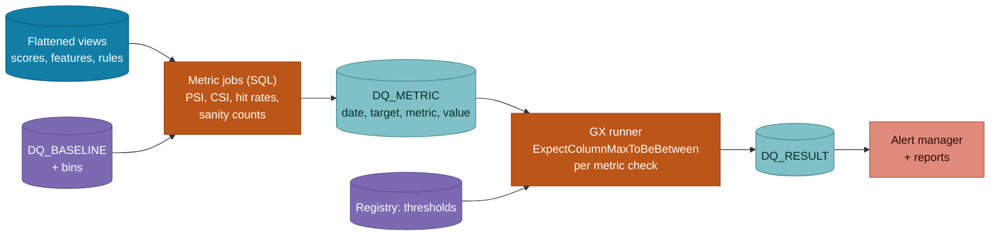
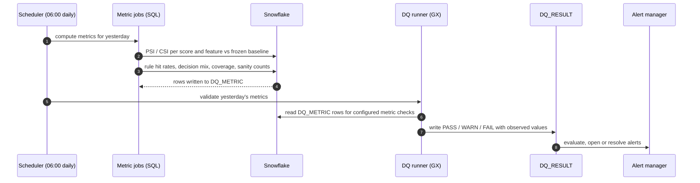

# Phase 2: Features, scores & rule activity

Phase 2 watches **what the models see** (features), **what they produce** (scores), and **how the rules
behave** (hit rates and the decision mix). It catches the shifts that come before a fall in performance,
months before Phase 3 can confirm one.

## Objective and success criteria

> Detect a meaningful shift in feature distributions, score distributions or rule activity **within one
> day**, and explain it in a report stakeholders can read.

| Success criterion | Target (proposed) |
| --- | --- |
| Score coverage | PSI on every **final** score per lane, and on every **component** score |
| Feature coverage | CSI on the **top features per model** (importance-ranked, as in Phase 1) |
| Rule coverage | A hit-rate trend for **every active rule** |
| Detection | A shift injected into a sandbox copy is flagged in the next daily run |
| Reporting | The weekly report and the on-demand report include PSI/CSI tables and rule hit-rate trends |

!!! tip "Rule hit-rate monitoring is the quickest win in this phase"
Today the business notices "an uptick in this rule" before the team does
([kickoff](../kickoff/discussion.md#1-why-this-project-exists)). A daily check of each rule's hit rate
against its trailing four weeks catches **exactly that signal, first**. It needs only the decision
section of the JSON output, not any outcome data. **Recommendation:** build it first in Phase 2.

## Scope

| In scope | Detail |
| --- | --- |
| **The new model only** | The kickoff explicitly excluded the legacy model. |
| **Features** | Raw and transformed features **used by a model**, starting with the top-ranked ones. |
| **Scores** | Per lane (MF, IDT, Credit): **component** scores (one per available source) and the **final** score; both **raw** (probability) and **weighted**. IDT and MF have up to 5 scores, Credit up to 3. |
| **Rule activity** | Hit rate per rule; the decision mix (for example approve / refer / decline shares). |
| **Not in scope** | Anything that needs outcomes, such as AUC or bad rates. That is [Phase 3](phase-3-performance.md). |

## Data source: the model service JSON output

Every decision produces one JSON object with **header**, **scores**, **features** and **decision**
sections ([kickoff](../kickoff/whiteboard.md#d-the-onboarding-flow-centre)). The rules engine writes it
to S3 ([step 5a](../data-flow.md#band-3-asynchronous-transaction-logging-bottom)), and it is loaded into
the Snowflake **history table** (step 5c). Phase 2 reads that table through **flattened monitoring
views**:



The JSON schema hasn't been documented yet, so the paths below are **illustrative**. Getting sample
payloads and a schema description is the first task of this phase.

```sql
create or replace view DQ_FRAMEWORK.DQ_VW_UW_SCORES as
select
    h.payload:header:application_id::varchar     as APPLICATION_ID,
    h.payload:header:decision_ts::timestamp_ntz  as EVENT_TS,
    s.value:lane::varchar                        as LANE,            -- MF / IDT / CREDIT
    s.value:name::varchar                        as SCORE_NAME,      -- e.g. idt_lexis_neustar, idt_final
    s.value:type::varchar                        as SCORE_TYPE,      -- COMPONENT / FINAL
    s.value:raw::float                           as RAW_SCORE,       -- probability
    s.value:weighted::float                      as WEIGHTED_SCORE
from <UW_HISTORY_DB>.<SCHEMA>.<HISTORY_TABLE> h,
     lateral flatten(input => h.payload:scores) s;
```

## Baselines: what "normal" means

Drift is always measured **against something**. A **baseline** is a frozen reference distribution for
one score or feature.

| Aspect | Recommendation |
| --- | --- |
| **Which period** | The model's **development / validation sample**, or the first 4–8 stable weeks after the new model goes live. Modelling team approves. |
| **Bins** | **10 bands** (as the kickoff described): score deciles from the baseline. Categorical features use their categories; rare categories are grouped into "other". |
| **Storage** | `DQ_BASELINE` (header: period, version, approver) + `DQ_BASELINE_BINS` (bin edges, expected share). Versioned, never overwritten. |
| **Refresh policy** | **Frozen per model version.** Re-baseline only when the model is retrained or released, through an approved config change. Reviewed quarterly. |
| **Second comparison** | Also compare each day with the **previous 4 weeks**. This catches sudden changes that a long-frozen baseline would smooth over. |

!!! question "Decision needed: how often is the baseline updated?"
The kickoff asked "is that updated every month?". **Recommendation: no.** A baseline that rolls forward
every month slowly absorbs drift, so gradual drift is never reported. Keep the frozen baseline for slow
drift, and the trailing 4-week comparison for sudden change. That gives the benefit of both.

## Check catalog

| Group | Check | How | Suggested thresholds |
| --- | --- | --- | --- |
| **Validity** (reuses Phase 1) | Scores in range, not null when the source was available; feature ranges and types | Phase 1 builders on the flattened views | Raw scores in **[0, 1]**: FAIL on any value outside |
| **Score sanity** | A **component score exists if and only if** its source returned data | Compare score presence with the source hit flags in the same JSON | FAIL above 0.5% mismatches |
| **Score sanity** | The **final score reconciles** with its components (a weighted sum) | Recompute `Σ weight × component` and compare it with the final score | FAIL if more than 0.1% differ by more than a tolerance. **Decision needed:** the weights must come from the modelling team |
| **Stability** | **PSI** for each final and component score against its baseline | Metric job → `DQ_METRIC` → GX | WARN ≥ **0.10**, FAIL ≥ **0.25** (common industry convention) |
| **Stability** | **CSI** for each top feature | Same as PSI, per feature | WARN ≥ 0.10, FAIL ≥ 0.25 |
| **Stability** | Summary shifts: mean, median, % of applications in the riskiest band | Metric job | WARN at ±10% relative to baseline |
| **Coverage** | Share of applications **missing a component** per source (for example, no TMX score) | Metric job | WARN at +3 points against trailing, FAIL at +5 |
| **Rule activity** | **Hit rate per rule** compared with trailing 4 weeks | Metric job on `DQ_VW_UW_RULES` | WARN at ×1.5, FAIL at ×2 (or ±X points for frequent rules) |
| **Rule activity** | **Decision mix** (approve / refer / decline shares) | Metric job | WARN at ±3 points, FAIL at ±5 points against trailing |

!!! info "How these criteria relate to the BRD's \"Dec > 10%\""
The [BRD's FSI/CSI criteria](../data-quality/review-notes.md#4-clarify-what-the-fsicsi-criteria-measure)
were written as directional percentages. This catalog keeps the two ideas separate. **PSI/CSI** use
index thresholds (0.10 / 0.25), because the index has no direction. Directional rules such as
"mean dropped more than 10%" go under **summary shifts**.

## GX pattern: metrics, then expectations

GX has no built-in PSI or CSI expectation. **Recommendation** (ADR-06): compute metrics in Snowflake
SQL into one long `DQ_METRIC` table, then let GX judge each metric. That keeps the heavy computation
inside Snowflake, and keeps the judging (thresholds, WARN/FAIL, alerts) in the same framework as
Phase 1.



The PSI metric job for one score and one day, with a small floor so an empty bin can't break `ln()`:

```sql
insert into DQ_FRAMEWORK.DQ_METRIC (metric_date, source_id, target, metric_name, metric_value, baseline_id)
with bins as (
    select bin_id, lo, hi, expected_share
    from DQ_FRAMEWORK.DQ_BASELINE_BINS
    where baseline_id = :baseline_id                 -- frozen baseline for this score
),
counts as (
    select b.bin_id, count(s.APPLICATION_ID) as n
    from bins b
    left join DQ_FRAMEWORK.DQ_VW_UW_SCORES s
      on  s.SCORE_NAME = :score_name
      and s.RAW_SCORE >= coalesce(b.lo, -1e9) and s.RAW_SCORE < coalesce(b.hi, 1e9)
      and s.EVENT_TS >= :day_start and s.EVENT_TS < :day_end
    group by b.bin_id
),
shares as (
    select b.bin_id,
           b.expected_share                                             as e,
           greatest(c.n / nullif(sum(c.n) over (), 0), 0.0001)          as a
    from bins b join counts c using (bin_id)
)
select :day, :source_id, :score_name, 'PSI', sum((a - e) * ln(a / e)), :baseline_id
from shares;
```

Each metric check in the registry then becomes a one-row query asset that GX checks, for example
`ExpectColumnMaxToBeBetween(column="METRIC_VALUE", max_value=0.25)`. The PSI value comes back as
`observed_value`, so WARN classification and history work exactly as in Phase 1.

## Cadence and sample size

- **Daily.** Hourly PSI is noise: a few hundred applications spread over 10 bins can't produce a
  stable index.
- **Minimum sample.** If a day has fewer applications than a minimum (for example 500 per score), compute
  on a **rolling 7-day window** instead and label the result so. **Decision needed:** confirm daily
  volumes per lane.
- **Reports.** The weekly report adds PSI/CSI tables and rule hit-rate trends. The on-demand report
  produces the stakeholder FSI/PSI view the kickoff asked for.

## The daily run



## Sprint plan

Phase 2 starts once Phase 1 is in shadow mode and the new model's JSON output is landing in Snowflake.

| Sprint | Weeks | Goal | Deliverables | Exit criteria |
| --- | --- | --- | --- | --- |
| **5: Contracts** | 9–10 | Data access to scores, features, rules | JSON schema documented; `DQ_VW_UW_SCORES` / `FEATURES` / `RULES`; baseline periods agreed with modelling | Views return correct counts against the history table |
| **6: Metric producers** | 11–12 | All Phase 2 metrics computed daily | `DQ_BASELINE(_BINS)`; PSI/CSI, summary shifts, coverage, rule hit-rate and decision-mix jobs; `DQ_METRIC` | Metrics match an independent notebook calculation |
| **7: Judging & sanity** | 13–14 | Metrics are checked and reported | Metric checks in the registry; score-sanity checks (presence, reconciliation); report sections | Injected shifts are flagged; reconciliation passes on real data |
| **8: Shadow & go-live** | 15–16 | Production | Two weeks in shadow mode; threshold calibration; alerts on for rule hit rate and final-score PSI | Alert volume within budget; modelling team signs off baselines |

## Dependencies and risks

| Item | Mitigation |
| --- | --- |
| The new model must be live, with JSON output in Snowflake | If it's delayed, run Phase 2 on sandbox / shadow traffic, or extend Phase 1 to Day 2 sources in the meantime |
| The JSON schema can change between model releases | The monitoring views absorb the change; CI checks the view against a sample payload |
| Reconciliation needs the model's combination weights | Request them in sprint 5; until then, check only that scores are present and in range |
| Teams disagree about which baseline to use | The modelling team owns and approves baselines (see [governance](roadmap.md#responsibilities-raci)) |
| Low daily volume makes PSI noisy | Rolling 7-day windows plus minimum sample rules |
