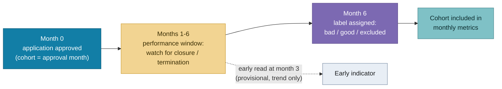
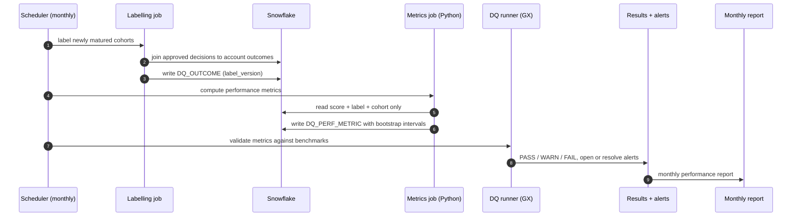

# Phase 3: Model & rule performance

Phase 3 answers the question the other phases can only hint at: **are the models and rules still
separating good accounts from bad ones?** It is the slowest signal, because an account has to age before
its outcome is known. That is the "six-month lag" from the
[kickoff](../kickoff/discussion.md#model-rule-performance). It is also the most conclusive.

## Objective and success criteria

> Report model and rule performance for every **matured** approval cohort, and alert when performance
> drops meaningfully below the model's development benchmark.

| Success criterion | Target (proposed) |
| --- | --- |
| Labelling | Every approved application in a matured cohort has an outcome label (good / bad / excluded) |
| Model metrics | AUC, Gini, KS and % bads captured, per final score and per component score, per monthly cohort |
| Rule metrics | Hit / no-hit bad rate and lift for every active rule |
| Benchmarking | Each metric shown against the development benchmark, with confidence intervals |
| Reporting | A monthly performance report, plus the on-demand report |

## The performance definition

From the kickoff: for every **approved** application, if the account was later **closed or
terminated** it is **bad**, otherwise it is **good**. The definition **differs by business line**
(Underwriting vs Clover Capital), so it is configuration, not code:

```yaml
performance_definition:
  domain: UW
  population: approved_applications
  outcome_source: <DB>.<SCHEMA>.<ACCOUNT_STATUS_TABLE>     # decision needed
  bad_when:
    status_in: [CLOSED, TERMINATED]                       # exact codes to be confirmed
    reason_not_in: [VOLUNTARY_CLOSURE]                    # decision needed (see below)
  performance_window_months: 6
  exclusions: [test_accounts, withdrawn_before_activation]
  label_version: v1
```

!!! question "Decision needed: does every closure count as bad?"
"Closed or terminated" may include merchants who simply **left voluntarily**, which is not a risk
event. Counting those as bad would make good models look worse. Agree which **closure reasons** count
as bad with the reviewers. The kickoff suggested asking them how they measure performance today.
**(inferred)** The account-status codes already used by the feature store (`02`/`03` terminated or
off-boarded, `13` dormant, see [Step 1](../feature-store/step1-arrays.md)) may be a usable outcome
source.

## How a cohort matures



- **Cohorts** are grouped by approval month. A cohort is **matured** once every application in it has
  had the full performance window.
- **Early reads** (for example at 3 months) give a provisional trend sooner. They are always labelled
  provisional and never used to judge the model against its benchmark.

## Data model additions

| Table | Grain | Key columns |
| --- | --- | --- |
| `DQ_OUTCOME` | One row per approved application | `application_id`, `account_id`, `domain`, `cohort_month`, `outcome_status`, `outcome_reason`, `outcome_date`, `bad_flag`, `matured`, `label_version` |
| `DQ_PERF_METRIC` | One row per cohort × target × metric | `cohort_month`, `domain`, `target` (score or rule), `metric_name`, `metric_value`, `ci_low`, `ci_high`, `n`, `n_bad`, `benchmark_value` |

!!! warning "Dependency: linking applications to accounts"
Labels need a reliable join from **application** (in the decision JSON) to **account** (in the
outcome source). If no such key exists, Phase 3 cannot start. Confirm it in the first weeks. This is
why Phase 3 groundwork runs in parallel with Phase 1.

## Metrics

### Model metrics

Computed per **final score** and per **component score**, per lane, per matured cohort. Higher scores
are assumed to mean riskier.

| Metric | Reads as | Typical use |
| --- | --- | --- |
| **AUC** | The chance a random bad scores riskier than a random good (0.5 = chance) | Overall ranking power |
| **Gini** | `2 × AUC − 1` | The figure model reports usually quote |
| **KS** | The largest gap between the cumulative bad and good distributions | How well a cutoff separates the two |
| **% bads captured at k%** | Share of all bads in the riskiest *k*% of applications | Business-facing; **k is configurable** (5% default, 1% for credit, per the kickoff) |
| **Bad rate by score band** | Bad rate in each of the 10 bands | Should rise steadily from band to band (**rank ordering**). A band that breaks the order is a warning |

Worked definitions and an example are in [the kickoff notes](../kickoff/discussion.md#model-rule-performance).

```python
# src/dqf/metrics/performance.py (sketch)
import numpy as np
from sklearn.metrics import roc_auc_score, roc_curve


def model_metrics(y_bad: np.ndarray, score: np.ndarray, capture_pct: float = 0.05) -> dict:
    """y_bad: 1 = bad, 0 = good. score: higher = riskier."""
    auc = roc_auc_score(y_bad, score)
    fpr, tpr, _ = roc_curve(y_bad, score)
    top_n = max(1, int(round(len(score) * capture_pct)))
    riskiest = np.argsort(-score)[:top_n]
    return {
        "AUC": auc,
        "GINI": 2 * auc - 1,
        "KS": float(np.max(tpr - fpr)),
        f"CAPTURE_AT_{capture_pct:.0%}": y_bad[riskiest].sum() / max(1, y_bad.sum()),
    }
```

Only the score, the label and the cohort leave Snowflake for this calculation. No personal fields are
needed.

### Rule metrics

For each rule, compare approved accounts where it **hit** with those where it **didn't**:

| Metric | Formula | Healthy sign |
| --- | --- | --- |
| Hit bad rate | bads among hits ÷ hits | Clearly above the no-hit bad rate |
| No-hit bad rate | bads among non-hits ÷ non-hits | Close to the portfolio bad rate |
| **Lift** | hit bad rate ÷ no-hit bad rate | Well above 1. A lift that keeps falling means the rule is losing value |
| Hit volume | hits ÷ applications | Matches Phase 2's hit-rate trend |

!!! warning "Declined applications have no outcome"
Only **approved** accounts have outcomes. A rule that **declines** an application removes it from the
population, so its performance can't be measured this way (selection bias). Options, in order of ease:
(1) measure rules that refer or flag without blocking; (2) measure on referred-then-approved
applications; (3) a small, approved **hold-out** that lets some flagged applications through. Option 3
is a business and risk-policy decision. **Decision needed** with the reviewers.

### Statistical reliability

- **Minimum bads.** AUC and KS are unstable with few bad accounts. **Recommendation:** report a cohort
  only when it has at least ~50 bads. Otherwise pool consecutive cohorts (for example a rolling 3
  months) and label it so.
- **Confidence intervals.** Bootstrap each metric (`ci_low`, `ci_high`) and alert only when the
  **interval** is clearly below benchmark, not on the point estimate alone.
- **Benchmarks.** Take the development benchmark from the model's documentation. The modelling team
  owns these values.

## GX pattern: metrics, then expectations

As in Phase 2 (ADR-06): compute into `DQ_PERF_METRIC`, then let GX judge. Typical checks:

| Check | Expectation on `DQ_PERF_METRIC` | Suggested threshold |
| --- | --- | --- |
| Gini against benchmark | `ExpectColumnMinToBeBetween(column="GINI_RATIO", min_value=0.90)` | WARN below 95% of benchmark, FAIL below 90% |
| KS against benchmark | Same pattern | WARN below 95%, FAIL below 90% |
| Capture at k% | `ExpectColumnMinToBeBetween(column="CAPTURE", min_value=…)` | Set by modelling team |
| Rank ordering | Custom: bad rate must not fall between adjacent bands | FAIL if more than one band breaks the order |
| Rule lift | `ExpectColumnMinToBeBetween(column="LIFT", min_value=1.5)` | Per rule, set by the rule owner |

## The monthly run



## Plan

Phase 3 has two tracks. The **groundwork** starts early because it has the longest lead time; the
**build** comes after Phase 2.

| Track / sprint | Weeks | Goal | Deliverables | Exit criteria |
| --- | --- | --- | --- | --- |
| **Groundwork** | 5–14 | Make labelling possible | Outcome source found; application → account key confirmed; bad definition agreed (incl. closure reasons); benchmark values collected | Signed-off performance definition (YAML) |
| **9: Labelling** | 15–16 | Outcome labels in Snowflake | Labelling job; `DQ_OUTCOME`; backfill of historical cohorts | Label counts reconcile with the business's own reporting |
| **10: Metrics** | 17–18 | Metrics per cohort | Model + rule metrics with confidence intervals; `DQ_PERF_METRIC` | Matches an independent notebook calculation |
| **11: Judging & report** | 19–20 | Checked and readable | Benchmark checks in the registry; monthly report | Reviewers accept the report format |
| **12: Go-live** | 21–24 | Production | Monthly schedule; alerts on severe drops; runbook | First production report delivered |

!!! tip "Prove the pipeline on the legacy model"
The new model won't have matured cohorts until about six months after it launches. **Recommendation:**
if past decisions from the legacy model are available, build and test the labelling and metrics
pipeline on those. It will then be proven and ready when the new model's first cohort matures.

## Dependencies and risks

| Item | Mitigation |
| --- | --- |
| No application → account key | Escalate early; it blocks the whole phase |
| Disagreement on what counts as "bad" | Reviewers own the definition; it is versioned (`label_version`) so changes are traceable |
| Too few bads per cohort | Pool cohorts; confidence intervals; minimum-bad rule |
| Selection bias for declining rules | Measure what can be measured; raise the hold-out option as a policy decision |
| New model has no matured history | Prove the pipeline on legacy decisions first |
