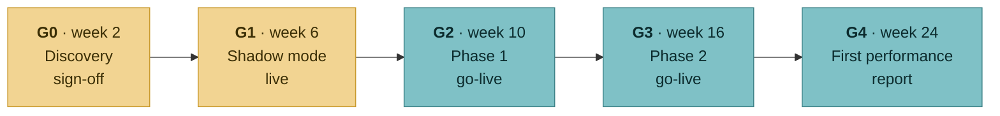

# Roadmap & governance

The delivery plan across all three phases: timeline, decision gates, responsibilities, the decisions
still open, risks, and what to do in the first two weeks.

!!! note "Updated after the 1:1"
    The [After the BRD](../next-steps/index.md) section has the immediate plan: socialise the templates,
    raise a Jira ticket, and build end to end on a stand-in table while deployments stay the priority.
    Decisions D1, D2, D3 and D6 below reflect it.

## Timeline

About **24 weeks** in total. Weeks are counted from project start. Phase 3 groundwork runs in
parallel because it has the longest lead time (finding outcome data and agreeing definitions).

```text
Week                1  2  3  4  5  6  7  8  9 10 11 12 13 14 15 16 17 18 19 20 21 22 23 24
Phase 1             █  █  █  █  █  █  █  █  █  █                                          
P3 groundwork                   ░  ░  ░  ░  ░  ░  ░  ░  ░  ░                              
Phase 2                                     █  █  █  █  █  █  █  █                        
Phase 3 build                                                 █  █  █  █  █  █  █  █  █  █
Gates                 G0          G1          G2                G3                      G4
```

| Weeks | Phase | Headline |
| --- | --- | --- |
| 1–10 | **Phase 1: Input monitoring** | Platform + A1 input checks. Shadow mode week 6, alerts live week 10 |
| 5–14 | Phase 3 groundwork | Outcome source, application → account key, bad definition, benchmarks |
| 9–16 | **Phase 2: Features, scores & rule activity** | Rule hit-rate drift first; PSI/CSI on frozen baselines |
| 15–24 | **Phase 3: Performance** | Labelling, model and rule metrics, monthly report |

The detailed sprint plans are on each phase page:
[Phase 1](phase-1-input.md#sprint-plan) · [Phase 2](phase-2-features-scores.md#sprint-plan) ·
[Phase 3](phase-3-performance.md#plan).

## Decision gates

Each gate is a short review. The next stage starts only when its criteria are met.



| Gate | Week | Criteria | Approver |
| --- | --- | --- | --- |
| **G0** Discovery sign-off | 2 | A1 path and cadence confirmed; top-5 field list received; runtime (ADR-04) and alert recipients decided; BRD updated | Manager |
| **G1** Shadow mode | 6 | Hourly runs writing results; fault-injection suite passes; no notifications yet | DQ engineer (lead) |
| **G2** Phase 1 go-live | 10 | Phase 1 success criteria met for 2 weeks; alert budget respected in shadow; runbooks written | Manager + source owners |
| **G3** Phase 2 go-live | 16 | Baselines signed off; rule hit-rate and PSI checks within alert budget | Manager + modelling team |
| **G4** First performance report | 24 | Performance definition signed off; report reviewed and accepted | Manager + reviewers |

## Responsibilities (RACI) { #responsibilities-raci }

**R** = does the work · **A** = accountable (final say) · **C** = consulted · **I** = informed.

| Activity | Manager (sponsor) | DQ engineer (owner) | Modelling team / reviewers | Data engineering / source owners | Snowflake / platform admins | Business stakeholders |
| --- | :-: | :-: | :-: | :-: | :-: | :-: |
| BRD and scope | **A** | **R** | C | C | | I |
| Architecture and build | C | **A/R** | C | C | C | |
| Field inventory and importance ranks | I | C | **A/R** | C | | |
| Input check thresholds | C | **R** | C | **A** | | |
| Baselines (Phase 2) | I | **R** | **A** | | | |
| Performance definition (Phase 3) | **A** | **R** | **R** | C | | C |
| Responding to input alerts | I | C | | **A/R** | | |
| Responding to model / rule alerts | I | C | **A/R** | | | I |
| Access, service users, warehouses | I | **R** | | | **A** | |
| Weekly and on-demand reports | **A** | **R** | C | | | I |

## Open decisions

The decisions collected from every page of this blueprint, with an owner and a deadline:

| # | Decision | Owner | Needed by | Recommendation |
| --- | --- | --- | --- | --- |
| D1 | UW tables: the **API request table** (input) and the **5c output** (scores); their paths, timestamps and cadence | Modelling contact (Jira ticket) | Week 1 | Build on the [15-minute stand-in table](../next-steps/what-to-monitor.md#the-stand-in-table) meanwhile |
| D2 | Runner runtime (ADR-04) | DQ engineer + manager | **Decided** | AWS Lambda + EventBridge, alerts via SNS (manager, 1:1) |
| D3 | Alert channel and recipients per source | Manager | Week 2 | **SNS email** to team distribution lists; reuse the existing email Lambda if possible |
| D4 | Database and schema for `DQ_FRAMEWORK`, per environment | Platform admins | Week 2 | Sandbox for development; a production database for go-live |
| D5 | Where input drift lives | Manager | Week 2 | Lightweight trend checks in Phase 1; formal PSI/CSI in Phase 2 ([details](phase-1-input.md#scope)) |
| D6 | Report tool | Manager | Friday review | HTML + Excel for the MVP; **Power BI** for production (the team's standard) |
| D7 | Application → account linking key | Data engineering | Week 6 | (fact to confirm; blocks Phase 3) |
| D8 | Bad definition, including which closure reasons count | Reviewers | Week 8 | Exclude voluntary closures |
| D9 | Baseline periods and refresh policy | Modelling team | Week 9 | Frozen per model version, plus a trailing 4-week comparison |
| D10 | Final-score combination weights | Modelling team | Week 9 | Needed for the reconciliation check |
| D11 | How to measure rules that decline (hold-out?) | Business / risk | Week 16 | Start with non-blocking rules; hold-out only with policy approval |

## Risks

| Risk | Likelihood | Impact | Mitigation |
| --- | :-: | :-: | --- |
| **Too much depends on one person**: one engineer owns the project end to end | High | High | These docs; pair on key parts; runbooks; a second person on-call for alerts |
| Too many alerts, so people stop reading them | Medium | High | Shadow mode, alert budget, stateful alerts, severity routing |
| New model deployment slips | Medium | Medium | Phase 1 doesn't depend on it; Phase 2 can use sandbox / shadow output |
| Access approvals are slow | Medium | Medium | Request service users and roles in week 1 |
| Scope creep ("monitor all 2,000 TMX fields") | Medium | Medium | Scope rule enforced in code: only fields used in a model or rule, top-ranked first |
| No outcome data or linking key | Medium | High (Phase 3) | Groundwork from week 5; escalate early |
| GX API changes on upgrade | Low | Medium | Pin the version; upgrade deliberately with the test suite |
| Monitoring costs creep up | Low | Low | Window-only queries, X-Small warehouse, credits tracked per run |

## Definition of done

| Phase | Done when |
| --- | --- |
| **Phase 1** | A1 monitored hourly on all fields used in a model or rule; availability + validity + trend checks live; HIGH alerts on with stateful routing; weekly + on-demand reports; runbooks; fault suite in CI; one Day 2 source onboarded with config only. |
| **Phase 2** | Rule hit-rate drift and the decision mix live; PSI on all final + component scores; CSI on top features; score sanity checks; baselines signed off and versioned. |
| **Phase 3** | Outcome labelling in production; model and rule metrics with confidence intervals per matured cohort; benchmark checks; monthly report accepted by reviewers. |
| **Every phase** | Documentation updated; the KPIs in [Operations](operations.md#service-levels-and-kpis) reported; the platform is reusable for RM / Clover Capital through config. |

## The first two weeks: start now

!!! tip "Superseded by the 1:1"
    The concrete near-term actions now live in [After the BRD → Action items](../next-steps/index.md#action-items).
    The list below is still a useful checklist.

Phase 1 doesn't need the new model, so it can start immediately:

1. **Request access:** a Snowflake service user (key-pair), the `DQ_RUNNER_ROLE` role, an X-Small
   warehouse, and a sandbox schema for `DQ_FRAMEWORK` (D4).
2. **Confirm A1:** its Snowflake path, timestamp column, load cadence, keys and row volumes per hour (D1).
3. **Get the field inventory** from the modelling team: fields used in a model or rule, with
   importance ranks, so the top 5 per source can be chosen.
4. **Identify the vendor status fields**, the Experian hit / no-hit flag first, plus placeholder
   conventions and allowed values for categorical fields.
5. **Update the BRD** with the [suggested additions](../kickoff/brd-mapping.md#suggested-additions-to-the-brd)
   and the input-drift resolution (D5), and send it for review.
6. **Decide the runtime** (D2) and **alert recipients** (D3).
7. **Create the repository** with the [layout](reference-implementation.md#repository-layout), the
   pinned GX version, the CI skeleton, and the first migration.
8. **Hold gate G0** at the end of week 2.
