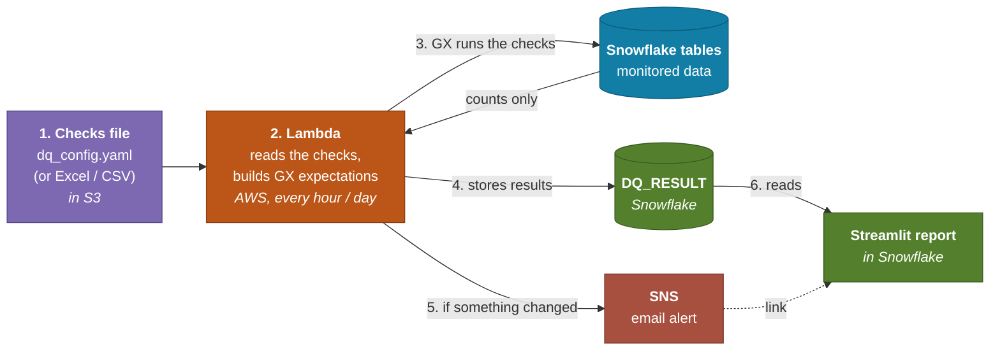
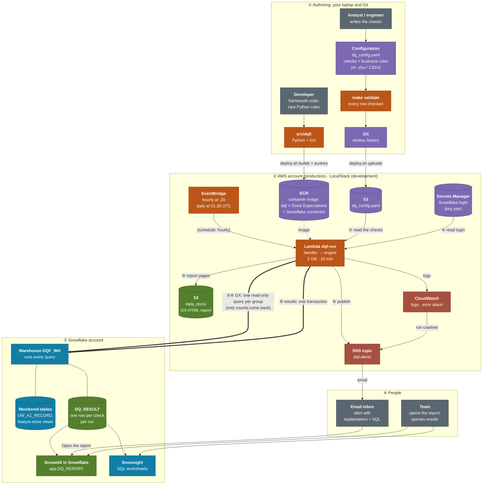
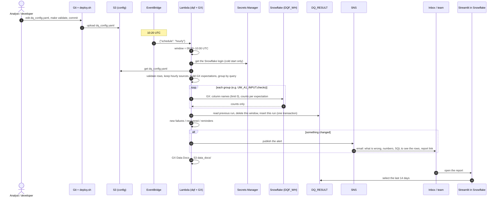

# End-to-end flow

This page follows the framework from start to finish:

1. Someone writes a data quality check in the configuration file.
2. Great Expectations runs it against Snowflake.
3. The result lands in a Snowflake table.
4. An alert reaches someone's inbox.
5. The team opens the report.

It names every service involved and says where each piece of code is hosted and runs.

The checks, including the business rules, are written in one **YAML file**, `config/dq_config.yaml`.
An Excel workbook or a folder of CSVs can be used instead; see
[Configuration formats](#configuration-formats). Everything after the reading step is the same
whichever format is used.

## The whole picture

### At a glance



1. **The checks file.** You describe each check in a file, not in code: which table, which column,
   what counts as bad, how much bad is allowed, and whether to alert. **Business rules**, such as "no
   auto-approval with a score below 400", are written in the same file as plain field conditions
   (*when* `DECISION` is `AUTO_APPROVE`, *then* `MF_SCORE` at least 400), with no SQL. The file is
   `config/dq_config.yaml`, reviewed in Git like code; an Excel workbook or CSVs are optional
   alternatives. `make validate` checks every entry
   first. The deployment copies the file to an **S3** bucket, where the Lambda reads it at every run.
   A change to the checks therefore needs no code release.
2. **The Lambda.** EventBridge starts it at 20 past every hour, and at 01:30 UTC every day. It works
   out the window to check (the previous full hour or day), reads the checks file, and turns each row
   into a **Great Expectations expectation**, such as "`AVG_TICKET` is not empty in at least 70% of
   rows". It groups the expectations so that each table needs as few queries as possible. The
   Lambda's container image holds the framework, Great Expectations and the Snowflake connector.
3. **Great Expectations runs the checks in Snowflake.** It logs in as the service user `DQF_SVC`, using
   the key from Secrets Manager. It compiles every expectation into SQL that runs **inside Snowflake**
   on the warehouse `DQF_WH`, then judges each count against its limit: pass, warn, fail, or error.
   Only numbers come back, never the monitored rows.
4. **The results are stored.** Each check becomes one row in the Snowflake table `DQ_RESULT`: what was
   checked, the window, the status, the measured value, and the limit. Re-running a window replaces
   its rows. The table is the history that everything else reads, and anyone with access can query it
   in Snowsight.
5. **An alert, only when something changed.** The run compares itself with the previous one. If a
   check **started** failing, **recovered**, or is **still failing** a day later, one email goes out
   through **SNS** to the subscribed addresses. For each problem, it says what is wrong in plain words,
   the measured value and the limit, and gives a query to see the affected rows. An unchanged problem
   does not send an email every hour.
6. **The report.** A Streamlit app hosted **in Snowflake** shows the results table: what needs attention,
   the status of every field, and each check's history. It is separate from the Lambda, so it is always
   available. The alert email links to it.

### In detail



The diagram has four areas. The numbers on the arrows are the order things happen in a run.

- **① Authoring (your laptop and Git).**
    - An analyst or engineer edits `dq_config.yaml` (checks and business rules), runs
      `make validate`, and commits it to Git for review and history.
    - A developer changes the code in `src/dqf/` only when the framework itself changes, or for a
      rare rule that needs Python.
    - `infra/deploy.sh` carries both to AWS: it uploads the checks file to S3, and builds and pushes
      the code as a container image to ECR.
- **② AWS (production), or LocalStack on your laptop (development).**
    - **EventBridge** holds the two schedules and invokes the Lambda with `{"schedule": "hourly"}` or
      `{"schedule": "daily"}`.
    - The **Lambda** `dqf-run` runs the container image from **ECR**: Python, the framework, Great
      Expectations and the Snowflake connector. It has 2 GB of memory and up to 10 minutes per run.
    - At the start of a run it reads the checks file from **S3** (③) and the Snowflake login from
      **Secrets Manager** (④), through its IAM role. No passwords or keys are in the code or the image.
    - At the end it publishes the alert to the **SNS** topic (⑨) and writes GX's own HTML report
      (Data Docs) to **S3** `data_docs/` (⑩).
    - Every run writes a summary line to **CloudWatch Logs**. If a run crashes outright (rather than a
      check failing), a **CloudWatch alarm** sends a message through the same SNS topic.
    - LocalStack provides the same services on your laptop from the same template, so what is tested
      there is what goes to AWS.
- **③ Snowflake.**
    - Great Expectations connects through its Snowflake data source and runs **read-only** queries on
      the **monitored tables** (⑤⑥), on the warehouse **DQF_WH**.
    - The framework then writes the run's results to **DQ_RESULT** in **one transaction** (⑧), with
      the Snowflake connector directly.
    - The **Streamlit in Snowflake** app `DQ_REPORT` and **Snowsight** worksheets both read DQ_RESULT.
- **④ People.**
    - Subscribers receive the **alert email** from SNS. It explains each problem and has a button that
      opens the report.
    - The **team** opens the Streamlit report, or queries DQ_RESULT directly in Snowsight.

The step-by-step walk-through below goes through each numbered stage in full.

## Where each piece is hosted and runs

| Piece | Code / file | Hosted in | Runs when |
| --- | --- | --- | --- |
| The checks (configuration) | `config/dq_config.yaml` (or `.xlsx` / CSVs) | Git; deployed copy in **S3** | Read at the start of every run |
| Business rules | The `rules:` section of the same file: `when` / `then` field conditions | Git; in **S3** with the checks | Every run, as built-in GX expectations with row conditions |
| Custom checks (rare) | `src/dqf/expectations.py`: custom GX expectations, used by rules by name | Git; inside the **container image in ECR** | When a rule uses them |
| The framework (reader, planner, GX, alerts) | `src/dqf/` | **AWS Lambda** `dqf-run`, from the container image | Triggered by **EventBridge**: hourly at :20, daily at 01:30 UTC |
| Great Expectations library | `great-expectations[snowflake]==1.24.0` | Inside the same **Lambda image** | Inside each run |
| Snowflake login | key pair | **Secrets Manager** (`dqf/snowflake`) | Read once per cold start |
| Schedules | `HourlyRule`, `DailyRule` in the template | **EventBridge** | Always on |
| Monitored data | e.g. `DQF_DB.DQF.UW_A1_RECORD` | **Snowflake** | Read only |
| Check queries | Generated by GX | **Snowflake warehouse** `DQF_WH` | During each run |
| Results | `DQF_DB.DQF.DQ_RESULT` | **Snowflake** | Written at the end of each run; queried any time |
| Alerts | `src/dqf/alerts.py` | Built in the **Lambda**, delivered by **SNS** (email) | When something changed |
| GX HTML report | `src/dqf/datadocs.py` | Built in the **Lambda**, stored in **S3** `data_docs/` | Every run |
| Streamlit report | `app/streamlit_app.py` | **Streamlit in Snowflake** (app `DQ_REPORT`) | Always available; reads `DQ_RESULT` when opened |
| Logs and crash alarm | — | **CloudWatch** | Every run; the alarm fires if a run crashes |
| Infrastructure | `infra/cloudformation.yaml` | **CloudFormation** stack | When you deploy |

During development, the AWS column is **LocalStack** on your laptop: the same template, the same code,
and the real Snowflake account. See [Running it](running.md#in-localstack-aws-on-your-laptop).

## Step by step



### 1. Writing the checks

Checks are written in the configuration file, `config/dq_config.yaml`, not in code
([Configuration](configuration.md) has every key):

```yaml
sources:
  UW_A1_INPUT:                                  # a table, seen this way, this often
    table: DQF_DB.DQF.UW_A1_RECORD
    ts_column: REQUEST_TS
    schedule: hourly
    checks:
      - {field: AVG_TICKET, check_type: MISSING_VALUES, max_bad_pct: 30, alert: yes}
  UW_A1_DAILY:
    ...
    stability:                                  # drift against a benchmark
      - {field: MF_SCORE, index: PSI, field_type: NUMERIC, benchmark_start: -60, benchmark_end: -30, active_days: 7}

rules:                                          # business rules, as field conditions
  DECISION_MATCHES_SCORE:
    description: No auto-approval with a merchant fraud score below 400
    applies_to: UW_A1_SCORED
    when: {DECISION: AUTO_APPROVE}              # which rows
    then: {MF_SCORE: {at_least: 400}}           # what must hold
```

| Section | Holds | Example |
| --- | --- | --- |
| **sources** | One block per table (or view) seen a certain way, on a schedule | `UW_A1_INPUT`: `UW_A1_RECORD`, `REQUEST_TS`, `hourly` |
| … `checks` | The checks on each window of that source | `AVG_TICKET` not empty in at least 70% of rows |
| … `stability` | Scores (PSI) or features (CSI) compared with a benchmark | `MF_SCORE`, days `-60` to `-30`, last `7` days |
| **rules** | Business rules: `when` (which rows) and `then` (what must hold), as field conditions; or `check`, a named custom check | when `DECISION` is `AUTO_APPROVE`, `MF_SCORE` at least 400 |

Before anything is deployed, `make validate` checks every entry and reports all problems at once, each
with where it is (`sources.UW_A1_INPUT.checks[3]: …`). It refuses anything in a row filter or rule
that does more than read.

### 2. Deploying the configuration and the code

| What changed | What carries it to AWS | Where it lands |
| --- | --- | --- |
| The checks or business rules | `infra/deploy.sh` (or `aws s3 cp`) | **S3**: `s3://<stack>-config-…/dq_config.yaml` |
| Framework code (or a Python rule) | `infra/deploy.sh` builds the `Dockerfile` and pushes it | **ECR** image, used by the **Lambda** |
| Infrastructure | `infra/deploy.sh` deploys the template | **CloudFormation** creates or updates every resource |

The Lambda reads the configuration from S3 at every run, so a new check or business rule needs no
code deploy. The next run picks it up.

### 3. The trigger

**EventBridge** invokes the Lambda with `{"schedule": "hourly"}` at 20 past every hour, and with
`{"schedule": "daily"}` at 01:30 UTC. The Lambda works out the window:

| Schedule | A run at | Checks rows with the timestamp column in |
| --- | --- | --- |
| hourly | 10:20 UTC | 09:00 ≤ t < 10:00 |
| daily | 01:30 UTC on the 17th | the 16th, 00:00 ≤ t < 24:00 |

The 20 minutes leave time for late data to land. A run can also be started by hand, for any past
window: `{"schedule": "hourly", "window_end": "2026-10-17 12:00"}`.

### 4. Starting up: settings, login, configuration

Inside the Lambda (`handler.py` → `settings.py` → `engine.py`):

1. **Settings** come from the Lambda's environment variables, which the template sets: where the
   configuration is, the results table, the SNS topic, the report link.
2. **The Snowflake login** comes from **Secrets Manager** (`DQF_SNOWFLAKE_SECRET_ID`) through boto3,
   using the Lambda's IAM role. The login is the service user `DQF_SVC`, its role and warehouse, and
   the private key. It is read on a cold start and kept while the container stays warm.
3. **The configuration** (`dq_config.yaml`) comes from **S3** (`workbook.py`). It is validated again,
   and only the sources with this run's schedule are kept. Each business rule becomes a query that
   selects the rows breaking it.

### 5. Preparing Great Expectations

`plan.py` turns each row into a **GX expectation** and groups them by the query they run on, so a
whole group costs one Snowflake round of queries:

| Configuration entry | GX expectation |
| --- | --- |
| `MISSING_VALUES` on `AVG_TICKET`, `MAX_BAD_PCT 30` | `ExpectColumnValuesToNotBeNull(column="AVG_TICKET", mostly=0.70)` |
| `ACCEPTED_VALUES` on `BUREAU_INQUIRY_STATUS`, `'CY'` | `ExpectColumnValuesToBeInSet(column=…, value_set=["CY"], mostly=0.70)` |
| `VOLUME`, `MIN 1` | `ExpectTableRowCountToBeBetween(min_value=1)` |
| Rule `DECISION_MATCHES_SCORE`: `when {DECISION: AUTO_APPROVE}`, `then {MF_SCORE: {at_least: 400}}` | `ExpectColumnValuesToBeBetween(column="MF_SCORE", min_value=400, row_condition=Column("DECISION") == "AUTO_APPROVE")` |
| Rule `SSN_TAX_ID_MATCH_DERIVED`: `check: ssn_tax_id_match_follows_derivation` | The custom expectation `ExpectSsnTaxIdMatchToFollowDerivation` (`src/dqf/expectations.py`) |
| Stability `MF_SCORE`, `PSI` | PSI computed in SQL, then `ExpectColumnMaxToBeBetween(column="STABILITY_INDEX", max_value=0.25)` |

Each group becomes a GX **ExpectationSuite** and a GX **query asset**. The asset's query is the
source's window, for example:

```sql
select * from DQF_DB.DQF.UW_A1_RECORD
where REQUEST_TS >= '2026-10-17 11:00:00'::timestamp_ntz
  and REQUEST_TS <  '2026-10-17 12:00:00'::timestamp_ntz
```

The GX context is in memory only, so nothing, including the login, is written to disk.

### 6. Connecting to Snowflake and running the checks

GX connects through its built-in **Snowflake data source** (`context.data_sources.add_snowflake`).
That uses SQLAlchemy and `snowflake-sqlalchemy` on top of the Snowflake Python connector, with the
key pair and session time zone UTC. Each query runs on the warehouse `DQF_WH`.

GX compiles each expectation to SQL that runs **inside Snowflake**. These are real queries from Snowflake's query history
(17 Oct 11:00–12:00; the business rule from 01:00–02:00):

```sql
-- Several expectations answered by one query: unexpected counts per column
SELECT sum(CASE WHEN ("AVG_TICKET" IS NULL) THEN 1 ELSE 0 END)            AS "column_values.nonnull.unexpected_count",
       sum(CASE WHEN ("BUREAU_INQUIRY_STATUS" IS NOT NULL
                      AND ("BUREAU_INQUIRY_STATUS" NOT IN ('CY'))) THEN 1 ELSE 0 END) AS "column_values.in_set.unexpected_count",
       sum(CASE WHEN ("ZIP" IS NOT NULL AND REGEXP_COUNT("ZIP", '^[0-9]{5}$') <= 0) THEN 1 ELSE 0 END)
                                                                           AS "column_values.match_regex.unexpected_count",
       ...
FROM (select * from DQF_DB.DQF.UW_A1_RECORD where REQUEST_TS >= '2026-10-17 11:00:00'::timestamp_ntz
                                                and REQUEST_TS <  '2026-10-17 12:00:00'::timestamp_ntz) AS anon_1

-- Volume
SELECT count(*) AS "table.row_count" FROM (…the window…) AS anon_1

-- A business rule (when DECISION is AUTO_APPROVE, then MF_SCORE at least 400): the row condition
-- becomes the inner WHERE, so only the in-scope rows are counted
SELECT sum(CASE WHEN ("MF_SCORE" IS NOT NULL AND "MF_SCORE" < 400.0) THEN 1 ELSE 0 END) AS "column_values.between.unexpected_count",
       sum(CASE WHEN ("MF_SCORE" IS NULL) THEN 1 ELSE 0 END)                             AS "column_values.nonnull.unexpected_count"
FROM (SELECT * FROM (…the window…) AS anon_2 WHERE "DECISION" = 'AUTO_APPROVE') AS anon_1
```

GX then compares each count with the expectation. For example, 17 of 30 rows have an empty
`AVG_TICKET`: 56.7% bad, more than the 30% allowed, so the check **fails**.

!!! note "What comes back from Snowflake: counts only"
    The run receives numbers, never the monitored rows. Two GX defaults would otherwise bring rows
    back, and the framework turns both off:

    | GX default | Turned off by |
    | --- | --- |
    | Fetching up to 20 example bad values per check | `partial_unexpected_count: 0` in the result format (`engine.py`); the queries run with `LIMIT 0` |
    | Running a query asset unchanged to learn its column names, which returns the window's rows | `column_names_without_rows()` (`snowflake.py`): GX gets the names from `select * from (…) limit 0` |

    Checked in Snowflake's query history for the 17 Oct 11:00 run: before the change, a full
    `select *` of the window (30 rows) and up to 20 example values per check; after it, zero rows
    from both.

### 7. Turning GX results into results rows

`engine.py` reads GX's answer for each expectation and makes one row per check:

| Column | Example |
| --- | --- |
| `STATUS` | `FAIL` (`PASS`, `WARN` for drift between the limits, `FAIL`, `ERROR` if it could not run) |
| `CHECK_ID` | `UW_A1_INPUT|AVG_TICKET|MISSING_VALUES` (stable across runs) |
| `METRIC`, `OBSERVED_VALUE` | `bad_pct`, `56.67` |
| `ELEMENT_COUNT`, `UNEXPECTED_COUNT` | `30`, `17` |
| `CRITERIA` | `at most 30% bad rows` |
| `DETAILS` | GX's counts as JSON, or the error |

For the alert only (not stored), `explain.py` adds a plain-language sentence and a query to see the rows.

A broken check (a wrong column, a missing grant) becomes `ERROR` with the reason, and the run
continues. A broken group marks only its own checks.

### 8. Storing the results in Snowflake

`snowflake.py` opens one connection with the **Snowflake Python connector** directly (GX does not write
tables) and, in **one transaction**:

1. reads the previous run's status for each check, and since when each failing check has failed;
2. deletes any earlier rows for this schedule and window, so a re-run replaces, never duplicates;
3. inserts this run's rows into `DQ_RESULT`.

The table can be queried from Snowsight at any time:

```sql
-- What is failing right now (latest hourly window)
select SOURCE, FIELD_NAME, CHECK_TYPE, RULE_NAME, OBSERVED_VALUE, CRITERIA
from DQF_DB.DQF.DQ_RESULT
where SCHEDULE = 'hourly' and STATUS in ('FAIL', 'ERROR')
  and WINDOW_END = (select max(WINDOW_END) from DQF_DB.DQF.DQ_RESULT where SCHEDULE = 'hourly');

-- One check's history
select WINDOW_END, STATUS, OBSERVED_VALUE
from DQF_DB.DQF.DQ_RESULT
where CHECK_ID = 'UW_A1_INPUT|AVG_TICKET|MISSING_VALUES'
order by WINDOW_END desc;

-- Failure rate per check over the last 7 days
select CHECK_ID, count_if(STATUS = 'FAIL') as FAILED, count(*) as RUNS
from DQF_DB.DQF.DQ_RESULT
where WINDOW_END >= dateadd(day, -7, current_timestamp()::timestamp_ntz)
group by 1 order by FAILED desc;
```

### 9. Deciding and sending alerts (SNS)

The engine compares this run with the previous one, for checks with `ALERT = Yes`:

| Situation | Alerts? |
| --- | --- |
| A check **starts** failing, or can no longer run | Yes: "new problem" |
| A failing check **passes again** | Yes: "recovered" |
| A check is still failing after another 24 hours (`DQF_REMIND_HOURS`) | Yes: "still failing" |
| Still failing, within 24 hours | No, so there is no email every hour |
| `WARN` (drift between the warn and fail limits) | No; it shows in the reports |

If anything qualifies, `alerts.py` builds **one message for the run** and publishes it to the **SNS
topic** with boto3 (`sns:Publish`, using the Lambda's IAM role). SNS emails every confirmed subscriber.
The message reads like this:

```text
[DQ hourly] 1 new problem, 1 recovered in UW_A1_INPUT

1. [FAILED] UW_A1_INPUT · AVG_TICKET · MISSING_VALUES
   What is wrong: AVG_TICKET is empty in 56.7% of rows (17 of 30 rows); at most 30% allowed.
   Measured: 56.7% bad rows. Limit: at most 30% bad rows.
   Table: DQF_DB.DQF.UW_A1_RECORD
   See the rows (Snowflake):
      select * from DQF_DB.DQF.UW_A1_RECORD
      where REQUEST_TS >= '2026-10-17 11:00:00' and REQUEST_TS < '2026-10-17 12:00:00'
        and AVG_TICKET is null
      limit 100;

Open the data quality report: https://app.snowflake.com/…/#/streamlit-apps/DQF_DB.DQF.DQ_REPORT
```

The query in the email is for a person to run in Snowsight with their own access. The framework
itself never runs it.

On a laptop, the same message goes by SMTP email instead (HTML with a plain-text copy). In LocalStack
it goes to LocalStack's SNS and to the local mail inbox.

### 10. The GX HTML report

`datadocs.py` hands each validation to a second, file-based GX context. That context renders GX's
standard **Data Docs** pages (an index of runs, and a page per group with every expectation and its
measured value) and uploads them to **S3** `data_docs/`. If this step fails, it is logged and the run
is not affected.

### 11. The Streamlit report

The report runs as **Streamlit in Snowflake** (app `DQF_DB.DQF.DQ_REPORT`, published with
`make report-publish`). It is separate from the Lambda: it is always available and reads `DQ_RESULT`
whenever someone opens it, with the app's own Snowflake session (no keys). It shows:

- what needs attention in the chosen window;
- the status of each field by check;
- the history of any one check as a chart.

See [Hosting the report](../dq-aws/report.md).

### 12. Watching the framework itself

| What happens | Where you see it |
| --- | --- |
| A run finishes | One JSON line in **CloudWatch Logs** with the counts |
| A check cannot run | `ERROR` in the email, the report and `DQ_RESULT`, with the reason |
| The run itself crashes (bad secret, no network, Snowflake down) | The **CloudWatch alarm** on Lambda errors emails the same SNS topic |
| Something to try by hand | `{"action": "check"}` (login and configuration, nothing else), or `{"action": "test_alert"}` |

## One check, all the way through

How the entry `{field: AVG_TICKET, check_type: MISSING_VALUES, max_bad_pct: 30, alert: yes}` under
`UW_A1_INPUT` travels:

| Stage | What it is at that stage |
| --- | --- |
| `dq_config.yaml` (S3) | An entry in `sources.UW_A1_INPUT.checks` |
| `workbook.py` | A validated row with the ID `UW_A1_INPUT|AVG_TICKET|MISSING_VALUES` |
| `plan.py` | `ExpectColumnValuesToNotBeNull(column="AVG_TICKET", mostly=0.70)` in the suite `hourly.UW_A1_INPUT.checks` |
| GX → Snowflake | `sum(CASE WHEN ("AVG_TICKET" IS NULL) THEN 1 ELSE 0 END)` over the window, inside one shared query |
| GX result | `element_count 30, unexpected_count 17, unexpected_percent 56.67`, success = false |
| `engine.py` | `STATUS FAIL, OBSERVED_VALUE 56.67, CRITERIA "at most 30% bad rows"` |
| `DQ_RESULT` | One row for the window 11:00–12:00 |
| Alert decision | Passed in the previous window, fails now: **new problem** |
| SNS → email | "AVG_TICKET is empty in 56.7% of rows (17 of 30 rows); at most 30% allowed." plus the query to see them |
| GX Data Docs | A failed `expect_column_values_to_not_be_null` on the page `hourly.UW_A1_INPUT.checks` |
| Streamlit | Under **Needs attention**; its history chart shows the jump |

## Configuration formats

| Format | File | When to use it |
| --- | --- | --- |
| **YAML** (main) | `config/dq_config.yaml` | Always, unless there is a reason not to: one text file, reviewed in Git, with comments |
| Excel | `config/dq_config.xlsx` (sheets Sources, Checks, Stability, Rules) | Someone prefers editing in Excel |
| CSV folder | `config/sheets/` (`sources.csv`, `checks.csv`, `stability.csv`, `rules.csv`) | Spreadsheet-like text files |

`DQF_CONFIG_URI` says which one is read. `scripts/build_config.py` converts any format to any other,
and `make config-xlsx` writes the Excel and CSV copies from the YAML file. Every format is read into
the same rows and validated the same way, so planning, GX, Snowflake, the results, the alerts and the
reports do not know or care which format was used. The tests check that all three give an identical
configuration.
