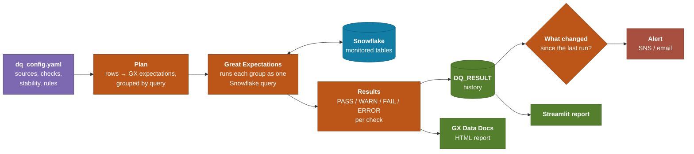
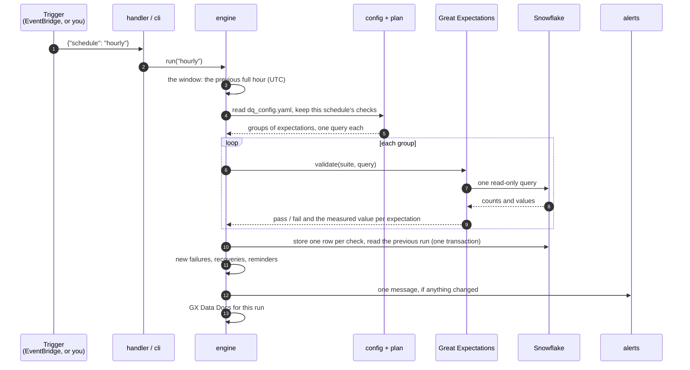

# How the framework works

This section explains the data quality framework in `dq-framework/`: how one run works, how to set it
up, how to configure it, how to run it, and what each code module does. To move it to AWS, see
[Lift and shift to AWS](../dq-aws/index.md).

| Page | Read it when you want to |
| --- | --- |
| [End-to-end flow](end-to-end.md) | See the whole journey, from writing a check to the alert and the report, with every service on the way |
| [One-time setup](setup.md) | Connect it to Snowflake for the first time |
| [Configuration](configuration.md) | Change what is checked or add a business rule (`dq_config.yaml`), or change the settings |
| [Running it](running.md) | Run checks, read the results, alerts and reports, and run the tests |
| [The code, module by module](modules.md) | Change the code, or understand where something happens |

## In one paragraph

A **YAML file** (`config/dq_config.yaml`) lists the tables to watch, the checks to run on them, and
the business rules. On a schedule (hourly or daily), the framework reads the file and turns each check
into a **Great Expectations (GX) expectation**. GX runs these against **Snowflake** and returns pass or fail with the measured value.
The framework then stores **one row per check** in a Snowflake results table and works out what
changed since the last run. It **emails an alert** when something starts failing, recovers, or keeps
failing. It also writes **GX's own HTML report**. The same code runs on your laptop, in a Lambda in
LocalStack, and in a Lambda in AWS.

## One run, step by step

1. **Trigger.** In AWS, EventBridge invokes the Lambda at 20 past each hour with `{"schedule": "hourly"}`,
   and at 01:30 UTC with `{"schedule": "daily"}`. On a laptop, you run `dqf run hourly`.
2. **Window.** An hourly run checks the **previous full hour**: a run at 10:20 checks 09:00–10:00. A
   daily run checks the **previous full day**. The 20 minutes leave time for late data to load.
3. **Plan.** Only the sources with that schedule are used. Their checks become GX expectations,
   grouped so that each group is **one Snowflake query** (see [Plan](modules.md#planpy)).
4. **Validate.** GX runs each group through its built-in Snowflake data source. Only counts and
   measured values come back: the framework never downloads the monitored rows.
5. **Record.** Each check becomes one row in `DQ_RESULT`. Re-running a window replaces that window's
   rows, so runs can be repeated safely.
6. **Decide.** The framework compares this run with the previous run of the same schedule. It alerts on a
   check that **started failing**, **recovered**, or has been failing for another 24 hours (a
   reminder). A check that keeps failing does not send an email every hour.
7. **Alert and report.** One email per run lists every change, explains each problem in plain words,
   and gives a query to see the rows. GX's HTML report is written for the run.

## Two kinds of monitoring

| Kind | Question | Schedule | Example |
| --- | --- | --- | --- |
| **Data checks** | Is the data valid, complete, and still arriving? | hourly (or daily) | `AVG_TICKET` empty in 57% of rows; no applications for 3 hours |
| **Drift checks** (PSI / CSI) | Does recent data still look like the benchmark the model was built on? | daily | `MF_SCORE` PSI 0.55 against the benchmark: a large shift |

Underwriting uses both, on the A1 record. The Risk Monitoring feature store mostly uses daily checks:
whether the day's load arrived, missing features, and CSI per top feature.

## Where Great Expectations is used, and where it is not

| Part | Done by |
| --- | --- |
| Connecting to Snowflake for the checks | **GX**: `context.data_sources.add_snowflake` (GX's Snowflake support, through the Snowflake connector) |
| Each check | **GX expectations** from its gallery, e.g. `ExpectColumnValuesToNotBeNull`, `ExpectColumnValuesToBeInSet`, `ExpectTableRowCountToBeBetween` |
| Business rules | **GX** built-in expectations restricted by a **row condition** (`when` / `then` in the configuration, no SQL) |
| Custom checks (e.g. the SSN / Tax ID derivation) | **GX custom expectations** (`src/dqf/expectations.py`): a per-row metric with a Snowflake (SQLAlchemy) version |
| PSI / CSI | Computed in Snowflake SQL; **GX** `ExpectColumnMaxToBeBetween` judges the result against the limit |
| The HTML report | **GX Data Docs** |
| Reading the configuration, scheduling, the history, alert decisions, the email | The framework's own code; GX does not do these |
