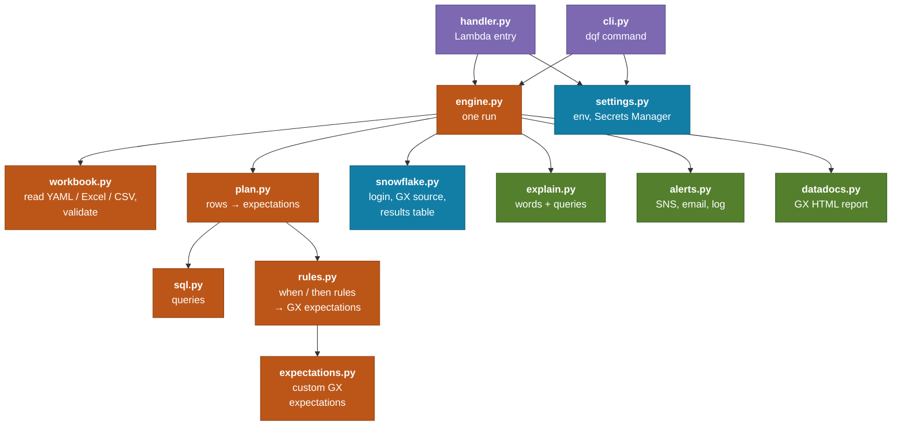
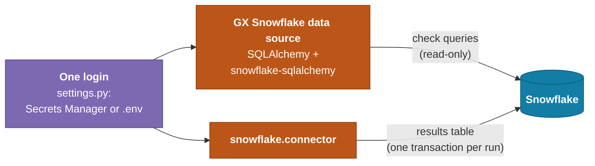

# The code, module by module

## The folder

```text
dq-framework/
├── src/dqf/                  the code: the only code that goes to AWS
├── config/dq_config.yaml     the checks and business rules (the main configuration)
├── config/dq_config.xlsx     the same, as Excel; config/sheets/*.csv: the same, as CSVs (generated)
├── sql/                      Snowflake: 01_setup.sql (user, role, warehouse), 02_sample_table.sql
├── Dockerfile                the Lambda image for AWS
├── requirements.in / .txt    what the Lambda installs (pinned)
├── infra/                    cloudformation.yaml (AWS and LocalStack), deploy.sh (AWS)
├── local/docker-compose.yml  LocalStack 4.9 and a local mail inbox
├── scripts/                  local.py (LocalStack), make_snowflake_key.sh, build_config.py
├── app/streamlit_app.py      the report
├── tests/                    unit tests; opt-in tests for Snowflake and LocalStack
├── Makefile                  shortcuts: `make help`
└── .env.example              settings template (.env is git-ignored)
```

Only `src/dqf/`, `config/dq_config.yaml` and `requirements.txt` go into the AWS image. Everything else is for
development.

## How the modules depend on each other



## Entry points

### `handler.py`

The AWS Lambda entry point (`dqf.handler.handler`). EventBridge calls it with an event:

| Event | Does |
| --- | --- |
| `{"schedule": "hourly"}` / `{"schedule": "daily"}` | One scheduled run |
| `+ "window_end": "2026-10-17 10:00"` | Check the window ending then (UTC), for a manual re-run |
| `+ "send_alerts": false` | Store results, send nothing |
| `{"action": "test_alert"}` | Send a test message through the alert channels, nothing else |

It returns the run's counts (checks, passed, failed, alerts sent, report location). It keeps the engine
between calls while the Lambda container is warm, and imports GX lazily, because GX takes seconds to
import and Lambda allows 10 seconds for start-up.

### `cli.py` and `__main__.py`

The `dqf` command (`python -m dqf` works too). It reads `.env`, then calls the same engine as the
Lambda: `run`, `backfill`, `validate`, `init`, `check-connection`, `describe-table`, `test-alert`,
`show`. It prints one line per check.

### `settings.py`

Reads every setting from environment variables into one `Settings` object. The Snowflake login comes
from **Secrets Manager** when `DQF_SNOWFLAKE_SECRET_ID` is set (AWS and LocalStack), otherwise from the
`SNOWFLAKE_*` variables (a laptop). The rest of the code never reads the environment directly, so it
behaves the same everywhere.

## The run

### `engine.py`

One run from start to finish. `Engine.run(schedule, end)`:

1. Works out the window (`plan.windows`).
2. Loads the configuration (YAML, Excel or CSV) and keeps the sources with this schedule.
3. For each group from `plan.plan`, builds a GX `ExpectationSuite`, adds the group's query as a GX
   **query asset** on the Snowflake data source, and runs `batch.validate(suite)`. A group that breaks
   (bad SQL, missing column) marks its checks `ERROR` and the run continues.
4. Turns GX's results into rows: `PASS`, `WARN` (PSI / CSI between the warn and fail limits), `FAIL`,
   or `ERROR` (GX could not evaluate it). GX is told not to fetch example values
   (`partial_unexpected_count: 0`), and any it returns are dropped. Only the counts in `SAFE_KEYS` are
   kept.
5. Adds a plain-language explanation and a "see the rows" query to each row (`explain.py`).
6. Stores the rows and reads the previous run (`snowflake.record`).
7. `decide()` picks the new failures, recoveries and reminders. Only checks with `ALERT = Yes` count,
   and `WARN` never alerts by itself.
8. Builds the GX report (`datadocs.py`) and sends one alert (`alerts.py`) if anything changed.

`Engine.backfill(schedule, periods)` runs past windows, oldest first, without alerts. It reuses one GX
context and one Snowflake data source.

The GX context is **ephemeral** (in memory): no GX project folder, and the Snowflake login is never
written to disk.

### `workbook.py`

Reads the configuration from a path or `s3://`:
- **YAML** (`.yaml`, `.yml`), the main format;
- an **Excel workbook** (`.xlsx`);
- a **folder of CSVs**.

Every format is turned into the same rows (`yaml_rows()` for YAML, `_rows()` for sheets), and then one
function, `_build()`, **validates everything** before anything runs. It reports all problems at once,
each with where it is (`sources.UW_A1_INPUT.checks[3]`, or `Checks row 5`). Among them:
- an unknown key, source or rule;
- a missing limit, a bad regex or a non-numeric value;
- a row filter or rule containing anything but reading (`;`, `--`, `drop`, `insert`, … are refused).

It returns a `Config`:
- **sources**, **checks** and **stability** rows, each with a stable `CHECK_ID` such as
  `UW_A1_INPUT|AVG_TICKET|MISSING_VALUES`. Alerts use the ID to tell "still failing" from "new".
- **rules**: each business rule, checked and read into a `rules.Rule` (its `when` blocks and `then`
  parts). It also adds one check row per rule and source the rule `applies_to`, with the ID
  `SOURCE||RULE_NAME`, so rules are planned, stored and alerted on like any other check.

### `plan.py`

Turns configuration rows into GX expectations (`BUILDERS`: one per check type; `rules.build` for
business rules) and **groups them by the
query they run on**, so each group needs only one Snowflake query:

| Group | Query | Checks in it | Named in the GX report |
| --- | --- | --- | --- |
| Window | The source's rows in the window | All standard checks and the business rules | `hourly.UW_A1_INPUT.checks` |
| Freshness | Hours since the newest row of the whole table | `FRESHNESS` | `hourly.UW_A1_INPUT.freshness` |
| Comparison | The window joined to the other source; one 0/1 flag column per check | `SOURCE_COVERAGE`, `MATCHES_SOURCE`, `LOST_IN_MAPPING` | `hourly.A.compared_with_B` |
| Stability | PSI / CSI computed in SQL, one row | One `PSI` or `CSI` | `daily.UW_A1_DAILY.drift_MF_SCORE` |

It also holds `windows()` (previous full hour or day), `criteria_text()` (the limit in words) and
`metric_name()`.

### `sql.py`

The Snowflake SQL behind the groups: `window_query`, `freshness_query`, `compare_query` and
`stability_query` (binning at benchmark quantiles or top categories, a missing-value bin, and a small
floor on empty bins so the logarithm is defined). Every query is **read-only** and starts with `SELECT`,
as GX requires. When a period has no rows, `NO_ROWS` (999999) makes the check fail instead of passing
silently.

### `rules.py`

The rule vocabulary: the words of `when` and `then` (`is`, `in`, `at_least`, `between`, `present`,
`matches`, `equals_field`, …).
- `parse_rule()` reads and checks a rule. It is plain Python, so validation needs no GX.
- `build()` turns each `then` field into a built-in GX expectation, with the `when` blocks as its
  **row condition** (`Column("DECISION") == "AUTO_APPROVE"`; blocks joined with `&` and `|`). A rule
  using `check:` becomes that custom expectation.
- `text()` writes the rule in words, for the criteria and the alert.
- `breaks_sql()` writes the condition for the alert's "see the rows" query. GX writes the SQL that
  actually runs.

The engine (`engine.combine()`) merges the parts of a rule into one result: it fails if any part
fails and reports the worst part. The current rules, all in `dq_config.yaml`:

| Rule | Checks |
| --- | --- |
| `SSN_TAX_ID_MATCH_DERIVED` | `SSN_TAX_ID_MATCH` follows the documented derivation (`1`, `0`, `Z`) |
| `SCORES_IN_RANGE` | MF, IT and CR scores are between 300 and 900 |
| `MINIMUM_DATA_FOR_MODEL` | A model with the Experian component is used only when the bureau and BizID returned data |
| `DECISION_MATCHES_SCORE` | No auto-approval with a merchant fraud score below 400 |

See [Business rules](configuration.md#business-rules) to add one.

### `expectations.py`

Custom GX expectations for logic that field conditions cannot express, written by a developer and used
by rules by name (`check: …`). Each is built the GX way: a `MulticolumnMapMetricProvider` with a
per-row condition for SQLAlchemy (Snowflake) and pandas (tests), and a `MulticolumnMapExpectation`
that uses it, so it gets `mostly`, percentages and row conditions for free. `CHECKS` registers each one
with a sentence for the alerts and a condition for the "see the rows" query. Today it has one:
`ssn_tax_id_match_follows_derivation`.

## Input and output

### `snowflake.py`

Everything that talks to Snowflake:

- **Login**: key pair (the service user), password, or browser SSO (laptop only). Every session runs in
  UTC.
- **`add_gx_source`**: registers GX's built-in Snowflake data source (`context.data_sources.add_snowflake`)
  with that login. GX runs all the check queries through it.
- **`column_names_without_rows`**: GX 1.24 learns a query asset's column names by running the query
  unchanged, which returns the window's rows. This makes it run `select * from (…) limit 0` instead:
  the same names, no rows.
- **The results table**: `ensure_result_table` creates it. `record` stores one run in one transaction: it
  reads the previous run's statuses and when each failing check started failing, deletes any earlier
  rows for the same window, and inserts the new rows.
- `read_results`, `whoami`, `describe`: read-only helpers for the CLI and tests.

It writes to no table except the results table.

#### How it connects to Snowflake

There are two connection paths. Both use the Snowflake Python connector underneath, and each does a
different job:

| Job | Connection | Code |
| --- | --- | --- |
| **The checks**: every expectation, business rule and PSI / CSI | **GX's built-in Snowflake data source**, `context.data_sources.add_snowflake(...)`. GX goes through SQLAlchemy and `snowflake-sqlalchemy`, which use the connector | `add_gx_source()` |
| **The results table**: create it; read the previous run; delete and insert this run | **The Snowflake Python connector directly**, `snowflake.connector.connect(...)` | `connect()`, `ensure_result_table()`, `record()` |
| `dqf check-connection`, `describe-table`, `show`, the Lambda's `check` action | The connector directly | `whoami()`, `describe()`, `read_results()` |
| The Streamlit report | The connector on a laptop; the app's own Snowpark session in Streamlit in Snowflake | `app/streamlit_app.py` |

**Why two paths:**

- **The checks go through GX.** That is the point of using GX: it compiles each expectation to SQL
  that runs inside Snowflake, so only counts and measured values come back, never the rows.
- **The results go through the connector.** GX validates data but does not write tables. Storing a
  run also needs one transaction: read the previous statuses, delete any earlier rows for the
  window, insert the new ones. That is simpler and safer with the connector.



**One login for both:**

- `settings.py` builds a single login dictionary: from Secrets Manager when `DQF_SNOWFLAKE_SECRET_ID`
  is set (AWS, LocalStack), otherwise from `.env`.
- Key pair (the `DQF_SVC` service user) is the default. Password and browser single sign-on (laptop
  only) also work.
- The private key is loaded once. GX gets it as base64 text and the connector as raw bytes, because each
  library expects a different format.
- Both paths set the same session options: `TIMEZONE = UTC`, and
  `platform_detection_timeout_seconds = 0`. The second skips a cloud-metadata probe that costs about
  2 seconds at every login.

**Connections per run:**

- **The checks:** the GX data source is created once per `Engine` and reused for every check group.
  It is also reused across a backfill and across invocations while the Lambda container stays warm. Each
  group is one query on it.
- **The results table:** the connector opens one short connection to store a run, then closes it. One
  more short connection creates the results table the first time.

### `explain.py`

For each result, `explain()` writes a sentence a person can act on, e.g. *"BUREAU_INQUIRY_STATUS has a
value other than 'CY' in 75.0% of rows (24 of 32 rows); at most 10% allowed. For a source status field
this means the source did not return data for those applications."* `investigate_sql()` writes a
Snowflake query that shows the rows (or, for drift, the two periods side by side). These go into the
alert, not the results table.

### `alerts.py`

Builds the message and sends it.

- `subject()`, `body()` (plain text, for SNS and the log) and `body_html()` (for email) build the
  message: new problems, still failing, recovered, and everything else not passing.
- `report_link()` builds the link to the Streamlit report from `DQF_REPORT_URL`. It adds
  `?schedule=…&window=…` so the report opens on this run. A Snowsight address is linked as it is,
  because its route after `#` would lose the parameters.
- Channels: `sns` (publish to the topic; SNS emails the subscribers), `email` (SMTP, HTML and text),
  `log` (print). A channel that fails is logged and does not stop the others.

### `datadocs.py`

GX's own HTML report. After each validation the engine hands the result to a second GX context that
only stores results and renders pages. For a folder target it builds in place. For an `s3://` target
(Lambda), GX 1.x has no S3 store, so it builds in `/tmp`: it first downloads the last 7 days of results,
so the index shows recent history, then uploads the new pages. If the report fails, the run is not
affected.

## Outside `src/`

| File | Does |
| --- | --- |
| `app/streamlit_app.py` | The report on the results table. Does not import `dqf`, so it runs as one file in Streamlit in Snowflake. Opens on the run named by `?schedule=&window=` |
| `scripts/publish_report.py` | `make report-publish`: uploads the app to a stage and creates or updates the Streamlit in Snowflake app `DQ_REPORT`; prints its address |
| `scripts/local.py` | LocalStack: build the Lambda folder, store the login in Secrets Manager, deploy the template, invoke, read SNS messages and logs. Talks only to `localhost:4566` |
| `scripts/build_config.py` | Converts the configuration between YAML, Excel and a CSV folder (`make config-xlsx`, `make config-from-xlsx`); refuses a configuration with problems |
| `scripts/make_snowflake_key.sh` | The service user's key pair |
| `infra/cloudformation.yaml` | Every AWS resource. See [What gets created](../dq-aws/index.md#what-gets-created) |
| `infra/deploy.sh` | Build and push the image, deploy the stack, upload the configuration |
| `Dockerfile` | The Lambda image: AWS's Python 3.12 Lambda base, the pinned requirements, `dqf`, `dq_config.yaml` (a fallback) |
