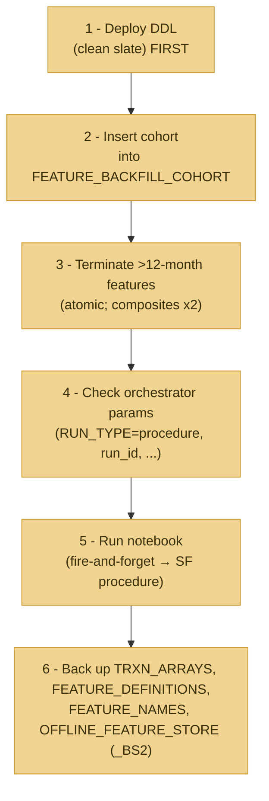
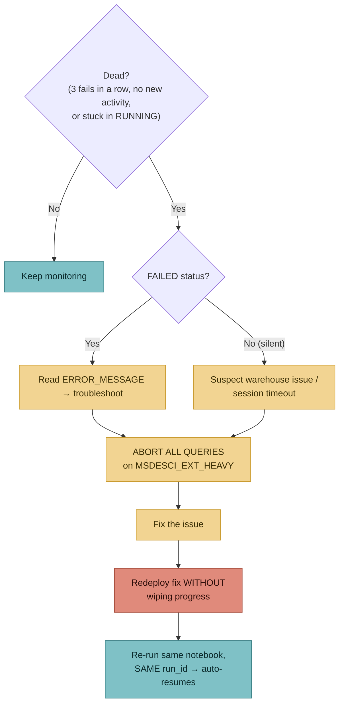

# Backfill runbook

Running the feature store pipeline over a set of **merchant / observation-date** pairs is called a
**backfill**. This page is the operational guide: how to kick one off, monitor it, and restart it after a
failure. It consolidates the walkthrough and the _"Feature Store Backfill"_ instructions email.

!!! danger "Read this before you deploy anything"
The DDL deploy **drops and recreates everything** (a clean slate), *including* `FEATURE_BACKFILL_COHORT`
and your in-flight progress. **Deploy first, insert the cohort second.** Never deploy in the middle of a
run to "apply a fix" without understanding that it wipes progress — see [Restart on failure](#restart-on-failure).

## What a backfill request looks like

The RM developers hand you a table of **`merchant_id` + `obs_date`** combinations (e.g.
`AP_SBX_GBSRISK.RMDEV.MERCHANT_BASE_OBS_DATE_LIST_2`). Notes:

- The same date (e.g. Oct 1) appears many times; dates are otherwise scattered. A merchant may appear once
  or dozens of times.
- For **each** merchant/observation-date, the pipeline generates the **full feature set for that merchant
  on that specific day**.

!!! tip "Do a little analysis first"
Before running, eyeball the cohort: how many merchants, how many observation dates, and the distribution.
It sets expectations for runtime (a large backfill can run for **days**).

## Prerequisites

- Clone the **Feature Store** GitLab repo; use branch **`cr_agg_rmi_info-as-input`**.
- Place the Snowflake private key file in `C:\Users\<LAN ID>\.snowflake`.
- Note the **`PRIVATE_KEY_PASSPHRASE`** — you'll be prompted when you run any notebook.
- You'll need **DBA privilege** on the warehouse to abort queries during recovery.

!!! note "Repo layout"
The project mirrors the underwriting-models repo: same GitLab CI/CD pipeline, `.infra`, `data`,
`notebooks`, `source`. The infrastructure here is **pure DDL** (no AWS component) — it operates inside the
`FEATURE_ENG` schema.

## Running a backfill — step by step

!!! warning "Order matters"
Steps **1 → 2 → 3 → 4 → 5 → 6**. In particular, **DDL deploy (step 1) comes before the cohort insert
(step 2)**, because the deploy wipes the cohort table.

### 1. Create a clean slate (deploy the DDL) — do this FIRST

The first DDL script drops everything in the `FEATURE_ENG` schema and recreates it from scratch. Deploy
by **either**:

- Running the notebook **`notebooks/deploy_ddl.ipynb`**, **or**
- Pushing to a non-`main` branch so the **GitLab CI/CD runner** executes the DDL scripts.

### 2. Insert the cohort into `FEATURE_BACKFILL_COHORT`

Pick a **`run_id`** (e.g. `big_sample_2`) and insert the merchant/observation-date pairs. `INSERT INTO`
adds rows; unspecified columns default to null — the other columns don't matter much.

```sql
insert into AP_SBX_GBSRISK_AUTO.FEATURE_ENG.FEATURE_BACKFILL_COHORT (run_id, mrch_no, feature_date)
select
    'big_sample_2' as run_id,
    merchant_id    as mrch_no,      -- source merchant_id → target mrch_no
    obs_date       as feature_date  -- source obs_date    → target feature_date
from AP_SBX_GBSRISK.RMDEV.MERCHANT_BASE_OBS_DATE_LIST_2;
```

### 3. Terminate long-window features { #terminate-long-window-features }

Because these samples use a **366-day (12-month) lookback**, any feature whose window needs **more than 12
months** of monthly history can't be computed — the arrays won't hold that history. Terminating them tells
the engine not to waste computation on features it can't produce.

!!! info "Why this is needed"
Monthly arrays *can* hold up to 36 months, but the backfill only builds a 12-month lookback. A feature
asking for a >12-month monthly window would have no data → a wasted (and wrong) computation.

```sql
-- (a) Terminate ATOMIC features whose monthly time window exceeds 12 months,
--     except consecutive-streak calcs (which only use a max window).
UPDATE feature_definitions
SET termination_dt = '2023-01-01'
WHERE calculation NOT LIKE '%consecutive%'
  AND inp_col1 LIKE '%_mly'
  AND array_max(transform(split(time_window1, '-'), v -> try_to_number(v::varchar))) > 12;
```

```sql
-- (b) Terminate COMPOSITE features that depend on a now-terminated upstream feature.
--     RUN THIS ONE TWICE — there are two layers of composites.
UPDATE feature_definitions fd
SET fd.termination_dt = '2023-01-01'
WHERE ((fd.inp_type1 = 'feature' AND fd.inp_col1 IN (
          SELECT feature_id::VARCHAR FROM feature_definitions WHERE termination_dt IS NOT NULL))
    OR (fd.inp_type2 = 'feature' AND fd.inp_col2 IN (
          SELECT feature_id::VARCHAR FROM feature_definitions WHERE termination_dt IS NOT NULL)))
  AND fd.termination_dt IS NULL;
```

!!! danger "Run statement (b) twice"
Composites can depend on other composites (two layers). The first pass terminates composites built on
atomic features; the second pass catches composites built on *those* composites.

### 4. Check the orchestrator parameters

Open **`notebooks/backfill_orchestrator.ipynb`** and confirm:

| Parameter                   | Value          | Notes                                                        |
| --------------------------- | -------------- | ------------------------------------------------------------ |
| `RUN_TYPE`                  | `'procedure'`  | **Use `procedure`**, not local — see below.                  |
| `run_id`                    | `'big_sample_2'` | **Must match** the `run_id` you inserted in step 2.         |
| `lookback_days`             | `366`          | Agreed one-year lookback; leave as-is.                       |
| `platform`                  | `None`         | Leave default.                                               |
| `subplatform`               | `None`         | Leave default.                                               |
| `step2_merchant_shard_fanout` | `1`          | Leave default.                                               |
| `max_stage_retries`         | `2`            | Failed steps auto-retry this many more times.                |

!!! warning "`RUN_TYPE = procedure`, not local"
`local` runs the whole thing inside your notebook — which must stay alive for **4–5 days straight**.
`procedure` launches a **server-side Snowflake stored procedure**: fire-and-forget. You can close your
laptop.

### 5. Run the notebook (fire-and-forget)

Running the notebook kicks off the server-side procedure (for `RUN_TYPE = local` it instead calls
`backfill_orchestrator_main` in-process). The notebook itself returns quickly; the real work continues on
the server.

### 6. Back up the outputs when it completes

When the run finishes, back up these tables with a run-specific suffix (e.g. `_BS2` for "Big Sample 2"):

- `TRXN_ARRAYS`
- `FEATURE_DEFINITIONS`
- `FEATURE_NAMES`
- `OFFLINE_FEATURE_STORE`



## Monitoring the backfill

Because the run is fire-and-forget, **no error pops up in the notebook**. Watch these instead:

| Table                        | What it tells you                                                                         |
| ---------------------------- | ----------------------------------------------------------------------------------------- |
| `FEATURE_BACKFILL_PROGRESS`  | **Primary monitor.** Every Step 1 / Step 2 execution with a `STATUS` of `SUCCESS` / `FAILED` / `RUNNING`. Order by `started_ts desc` for the latest activity on top. |
| `PROCEDURE_LOG`              | Lower-level, job-specific detail — use when a step is stuck.                               |
| `TRXN_ARRAYS`                | Watch arrays build up per merchant as a liveness signal.                                   |

```sql
select * from AP_SBX_GBSRISK_AUTO.FEATURE_ENG.FEATURE_BACKFILL_PROGRESS
order by started_ts desc;
```

!!! note "Auto-retry"
A failed **Step 2** is automatically retried up to `max_stage_retries` (2) more times before it's
considered failed.

## Restart on failure

### Step 1 — decide if it's actually dead

- A step that has **failed 3 times in a row** is dead.
- It can also be dead silently: **no new activity** for a long time in `FEATURE_BACKFILL_PROGRESS` or
  `PROCEDURE_LOG`, or a step **stuck in `RUNNING`**.

### Step 2 — diagnose

- If you see a **`FAILED`** status, read the **`ERROR_MESSAGE`** column and troubleshoot (Copilot helps).
- A **silent** death (no `FAILED`) is harder — the usual culprits are a **warehouse issue** or a
  **session timeout**.

### Step 3 — kill orphaned queries

A failure doesn't guarantee everything stopped — child queries can be orphaned and keep running. Abort
everything on the warehouse:

```sql
ALTER WAREHOUSE MSDESCI_EXT_HEAVY ABORT ALL QUERIES;
```

!!! warning "This affects teammates"
This kills **all** queries on that warehouse, not just yours. Give your team a heads-up first.

### Step 4 — fix, then redeploy *carefully*

Fix the underlying issue. Then **be very careful deploying the fix**:

!!! danger "Do NOT lose your progress"
A **default deploy creates a clean slate** and wipes the run so far. Make sure however you apply the fix
does **not** re-run the full DDL drop against your in-flight cohort/progress.

### Step 5 — resume

Re-run the **same notebook** with the **same `run_id`**. The orchestrator is smart enough to read
`FEATURE_BACKFILL_PROGRESS` and **resume where it left off** — so keeping the same `run_id` is essential.



## Quick reference

| Thing                        | Value                                                              |
| ---------------------------- | ------------------------------------------------------------------ |
| Repo / branch                | **Feature Store** / `cr_agg_rmi_info-as-input`                     |
| Orchestrator notebook        | `notebooks/backfill_orchestrator.ipynb`                            |
| DDL deploy notebook          | `notebooks/deploy_ddl.ipynb`                                       |
| Cohort table                 | `AP_SBX_GBSRISK_AUTO.FEATURE_ENG.FEATURE_BACKFILL_COHORT`          |
| Progress monitor             | `AP_SBX_GBSRISK_AUTO.FEATURE_ENG.FEATURE_BACKFILL_PROGRESS`        |
| Low-level log                | `AP_SBX_GBSRISK_AUTO.FEATURE_ENG.PROCEDURE_LOG`                    |
| Warehouse                    | `MSDESCI_EXT_HEAVY`                                                |
| Lookback                     | `366` days (12 months)                                             |
| Tables to back up on finish  | `TRXN_ARRAYS`, `FEATURE_DEFINITIONS`, `FEATURE_NAMES`, `OFFLINE_FEATURE_STORE` |

!!! note "Where this is inferred"
The step sequence, parameters, SQL and recovery procedure come directly from the walkthrough and the
backfill email. Schema prefixes (`AP_SBX_GBSRISK_AUTO.FEATURE_ENG`) are taken from the email's examples;
confirm the exact database/schema for your environment (sandbox vs. prod) before running.
