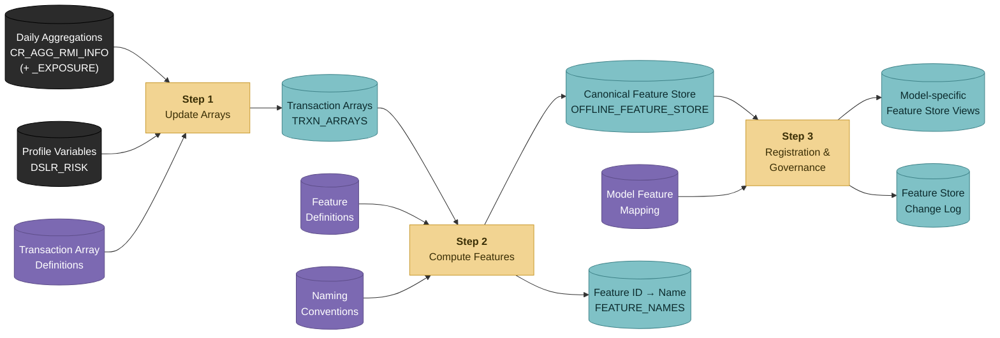

# Feature Risk Monitoring — feature store pipeline

This section documents the **Risk Monitoring (RM) Feature Store pipeline** — a Snowflake-based pipeline
that turns daily merchant transaction aggregations into a large library of time-series **features** used
by the risk-monitoring models (attrition, sales, fraud, credit).

!!! info "Sources"
This is derived from a walkthrough recording of the feature store pipeline, the _"Risk Monitoring –
Feature Stores"_ diagram, and the _"Feature Store Backfill"_ instructions email. Where something is an
interpretation rather than stated in those sources, it is marked **(inferred)**. Illustrative example
values (merchants, feature numbers, sample data) are marked **(illustrative)**.

!!! note "This is a different system from Underwriting"
The [Underwriting Decisioning](../data-flow.md) service is a **real-time, synchronous** scoring service
on AWS. This pipeline is a **batch, Snowflake-native** feature-engineering pipeline. They share
*terminology* ("primitive vs composite") and both live under Risk/Merchant Solutions, but they are
separate systems with separate code and data.

## The pipeline in one picture

Everything inside the dotted boundary is the **feature store pipeline**. It is a **three-step** process
(the yellow boxes). Black cylinders are **upstream inputs**, purple cylinders are **config tables**, and
blue/teal cylinders are **pipeline tables / outputs**.

## The three steps

| Step                                       | Input                                                                                   | Output                                                                | In one line                                                                      |
| ------------------------------------------ | --------------------------------------------------------------------------------------- | --------------------------------------------------------------------- | -------------------------------------------------------------------------------- |
| **[1 — Update Arrays](step1-arrays.md)**   | Daily Aggregations + Profile Variables, driven by **Transaction Array Definitions**     | **Transaction Arrays** (`TRXN_ARRAYS`)                                | Build/extend per-merchant rolling arrays of daily & monthly activity.            |
| **[2 — Compute Features](step2-features.md)** | Transaction Arrays, driven by **Feature Definitions** + **Naming Conventions**         | **Canonical feature store** (`OFFLINE_FEATURE_STORE`) + **Feature Names** | Run calculations over the arrays to produce the full feature library.            |
| **[3 — Registration & Governance](step3-registration.md)** | Canonical feature store, driven by **Model Feature Mapping**           | **Model-specific feature store views** + **Change Log**               | Pivot each model's selected features into wide, inference-ready views.            |

The code lives in the **Feature Store** GitLab repo. Running the pipeline over a set of merchant /
observation-date pairs is called a **backfill** — see the [Backfill runbook](backfill-runbook.md).

## The scale problem (why this is hard)

- **~3 million merchants**, features generated **every day**.
- The daily aggregation source holds **~5,000** variables per merchant per day.
- The pipeline maintains **~821 arrays** per merchant (per the array-definitions table).
- A training-sample request from the modelling team was on the order of **~300,000 features** — each of
  which must be generated for every merchant. _"It's a big scaling problem."_

This is why the canonical feature store is stored **long** (one row per feature), the arrays cap at a
**366-day** lookback, and the backfill runs as a **server-side, fire-and-forget** Snowflake procedure.

## Key tables at a glance

| Table                     | Type              | Role                                                                          |
| ------------------------- | ----------------- | ----------------------------------------------------------------------------- |
| `CR_AGG_RMI_INFO`         | Upstream          | Daily aggregated transaction data — **base** (one row per merchant per day).  |
| `CR_AGG_RMI_INFO_EXPOSURE`| Upstream          | Same, but only transactions where **Fiserv owns the risk** (**exposure**).    |
| `DSLR_RISK`               | Upstream          | Profile variables — merchant snapshots (status, install date, region, …).     |
| Transaction Array Definitions | Config        | Which attributes to collect into which arrays (`source`, `source_group`, `cadence`). |
| `TRXN_ARRAYS`             | Pipeline output   | One row per merchant; the rolling daily/monthly arrays.                        |
| Feature Definitions       | Config            | The calculation for every feature (atomic & composite).                        |
| Naming Conventions        | Config            | Abbreviations used to build short, algorithmic feature names.                  |
| `FEATURE_NAMES`           | Pipeline output   | Feature ID → generated feature name mapping.                                   |
| `OFFLINE_FEATURE_STORE`   | Pipeline output   | The canonical feature store (long format).                                     |
| Model Feature Mapping     | Config            | Model name → the features it needs.                                            |
| Feature Store Views       | Pipeline output   | Wide, per-model, inference-ready views.                                        |

Most pipeline/config tables live in the **`AP_SBX_GBSRISK_AUTO.FEATURE_ENG`** schema **(inferred to be the
sandbox schema used in the walkthrough)**; the upstream sources live under
`GBS_PROD_CRANALYTICS.CRAGGR` and the `DSLR` risk schema.

## Where to go next

- [Step 1: Update Arrays](step1-arrays.md) — the arrays and how they roll.
- [Step 2: Compute Features](step2-features.md) — atomic vs composite features, naming.
- [Step 3: Registration & Governance](step3-registration.md) — model-specific views.
- [Backfill runbook](backfill-runbook.md) — how to run, monitor and restart a backfill.
