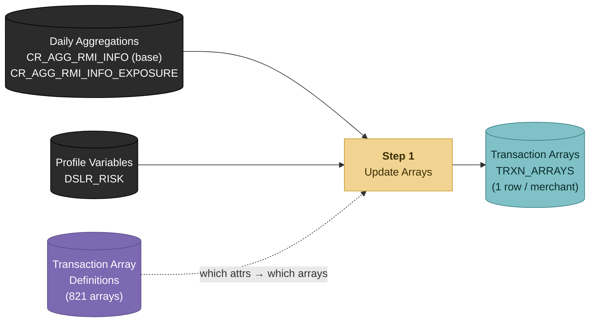
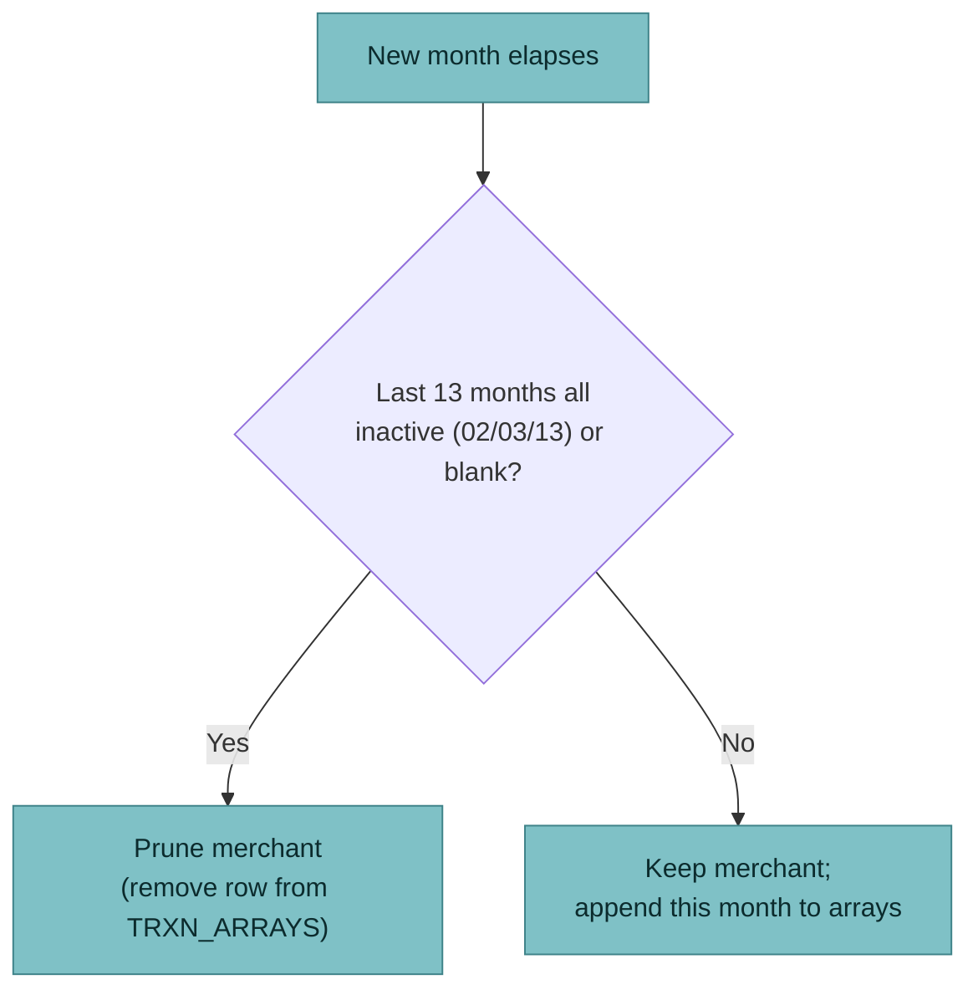
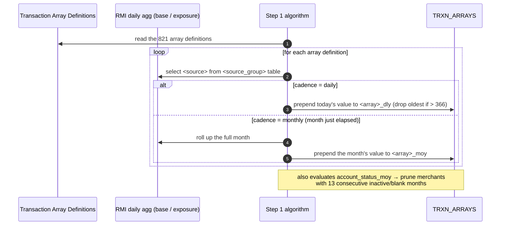

# Step 1 — Update Arrays

Step 1 builds and maintains the **Transaction Arrays**: per-merchant, rolling caches of daily and monthly
activity. These arrays are the raw material every feature in [Step 2](step2-features.md) is calculated on.



## Inputs

### 1. Daily Aggregations (the main input)

Table **`CR_AGG_RMI_INFO`** (referred to as _"CRAG RMI info"_), in `GBS_PROD_CRANALYTICS.CRAGGR`.

!!! warning "This is **not** transaction-level data"
It is **already aggregated to one record per merchant per load date**. For a given merchant on a given
`loaddt` there is a single row holding totals/counts like gross sales amount, chargeback amount,
chargeback count, etc. There are on the order of **~5,000** such variables per merchant per day
(different ways of slicing every transaction — card-present, swiped, keyed, high value, same card,
possibly-foreign card, government card, same-bin, …). The feature store only uses a subset of them.

**Base vs. Exposure — two twin tables:**

| Table                        | What it holds                                                                 |
| ---------------------------- | ----------------------------------------------------------------------------- |
| `CR_AGG_RMI_INFO`            | The **base** table — all transactions.                                        |
| `CR_AGG_RMI_INFO_EXPOSURE`   | The **exposure** table — *same schema*, but only transactions where **Fiserv owns the risk**. |

Both are considered "daily aggregations". Which one an array pulls from is chosen per-array via the
`source_group` column in the definitions table (see below).

```sql
-- illustrative: inspect one merchant for one day (filters are required or the query is very slow)
select mrch_no, platform, loaddt, dly_grs_sls_amt, dly_cr_opn_tot_disp_chgbk_amt
from GBS_PROD_CRANALYTICS.CRAGGR.CR_AGG_RMI_INFO
where loaddt = '2026-08-01'
  and merch_group_lvl = 'Outlet'
  and mrch_no = '<merchant id>'
order by loaddt, platform;

-- the exposure twin is identical except for the table name:
--   ...CRAGGR.CR_AGG_RMI_INFO_EXPOSURE
```

!!! tip "See all available columns"
Because there are thousands of columns, inspect the schema row-wise instead of scrolling:
`select * from information_schema.columns where table_name = 'CR_AGG_RMI_INFO';`

### 2. Profile Variables

Table **`DSLR_RISK`** (_"DSLR risk data"_). One record per merchant per load date, holding **snapshot /
inherent attributes** that don't change day to day:

- Risk monitoring **channel group** names (e.g. region such as Canada).
- **Account status** — e.g. `13` ≈ dormant for some time; `02` / `03` ≈ terminated / off-boarded.
- **First post date** — the merchant's first-ever transaction.
- **Install date** — the actual boarding date.
- Onboarding declarations such as stated **annual volume** and **average ticket**, region, etc.

These flow through to the front of the `TRXN_ARRAYS` row as profile columns.

### 3. Config: Transaction Array Definitions

The purple config table that tells the Step 1 algorithm **which attributes to collect into which arrays**.
In the walkthrough it had **821 rows → 821 arrays** maintained per merchant.

| Column         | Meaning                                                                                      |
| -------------- | -------------------------------------------------------------------------------------------- |
| `array_name`   | The **root** array name (e.g. `gross_sales_amount`).                                          |
| `source`       | Which **column** from the daily-aggregation table to pull (used in a `select` against RMI info). |
| `source_group` | **`base`** or **`exposure`** — which of the twin tables to read from.                          |
| `cadence`      | **`daily`** or **`monthly`** — whether to maintain a daily array, a monthly array, or both.   |

## Output: the Transaction Arrays table (`TRXN_ARRAYS`)

The blue output table. Its defining characteristic:

!!! note "One row per merchant — for all time"
There is **no merchant-date grain** here. Each merchant has exactly **one** row that is updated over
time. The row starts with **profile variables** (from `DSLR_RISK`), followed by the **arrays**.

### Daily arrays (`*_dly`)

- Each **element = one day**, going back in time. The **first element is the latest** entry.
- Capped at a **366-day** lookback. Once full, the **oldest element drops off** as a new day is appended —
  so you only ever have up to **one year** of daily history.
- The `day_snapshot` column tells you which **date** the first element corresponds to; count backwards
  from there.

### Monthly arrays (`*_moy` / "MOY")

- Each **element = one full elapsed month**, starting with the **latest completed month**.
- Built by **rolling up a full month** of daily data once the month has elapsed. (Example: on Oct 2, to
  append September you roll up all of September per merchant and append it.)
- Monthly arrays can go back up to **36 months**. _(Note: Step 2 only uses up to 12 months for the
  366-day-lookback samples — see the [backfill runbook](backfill-runbook.md#terminate-long-window-features).)_
- The `month_snapshot` column tells you which **month** the first element corresponds to; count backwards.

```text
Reading an array (illustrative):
  account_status_moy = [ <Apr-2025>, <Mar-2025>, <Feb-2025>, <Jan-2025>, ... ]
                          ^ first element = month_snapshot
  gross_sales_amount_dly = [ <today-1>, <today-2>, <today-3>, ... up to 366 ]
                             ^ first element = day_snapshot
```

!!! tip "Sanity check: array count matches the definitions"
The number of arrays in `TRXN_ARRAYS` equals the number of rows in the array-definitions table (821 in
the walkthrough). If they diverge, a definition didn't materialise.

## Special case: the account-status monthly array (population pruning)

The **`account_status` monthly array** does double duty — besides being a feature input, it **maintains
the merchant population** in `TRXN_ARRAYS`:

- Inactive signals are statuses **`02`, `03`, `13`** (and **blanks**).
- If a merchant has **13 consecutive months** of inactive statuses or blanks, the merchant is **pruned**
  (completely removed) from `TRXN_ARRAYS`.

This keeps the table from growing without bound as merchants churn.



## How Step 1 builds an array (summary)



## Worked example: one merchant through Step 1 (illustrative)

Follow merchant **`22553150012`** on load date **2026-10-01**. (All numbers here are **illustrative**; we
reuse this same merchant in [Step 2](step2-features.md#worked-example-from-arrays-to-feature-rows) and
[Step 3](step3-registration.md#worked-example-long-to-wide-illustrative).)

### Appending a daily value

One array definition says: pull `DLY_GRS_SLS_AMT` from the **base** table into a **daily** array.

| Definition column | Value                  |
| ----------------- | ---------------------- |
| `array_name`      | `gross_sales_amount`   |
| `source`          | `DLY_GRS_SLS_AMT`      |
| `source_group`    | `base`                 |
| `cadence`         | `daily`                |

On 2026-10-01 the daily-aggregation row for this merchant has `DLY_GRS_SLS_AMT = 400`. Step 1 **prepends**
it (newest first) and drops the oldest element if the array now exceeds 366:

```text
before (day_snapshot = 2026-09-30):  gross_sales_amount_dly = [120, 0, 300, 50, ... ]   (len 366)
append today's value 400 →
after  (day_snapshot = 2026-10-01):  gross_sales_amount_dly = [400, 120, 0, 300, 50, ... ]  (oldest dropped, len 366)
```

The **exposure** twin is a *separate* array fed from `CR_AGG_RMI_INFO_EXPOSURE` (a definition with
`source_group = exposure`). On the same day its value might be `260` → `gross_sales_amount_exp_dly` gets
`260` prepended. Base and exposure never mix within one array.

### Rolling up a monthly value

Because it is now October, **September 2026 has fully elapsed**. For any array with `cadence = monthly`,
Step 1 rolls up the whole month and prepends one element:

```text
roll up all of Sep-2026 daily gross sales → 8,250
before (month_snapshot = 2026-08):  gross_sales_amount_moy = [7,900, 6,540, ... ]
after  (month_snapshot = 2026-09):  gross_sales_amount_moy = [8,250, 7,900, 6,540, ... ]
```

### Population check (pruning)

Suppose this merchant's `account_status_moy` reads
`[13, 13, '', 02, 13, 13, 13, '', 13, 02, 13, 13, 13]` — 13 consecutive inactive/blank months. Step 1
would **prune** the merchant: its entire row is removed from `TRXN_ARRAYS`. (Our example merchant is
active, so it stays.)

Next: [Step 2 — Compute Features](step2-features.md).
