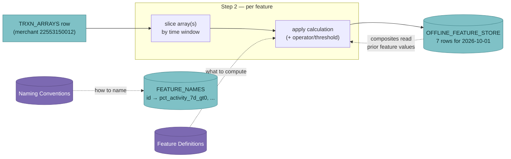
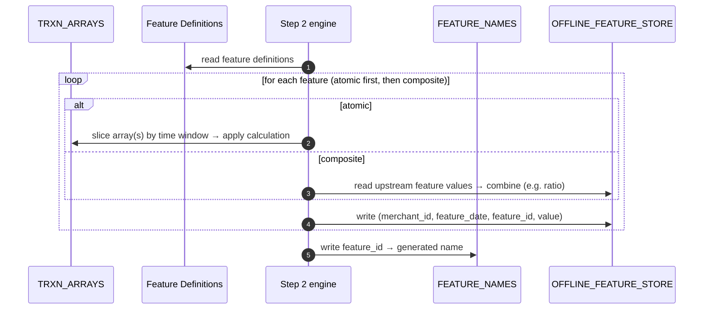

# Step 2 — Compute Features

Step 2 takes the [Transaction Arrays](step1-arrays.md) and runs a large library of calculations over them
to produce the **canonical feature store**. It is driven by two config tables: **Feature Definitions**
(what to calculate) and **Naming Conventions** (how to name the results).

```mermaid
flowchart LR
    TA[("Transaction Arrays<br/>TRXN_ARRAYS")]:::out
    FD[("Feature<br/>Definitions")]:::cfg
    NC[("Naming<br/>Conventions")]:::cfg
    S2["<b>Step 2</b><br/>Compute Features"]:::step
    FS[("Canonical Feature Store<br/>OFFLINE_FEATURE_STORE")]:::out
    FIN[("Feature ID → Name<br/>FEATURE_NAMES")]:::out

    TA --> S2
    FD -. "the calculation per feature" .-> S2
    NC -. "abbreviations for names" .-> S2
    S2 --> FS
    S2 --> FIN

    classDef cfg  fill:#7C69B2,stroke:#5e4e8a,color:#fff;
    classDef step fill:#f2d492,stroke:#c99a2e,color:#3a2e05;
    classDef out  fill:#7fc1c6,stroke:#3f8389,color:#0c2b2d;
```



!!! info "Scale"
A training-sample request was ~**300,000 features**, each generated for **every merchant (~3M)** for
**every day** requested. The canonical store is therefore stored **long** (one row per feature), not
wide.

## Config: Feature Definitions

Every feature is one row. The key columns:

| Column          | Meaning                                                                                   |
| --------------- | ----------------------------------------------------------------------------------------- |
| `feature_id`    | Unique ID for the feature.                                                                 |
| `calculation`   | The operation to perform (e.g. `percent`, `count`, `average`, `percent_compare`, `max_consecutive_monotonic`, `ratio`, …). |
| `inp_col1`      | First input — usually an **array name**; for composites, a **feature ID**.                 |
| `inp_type1`     | **`array`** or **`feature`** — tells the engine whether the input is an array or another feature. |
| `inp_col2` / `inp_type2` | A second input, for calculations that compare/combine two inputs.                 |
| `time_window1`  | The window (see [time windows](#time-windows)).                                            |
| `operator`      | A comparison used by the calculation (e.g. `greater_than`, `less_than`).                    |
| `threshold`     | The value compared against (e.g. `0`).                                                      |

### Two kinds of features

The pipeline reuses the model world's **primitive vs composite** idea (here the walkthrough also called
them **atomic vs composite**):

| Kind                       | Operates on        | How to read it                                                      |
| -------------------------- | ------------------ | ------------------------------------------------------------------- |
| **Atomic** (primitive)     | the **arrays**     | Self-contained — the row tells you the whole calculation.            |
| **Composite**              | other **features** | You must look at the **upstream feature IDs** to know what it means. |

### Time windows

- A plain window (e.g. `7`) means the **most recent N** elements (last 7 days).
- A **hyphenated** window (e.g. `15-28`) is an **offset from today** — "from 15 to 28 days ago", *not*
  starting from the most recent element.

### Worked examples (illustrative feature IDs)

!!! example "Atomic — `percent` (feature #11)"
`calculation = percent`, `inp_col1 = activity_dly`, `inp_type1 = array`, `time_window1 = 7`,
`operator = greater_than`, `threshold = 0`
→ **"the percent of the activity daily array over the last 7 days that was greater than zero."**

!!! example "Atomic — `average` over an offset window (feature #1132)"
`calculation = average`, input = card-present sales **count** **with exposure** (`..._cnt_..._exp`),
`time_window1 = 15-28`, `operator = greater_than`, `threshold = 0`
→ **"the average daily count of card-present sales (exposure) over the window 15–28 days ago, where the
count was greater than zero."** (`EXP` in the name = exposure.)

!!! example "Atomic — `percent_compare` across two arrays (feature #1387, window 10)"
Compares **two** arrays over the **same** window:
→ **"the percent of times over this 10-day period where the declined auth amount was greater than the
approved auth amount."** The window is sliced over *both* arrays simultaneously.

!!! example "Atomic — `max_consecutive_monotonic` (feature #116053)"
`calculation = max_consecutive_monotonic`, input = refund counts, `time_window1 = 365`,
`operator = less_than`
→ **"the longest streak of *consecutive decreases* in refund counts over the last 365 days."**
(`less_than` ⇒ a decreasing streak. For the series `[.. , a, b, c, ..]` it finds the longest run where
each element is smaller than the previous.)

!!! example "Composite — `ratio` of two features (feature #139648)"
`calculation = ratio`, `inp_type1 = feature`, `inp_col1 = 227`, `inp_col2 = 243`.
Upstream: feature **227** = `count` of (approved auth amount > 0) over **7 days**; feature **243** =
same `count` over the **8–14 day** window.
→ **"the ratio of (approved-auth-count, last 7d) to (approved-auth-count, 8–14d ago)."** e.g. 1 vs 2 ⇒
`0.5`. You can't tell what a composite means without resolving its upstream features.

```sql
-- illustrative: resolve a composite by pulling the feature and its two inputs together
select * from feature_definitions
where feature_id in (139648, 227, 243);
```

## Config: Naming Conventions

Feature names are **generated algorithmically** by concatenating the array name + calculation + window +
operator + threshold. Raw, that produces very long names (e.g.
`count_approved_auth_amount_7D_greater_than_0_...`). The **Naming Conventions** table maps each verbose
term → a **short abbreviation** so the generated names stay manageable.

- For **composite** features, the generated name **injects the upstream feature names** (converting those
  inner tokens to camelCase) inside the outer snake_case name — so names can still get long.
- The abbreviations help a lot, but some names remain long by nature.

## Outputs

Step 2 produces **two** tables:

### 1. Feature ID → Name mapping (`FEATURE_NAMES`)

Maps each `feature_id` to its generated name. Join it to the definitions (or to the feature store) to make
either human-readable.

### 2. The canonical feature store (`OFFLINE_FEATURE_STORE`)

This is "the feature store" everyone refers to. It is stored **long**:

!!! note "Grain & shape"
- **Unique key = `merchant_id` + `feature_date` + `feature_id`.**
- One **row per feature** per merchant per feature date (values live in a single value column).
- **Not** model-friendly as-is — ML training wants features as **columns**. It cannot be pivoted wide for
  *all* features: ~**275,000 columns** would collapse Snowflake. Widening only happens per-model in
  [Step 3](step3-registration.md) after feature selection.

!!! tip "Sentinel value `-999`"
A value of **`-999`** means **"not sensible / not computable"** (e.g. a ratio with a zero denominator).
These appear often — the data is **fairly sparse**. Treat `-999` as a null-like default, not a real
measurement.

```sql
-- illustrative: make the long store readable by joining names on
select s.merchant_id, s.feature_date, s.feature_id, n.feature_name, s.value
from offline_feature_store s
join feature_names n using (feature_id)
where s.merchant_id = '<merchant id>'
  and s.feature_date = '2026-10-01';
```

## Worked example: from arrays to feature rows { #worked-example-from-arrays-to-feature-rows }

Let's compute real values for merchant **`22553150012`** on **feature_date 2026-10-01**, using the arrays
built in [Step 1](step1-arrays.md). **All numbers are illustrative** — the point is the arithmetic, not
the values.

### The input arrays (one merchant's `TRXN_ARRAYS` row)

`day_snapshot = 2026-10-01`, so **element 0 = Oct 1 (1 day back)**, element 1 = Sep 30, … The `|` marks
the day-7 / day-8 boundary just to make the windows easy to see:

```text
                              last 7 days          8–14 days ago
activity_dly            = [ 3, 0, 5, 2, 0, 4, 1 | 0, 0, 6, 2, 3, 0, 1 | ... up to 366 ]
approved_auth_amt_dly   = [120, 0,300,50, 0,200,80 | 0, 0,400,90,150, 0,60 | ... ]
declined_auth_amt_dly   = [ 40,10, 0,90, 0, 20,100 | 0, 5, 0, ...                 ]

card_present_sales_cnt_exp_dly   (the 15–28-days-ago slice) = [ 2,0,3,1,0,0,4,2,1,0,5,0,2,3 ]
refund_cnt_dly          (oldest → newest, one 365-day run)  = [ 5, 3, 4, 2, 1, 6, 2 ]
```

The engine computes **atomic** features first (they only need arrays), then **composite** features (which
read other features). Here's each feature type worked out against the arrays above.

### Atomic #11 — `percent` of `activity_dly > 0` over last 7 days

Window = indices 0–6 → `[3, 0, 5, 2, 0, 4, 1]`. Values `> 0`: `3, 5, 2, 4, 1` → **5 of 7**.

> **value = 5 / 7 = 0.714**

### Atomic #227 — `count` of `approved_auth_amt_dly > 0` over last 7 days

Window = indices 0–6 → `[120, 0, 300, 50, 0, 200, 80]`. Values `> 0`: `120, 300, 50, 200, 80` → **5**.

### Atomic #243 — `count` of `approved_auth_amt_dly > 0` over the **8–14-day** window

Hyphenated window `8-14` = an **offset** → indices 7–13 → `[0, 0, 400, 90, 150, 0, 60]`. Values `> 0`:
`400, 90, 150, 60` → **4**.

### Composite #139648 — `ratio` of feature 227 ÷ feature 243

A composite reads the two **feature values just computed**, not the arrays:

> **value = #227 / #243 = 5 / 4 = 1.25**

!!! note "This is why composites are unreadable alone"
Row 139648 only says `ratio, feature, 227, 243`. You must resolve 227 and 243 to know it means
"approved-auth-count last-7d vs 8–14d-ago."

### Atomic #1387 — `percent_compare`: `declined > approved` over last 10 days

Slice **both** arrays over indices 0–9 and compare element-by-element:

| idx | approved | declined | declined > approved? |
| --: | -------: | -------: | :------------------: |
| 0   | 120      | 40       | no                   |
| 1   | 0        | 10       | **yes**              |
| 2   | 300      | 0        | no                   |
| 3   | 50       | 90       | **yes**              |
| 4   | 0        | 0        | no                   |
| 5   | 200      | 20       | no                   |
| 6   | 80       | 100      | **yes**              |
| 7   | 0        | 0        | no                   |
| 8   | 0        | 5        | **yes**              |
| 9   | 400      | 0        | no                   |

**4 of 10** → value = `0.40`.

### Atomic #1132 — `average` of `card_present_sales_cnt_exp_dly` over 15–28 days ago, where `> 0`

Slice = `[2,0,3,1,0,0,4,2,1,0,5,0,2,3]`. Keep only `> 0`: `2,3,1,4,2,1,5,2,3` (nine values, sum = 23).

> **value = 23 / 9 = 2.56**

!!! info "Interpretation of `operator/threshold` here"
`> 0` acts as a **filter** (average only the days that had activity), **(inferred)** from the phrasing in
the walkthrough. If instead it averaged over all 14 days, it'd be `23/14 = 1.64` — confirm the exact
semantics with the team.

### Atomic #116053 — `max_consecutive_monotonic` (decreasing) of `refund_cnt_dly` over 365 days

`operator = less_than` ⇒ find the longest run where each value is **lower than the previous**. On
`[5, 3, 4, 2, 1, 6, 2]`:

```text
5 → 3   decrease  (run: 5,3)
3 → 4   increase  (reset)
4 → 2   decrease
2 → 1   decrease  (run: 4,2,1)  ← longest
1 → 6   increase  (reset)
6 → 2   decrease  (run: 6,2)
```

Longest decreasing run = **3 points** (`4, 2, 1`) → value = `3`.

### The result: rows written to `OFFLINE_FEATURE_STORE` (long)

Each computed value becomes **one row** keyed by merchant + date + feature:

| merchant_id | feature_date | feature_id | value |
| ----------- | ------------ | ---------: | ----: |
| 22553150012 | 2026-10-01   | 11         | 0.714 |
| 22553150012 | 2026-10-01   | 227        | 5     |
| 22553150012 | 2026-10-01   | 243        | 4     |
| 22553150012 | 2026-10-01   | 139648     | 1.25  |
| 22553150012 | 2026-10-01   | 1387       | 0.40  |
| 22553150012 | 2026-10-01   | 1132       | 2.56  |
| 22553150012 | 2026-10-01   | 116053     | 3     |

!!! tip "When a value is `-999`"
If feature 243 had been `0`, the ratio #139648 would divide by zero → the engine writes the sentinel
**`-999`** instead of a number. With sparse data these show up a lot.

### Naming: how `FEATURE_NAMES` labels those rows

The name generator concatenates `calculation + input + window + operator + threshold`, applying the
**Naming Conventions** abbreviations:

| Raw term              | Abbreviation |
| --------------------- | ------------ |
| `count`               | `cnt`        |
| `percent`             | `pct`        |
| `percent_compare`     | `pctCmp`     |
| `approved_auth_amount`| `apprvAuthAmt` |
| `greater_than`        | `gt`         |
| `7 day` / `8-14 day`  | `7d` / `8-14d` |

| feature_id | generated name                                                        | value |
| ---------: | --------------------------------------------------------------------- | ----: |
| 11         | `pct_activity_7d_gt0`                                                  | 0.714 |
| 227        | `cnt_apprvAuthAmt_7d_gt0`                                              | 5     |
| 243        | `cnt_apprvAuthAmt_8-14d_gt0`                                           | 4     |
| 1387       | `pctCmp_declAuthAmt_gt_apprvAuthAmt_10d`                              | 0.40  |
| 139648     | `ratio_cntApprvAuthAmt7dGt0_to_cntApprvAuthAmt8to14dGt0`              | 1.25  |

Notice the **composite** name (139648) **injects the two upstream names** — converting those inner tokens
to camelCase while the whole thing stays snake_case. That's why composite names get long.

### The whole Step-2 flow for this merchant



## Training vs. inference (why "long" is intentional)

- **Training:** the modelling team reads the **canonical long store** directly (a subset of features) and
  reshapes it themselves — because the exact feature set isn't known until *after* feature selection.
- **Inference:** once a model's feature list is fixed, [Step 3](step3-registration.md) pivots just those
  features into a wide, pretty **view**.



Next: [Step 3 — Registration & Governance](step3-registration.md).
