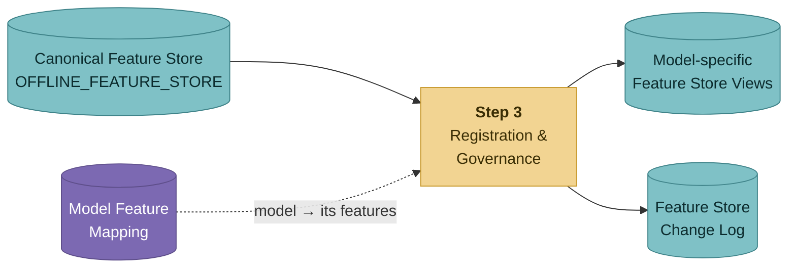
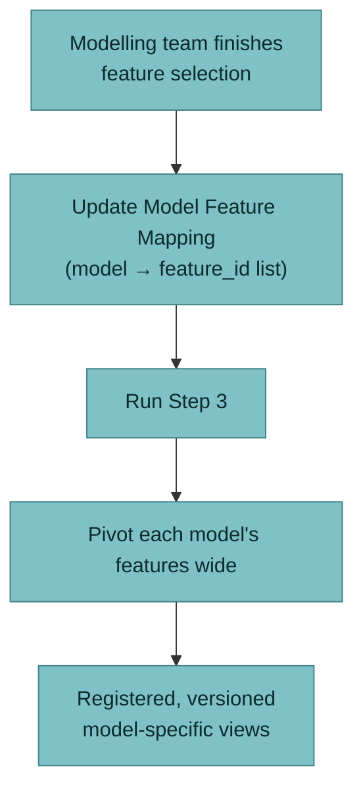
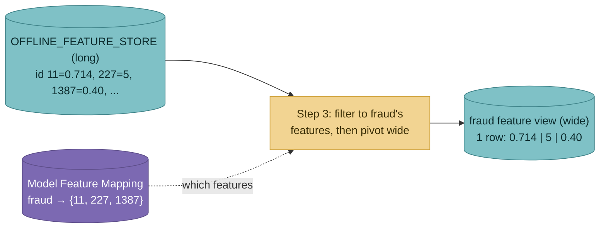

# Step 3 — Feature Store Registration & Governance

Step 3 turns the big, hard-to-read [canonical feature store](step2-features.md#2-the-canonical-feature-store-offline_feature_store)
into **wide, inference-ready views**, one per model. It is the simplest step.

## Config: Model Feature Mapping

A very simple config table: it maps a **model name → the features that model needs**. Models seen in the
walkthrough include **attrition, sales, fraud, credit**.

| Column        | Meaning                                              |
| ------------- | ---------------------------------------------------- |
| `model_name`  | The model the row belongs to (e.g. `fraud`).         |
| `feature_id`  | A feature that model requires.                       |

Conceptually this is a **row-level mask** over the canonical store: "for model X, keep only these
features." Once the modelling team has finished **feature selection**, you simply **update this table**
and re-run Step 3 — no feature recomputation needed.

## What Step 3 produces

### 1. Model-specific feature store views

For each model, Step 3 **pivots the selected features out wide** into a view that looks like what an ML
pipeline expects — one column per feature, rather than the long format of the canonical store.

!!! note "Why wide is possible *here* but not in Step 2"
The canonical store can't be pivoted wide for *all* ~275,000 features (Snowflake would collapse). A model
only needs on the order of **~100 features**, so *that* subset pivots cleanly into a readable view.

### 2. Feature Store Change Log

A log table (top-right of the architecture diagram) recording changes to the registered feature store
**(exact contents not detailed in the source — inferred to support governance/versioning)**.

## Snowflake feature store governance

Step 3 registers these views using **Snowflake's built-in feature store governance tooling**. That gives
you **version IDs** for the offline store — you can select which version to view, and it controls which
columns you see. This is the "registration & governance" part of the step's name.

## Worked example: long → wide { #worked-example-long-to-wide-illustrative }

Continuing merchant **`22553150012`** from
[Step 2](step2-features.md#worked-example-from-arrays-to-feature-rows). Suppose the **fraud** model, after
feature selection, needs just three features: `11`, `227`, `1387`. The modelling team updates **Model
Feature Mapping**:

| model_name | feature_id |
| ---------- | ---------: |
| fraud      | 11         |
| fraud      | 227        |
| fraud      | 1387       |

Step 3 reads the **long** canonical store rows for those feature IDs…

| merchant_id | feature_date | feature_id | value |
| ----------- | ------------ | ---------: | ----: |
| 22553150012 | 2026-10-01   | 11         | 0.714 |
| 22553150012 | 2026-10-01   | 227        | 5     |
| 22553150012 | 2026-10-01   | 1387       | 0.40  |

…joins `FEATURE_NAMES`, and **pivots them wide** into the fraud model's view — one column per feature,
one row per merchant/date, exactly what an ML pipeline expects:

| merchant_id | feature_date | pct_activity_7d_gt0 | cnt_apprvAuthAmt_7d_gt0 | pctCmp_declAuthAmt_gt_apprvAuthAmt_10d |
| ----------- | ------------ | ------------------: | ----------------------: | -------------------------------------: |
| 22553150012 | 2026-10-01   | 0.714               | 5                       | 0.40                                   |

The **sales**, **attrition** and **credit** models get their *own* views from their own rows in Model
Feature Mapping — each a different, usually overlapping, subset of the same canonical store.

## Training vs. inference (recap)

| Use case      | Reads from                                             | Shape | Why                                                            |
| ------------- | ------------------------------------------------------ | ----- | ------------------------------------------------------------- |
| **Training**  | canonical `OFFLINE_FEATURE_STORE` (subset)             | long  | The feature set isn't known until *after* feature selection.   |
| **Inference** | the Step 3 **model-specific view**                     | wide  | The feature set is fixed, so it can be pivoted into a clean view. |

!!! info "Status at time of walkthrough"
The presenter could not show a live example here because the views table was empty at the time — Step 3
output is produced on demand once a model's feature list is registered.

Next: the [Backfill runbook](backfill-runbook.md) — how to actually run the pipeline.
