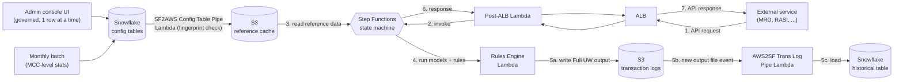

# Risk & Decisioning documentation

This site documents two related but separate systems in Merchant Solutions Risk, plus a proposed
platform to monitor them:

- **[Underwriting Decisioning](data-flow.md)** — a real-time, synchronous scoring service on AWS that
  turns an underwriting request into a decision.
- **[Feature Risk Monitoring](feature-store/index.md)** — a batch, Snowflake-native feature store
  pipeline that builds the feature library the risk-monitoring models train and score on.
- **[Monitoring Kickoff](kickoff/index.md)** — the meeting and whiteboard where the monitoring project
  was handed over: what the manager asked for, and why.
- **[Data Quality Monitoring](data-quality/index.md)** — a proposed (BRD-stage) platform to monitor
  input data, features and scores across Underwriting, Risk Monitoring and Clover Capital.
- **[After the BRD: Next Steps](next-steps/index.md)**: the 1:1 that followed the BRD. Socialise the
  templates, build end to end on a stand-in table, then add fixed-layout reports and hourly Lambda + SNS alerts.
- **[DQ Framework: How It Works](dq-guide/index.md)**: the framework that was built (Great Expectations
  on Snowflake, in an AWS Lambda): how it is set up, configured and run, and what each module does.
- **[DQ Framework: Lift & Shift to AWS](dq-aws/index.md)**: what to ask for, and the steps to move it
  from LocalStack into a real AWS account.
- **[DQ Framework Blueprint](dq-framework/index.md)** — the architecture and phased delivery plan
  for building that platform on Great Expectations, starting with input monitoring.

The two systems share some terminology ("primitive vs composite") but have separate code, data and
tooling.

---

## Underwriting Decisioning

The **UW (Underwriting) Real-Time Decisioning Service** receives an underwriting request from an external
service, runs it through a set of fraud, identity-theft and credit models on AWS, and returns a decision in
real time, while Snowflake acts as both the **source of reference/config data** and the **historical store
of every decision made**.

!!! info "Sources"
Everything here is derived from two inputs:

    1. Photos of *Real-Time Decisioning Service Architecture.pdf* ("UW AWS Architecture").
    2. A meeting transcript explaining what happens *before* the Snowflake config tables.

    Where something is my interpretation rather than stated in those sources, it is marked **(inferred)**.

## The system in one picture

## Three processes, one service

| Process                               | Timing                 | What it does                                                                                    |
| ------------------------------------- | ---------------------- | ----------------------------------------------------------------------------------------------- |
| **Config caching** (top band)         | Asynchronous           | Copies Snowflake config/reference tables into S3 so the real-time path never queries Snowflake. |
| **Decisioning** (middle band)         | Real-time, synchronous | API request in, models + rules run in a state machine, decision out.                            |
| **Transaction logging** (bottom band) | Asynchronous           | Every decision is written to S3 and then piped into a historical Snowflake table.               |

The key design idea: **Snowflake is never on the hot path.** The real-time request only touches AWS
(ALB, Lambda, Step Functions, S3). Snowflake is fed and read asynchronously on both sides.

## Where to go next

- [Before the config tables](upstream-config.md): the process the transcript describes.
- [End-to-end data flow](data-flow.md): numbered steps 1 to 7 in detail.
- [Components](components.md): what each box in the diagram is responsible for.
- [Decisioning lanes & layers](decisioning-lanes.md): inside the state machine.
- [Support engineer guide](support-guide.md): what can break and where to look.

## Feature Risk Monitoring

A separate, batch feature-engineering pipeline in Snowflake:

- [Feature store overview](feature-store/index.md): the three-step pipeline and its tables.
- [Step 1: Update Arrays](feature-store/step1-arrays.md) · [Step 2: Compute Features](feature-store/step2-features.md) · [Step 3: Registration & Governance](feature-store/step3-registration.md)
- [Backfill runbook](feature-store/backfill-runbook.md): how to run, monitor and restart a backfill.
