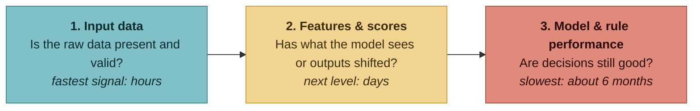
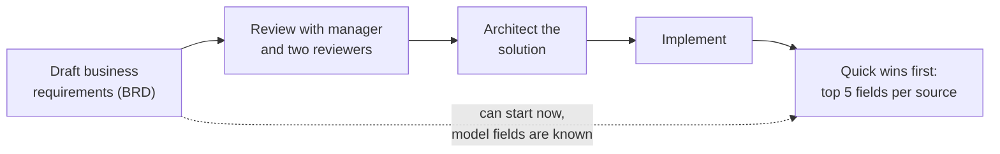

# Monitoring kickoff: overview

This section explains a **kickoff meeting** in which a manager hands an engineer a new project: build
proactive monitoring for the risk models. It is based on an audio transcript of the meeting and a photo
of the whiteboard drawn during it.

!!! info "Sources and labels"
- **The recording:** an automatic speech-to-text transcript. It has many mis-heard words. Where I've
  corrected one (for example "my tricks" → **TMX**), the correction is listed in
  [Transcript corrections](discussion.md#transcript-corrections).
- **The whiteboard photo:** handwritten and partly faded. Where a word is hard to read, my reading is
  marked **(inferred)**.
- The meeting **leads directly to the BRD** described in [Data Quality Monitoring](../data-quality/index.md).
  The [last page of this section](brd-mapping.md) compares the two.

## The meeting in one paragraph

The team has historically done a poor job of monitoring its models. Today the business notices a problem
first ("I saw an uptick in this rule, can you look into it?"), and the team reacts. The manager wants
this reversed: **detect problems ourselves, early**. The plan is to monitor three layers: the **input
data**, the **features and scores**, and the **model and rule performance**. The engineer is asked to own
the project **end to end**: write the business requirements, have them reviewed, then design and build
the solution over roughly **4–6 months**. It must be **modular**, so the same build works for
Underwriting, Risk Monitoring and Clover Capital.

## The three layers, and how fast each one warns you

The core idea of the meeting is that each layer gives a warning at a different speed:

| Layer                       | What it answers                                 | Why it is slow or fast                                                                                     |
| --------------------------- | ----------------------------------------------- | ---------------------------------------------------------------------------------------------------------- |
| **Input data**              | "Did a data source break or change?"            | Checks run as soon as data arrives. The quickest sign something is wrong.                                  |
| **Features & scores**       | "Is the model seeing or producing something unusual?" | Needs enough applications to compare distributions.                                                 |
| **Model & rule performance**| "Are our decisions actually separating good from bad?" | You only learn an account was bad when it is **closed or terminated**, often months after approval. |

## Who does what

| Role                              | Responsibility                                                                     |
| --------------------------------- | ---------------------------------------------------------------------------------- |
| **Manager** (speaker, unnamed)    | Sets the vision and business requirements; reviews the draft.                      |
| **Engineer** (being briefed)      | Owns end to end: requirements → review → architecture → implementation.            |
| **Two reviewers**                 | Review the requirements. One is Jack; the other name is garbled in the transcript. They are also the people to ask how performance is reported today. |

## The plan, as described

Phase 1 (input monitoring) **can start before the new model is deployed**, because the fields the model
and rules use are already known.

## What happened next

After the BRD was written, a 1:1 with the manager set the next steps: send the templates, raise a Jira
ticket, and build end to end on a stand-in table. See [After the BRD](../next-steps/index.md).

## Pages in this section

- [The whiteboard, decoded](whiteboard.md): every region of the board, redrawn and explained.
- [What was discussed](discussion.md): the meeting topic by topic, with the metrics explained.
- [From kickoff to BRD](brd-mapping.md): what the BRD already covers, what it is missing, and what the
  meeting reveals about the Underwriting service.
