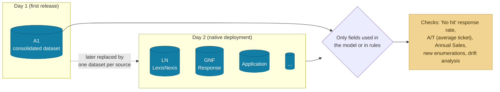
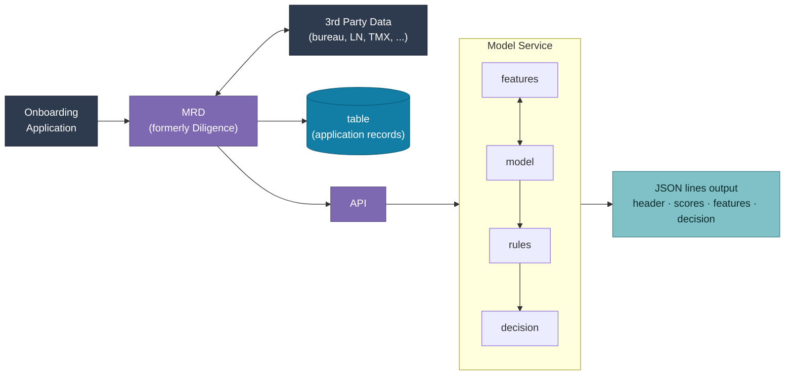
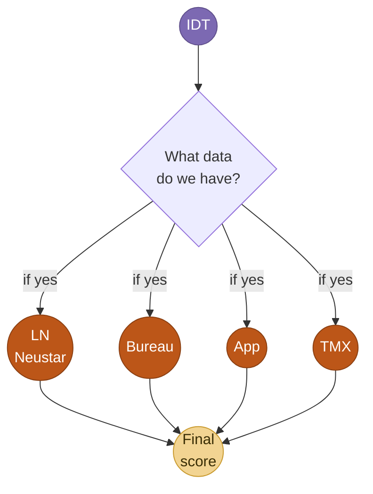

# The whiteboard, decoded

The whiteboard has six regions. This page redraws each one and explains what it means. Handwriting I
couldn't read with confidence is marked **(inferred)**.

## Layout of the board

```text
┌──────────────────────┬───────────────────────────────────────────┬───────────────────┐
│ A. The three layers  │ B. Input data: Day 1 / Day 2 sources       │ C. Alerting       │
│   (left edge)        │    + what to check                          │    questions      │
│   - Input Data       ├───────────────────────────────────────────┤                   │
│   - Features, Score  │ D. Onboarding flow → Model Service → JSON  ├───────────────────┤
│     & Rules          │                                            │ E. How a score is │
│   - Model & Rule     │                                            │    built (IDT, MF)│
│     Performance      │                                            │                   │
│ F. Performance table │                                            │                   │
└──────────────────────┴───────────────────────────────────────────┴───────────────────┘
```

## A. The three layers (left edge)

Written down the left side, each with a bracket:

| On the board                                     | Meaning                                                                       |
| ------------------------------------------------ | ----------------------------------------------------------------------------- |
| **Input Data**                                   | Layer 1: monitor the raw data sources.                                         |
| **Descriptive**: Features & Score & Rules        | Layer 2: describe *what is happening* in the model's inputs and outputs. The bracket labels this group "descriptive". |
| ‒ raw / ‒ transformations / ‒ Scores             | Features come in two kinds: **raw** fields and **transformations** of them. Then there are the **scores**. |
| → FSI, → PSI                                     | The two stability measures for this layer: **Feature Stability Index** (also called CSI) and **Population Stability Index**. |
| **Model & Rule Performance**                     | Layer 3: are the model and rules actually working?                             |
| • Feedback loop: closed / terminated             | Performance needs an **outcome**: was the approved account later **closed or terminated**? That is a "bad". |
| • AUC, Gini, KS, % Bad @ 5% capture              | The model performance metrics. See [the metrics explained](discussion.md#model-rule-performance). |

## B. Input data: Day 1 and Day 2



| On the board                       | Meaning                                                                                              |
| ---------------------------------- | ---------------------------------------------------------------------------------------------------- |
| **Day 1 → A1**                     | The first release monitors **A1**, an existing dataset that consolidates the fields needed in the past. Chosen because it is easy to deploy. |
| **Day 2 → LN, GNF Response, Application, …** | Later, each data source gets **its own dataset** (the "native deployment").                 |
| **Fields in model or in rules** (boxed, with an arrow) | Scope rule: monitor **only** the fields the model or rules actually use, not everything a vendor sends. |
| **"No hit response"**              | Example check: the rate at which a source (for example the Experian bureau) returns **no record** for an applicant. |
| **A/T**, **Annual Sales**          | Example application fields to check: **average ticket** and **annual sales**.                         |
| ‒ changes / enumeration            | Watch for **new categorical values** never seen before.                                               |
| ‒ drift analysis                   | Watch for **gradual shifts** in a field's distribution.                                               |

## C. Alerting questions (circled, top right)

> **When to alert? Who to alert to? Volume of alerts**

These are **open design questions** the manager wants answered. Alerts are **internal** (to the team),
and the number of alerts matters: too many and people stop reading them.

## D. The onboarding flow (centre)

This is the clearest part of the board. It shows how an application becomes a decision:



| On the board                    | Meaning                                                                                                |
| ------------------------------- | ------------------------------------------------------------------------------------------------------ |
| **Onboarding Application → MRD (Diligence)** | Applications enter **MRD**, previously called **Diligence**, the platform that both decides on and manages applications. |
| **3rd Party Data** (arrows up, then back)    | MRD calls the external data vendors and gets their responses back.                         |
| Small table under MRD (`300…`, `310…`, `330…`) | The application **lands in a table**. The values look like record IDs **(inferred)**.   |
| **API → Model Service**         | MRD sends the application to the **model service** by API.                                            |
| **features ⟷ model**, **rules → decision** | Inside the service: fetch the model, compute the features it needs, score, apply rules, decide. |
| **JSON: header, scores (5 scores for IDT), features, decision** | The output is one **JSON object per application** with these sections. This is the data monitoring should read from. |

The **MRD** box is the "External service (MRD, RASI, …)" in the
[Underwriting data flow](../data-flow.md), and the **Model Service** is the AWS decisioning service.
See [what the meeting tells us about the UW service](brd-mapping.md#what-the-meeting-reveals-about-the-underwriting-service).

## E. How a score is built (right side)

Circles for **IDT** (identity theft) and **MF** (merchant fraud). Under IDT: **"What data?"**, branching
into the sources, each labelled **"if yes"**, and joining into **Final score**:



Each available source produces a **component score**. The **final score** is a **linear combination**
(a weighted sum) of the component scores. This matches the
[lanes & layers](../decisioning-lanes.md): component scores are the primitive models, and the final score
is the lane aggregate.

## F. The rule performance table (bottom left)

A small grid labelled **Rule**:

|            | Bad (closed / terminated) | Good | Bad rate |
| ---------- | :-----------------------: | :--: | :------: |
| **Hit**    |                           |      |          |
| **No hit** |                           |      |          |

The column headings are hard to read; the reading above is **(inferred)** from the recording ("for the
rule, did you hit it or not, … bad, … bad rate"). For each rule, it compares the accounts where the rule
fired with those where it didn't. See the
[worked example](discussion.md#rule-performance).
