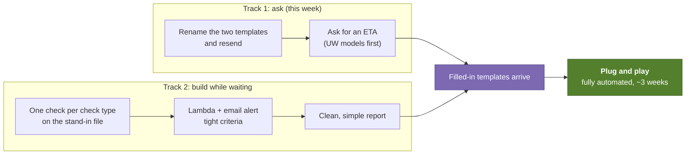

# Check-in: templates, test plan & timeline

A short follow-up with the manager after the [1:1](index.md). The transcript starts part-way through
the conversation. It changes three things: **how to ask for the templates**, **how to test the
alerting while you wait**, and **the deadline**.

!!! info "Source and labels"
    Same rules as the rest of this section: the transcript is automatic speech-to-text. Uncertain
    spellings are marked **(spelling uncertain)** and anything worked out rather than heard is marked
    **(inferred)**.

## The check-in in one paragraph

The templates sent to the modelling contact were **not clear enough**: an Excel / SharePoint link with
no explanation of which sheet to fill. Resend them as **two separately named files**, ask for the
Underwriting ones first, and **ask for an ETA**. Don't wait for the reply. Use the stand-in file to
build and test the **Lambda and the automatic email alert** now, with **one check of each type** and
**tight criteria** so it rarely fires. The whole thing should be **fully automated in about three
weeks**, so that the real templates can be dropped in ("plug and play"). Touch base **every other
day**.

## What was agreed

| # | Topic | What the manager said | Details |
| --- | --- | --- | --- |
| 1 | **The templates were unclear** | "Excel, SharePoint link. What does that mean?" People have seen the template once. The BRD is understandable; the Excel sheet is not | [Resend the templates](#resend-the-templates) |
| 2 | **Two named files** | Rename them, for example "Template to be filled: input data monitoring" and "Template to be filled: feature and score monitoring". Send them as **two separate sheets** | [Reminder draft](communications.md#reminder-email) |
| 3 | **One instruction** | "For each table you want us to track, provide the same two tables, filled in. Please start with the Underwriting models." | [Reminder draft](communications.md#reminder-email) |
| 4 | **Ask for an ETA** | A date gives you planning room, and gets them started | [Reminder draft](communications.md#reminder-email) |
| 5 | **Build while waiting** | Use the stand-in file. Build the Lambda and the automatic email trigger, and test them | [Test plan](#test-plan) |
| 6 | **One check per type** | "If you have 10 types of checks, one for each." Any columns will do; the manager will help set the first thresholds | [Test plan](#test-plan) |
| 7 | **Tight criteria** | Make the criteria tight so alerts are rare, "otherwise you'll end up having hundreds of emails". You are testing the function, not the volume | [Test plan](#test-plan) |
| 8 | **Email Lambda** | Austin already has a Lambda that sends email. Ask whether to reuse it or build a new one; either is fine | [Hourly alerting](mvp-build.md#hourly-alerting-on-aws) |
| 9 | **Plug and play** | When the filled-in templates arrive, they should drop straight into the pipeline with no code change | [Template → checks](mvp-build.md#from-template-to-checks) |
| 10 | **Deadline** | Next week is probably too soon given the deployment work. **Fully automated in about three weeks** | [Timeline](#timeline) |
| 11 | **Why it matters** | Compliance, model risk management (MRM) and **partner-bank reporting** will ask for these templated reports | [Who will use it](#who-will-use-it) |
| 12 | **Keep the UI simple** | "Clean and easy to understand, not too much happening." Add complexity only if needed | [The reports](mvp-build.md#the-reports) |
| 13 | **Cadence** | Touch base **every other day**, even for 10 minutes. Set up a call whenever you're stuck | [Timeline](#timeline) |
| 14 | **Priorities** | Underwriting is the first to go live this year, so contributing there comes first. Monitoring is "also important" and "really urgent" | [Deployment context](#deployment-context) |

## Action items

| # | Action | Owner | When |
| --- | --- | --- | --- |
| B1 | Rename the two template files with clear titles | You | Now |
| B2 | Resend them to the modelling contact with one instruction and a request for an **ETA** | You | Now |
| B3 | Pick a few columns from the stand-in file; write **one check of each type** with tight criteria | You (manager helps with thresholds) | This week |
| B4 | Ask Austin about the existing email Lambda: reuse or build new | You | This week |
| B5 | Build and test the Lambda + automatic email alert on the stand-in file | You | Weeks 1–2 |
| B6 | Build a clean, simple report view | You | Weeks 1–2 |
| B7 | Make the template **plug and play**, then swap in the real UW templates | You | By week 3 |
| B8 | Short update to the manager every other day | You | Ongoing |
| B9 | Keep asking to join deployment work; the deployment team won't offer | You | Ongoing |

## Resend the templates { #resend-the-templates }

The first message assumed too much. The reader got a link and had to work out which sheet to fill and
how. Fix three things:

| Problem | Fix |
| --- | --- |
| A link to a workbook, with no titles | Two **separate files**, each named for what it is |
| No instruction | One sentence: *for each table you want tracked, fill in both files* |
| No date | Ask for an **ETA** |

Suggested file names:

- `Template to be filled - Input data monitoring.xlsx`
- `Template to be filled - Feature, rule and score monitoring.xlsx`

Add a short "How to fill this in" note at the top of each file, with one example row. The reader has
seen the template once, in a meeting.

The ready-to-send text is in [Emails, Jira & review](communications.md#reminder-email).

## Test plan while you wait { #test-plan }

The goal is to prove that **every part works**: template → check → result → email. The values
themselves don't matter yet.

| Rule | Why |
| --- | --- |
| **One check of each type** | Proves the parser and the SQL for every check type in the template. One field per type is enough |
| **A few columns only** | "Take a few columns, take a shot at it." You don't need to know which columns matter yet |
| **Tight criteria** | An alert should fire rarely. A loose threshold on a 15-minute table can send hundreds of emails |
| **Force one failure on purpose** | Set one threshold you know will be breached, once, to see the email arrive. Then tighten it again |
| **Stateful alerts** | Email when an alert opens or resolves, not every hour it stays open ([alert lifecycle](../dq-framework/operations.md#alert-lifecycle)) |
| **Send to yourself first** | Subscribe only your own address until the alerts behave |

A starting set, one row per check type. Columns are placeholders until you've picked them:

| Check type | Example column **(inferred)** | Tight criterion for testing |
| --- | --- | --- |
| Missing Values | An ID that is always filled | Fail if > 50% missing |
| Field Population | A usually-filled field | Fail if < 10% populated |
| Acceptable Range | An amount | Fail if any value is outside a very wide range |
| Accepted Values | Final status | Fail on a value outside the known list |
| Expected Format | A date or timestamp | Fail if > 20% don't match |
| Duplicate Values | Application ID + status timestamp | Fail if > 5% duplicated |
| Value Length | An ID | Fail if the length is outside a wide band |
| Data Type | A numeric field | Fail if > 20% aren't numeric |
| Placeholder Value | An amount | Fail if > 50% are `-999` |
| Freshness / volume | Last-updated timestamp | Fail if no rows changed in 3 hours |

The step-by-step build for this is on [POC: getting started](poc-getting-started.md).

The manager offered to help set the first thresholds. Bring this table, with the real column names
filled in, to the next catch-up.

## Timeline { #timeline }

"Think about it like two to three weeks out. This should be completely automated in three weeks' time."
Deployment work comes first, so the plan leaves slack.

| Week | Monitoring work | Done when |
| --- | --- | --- |
| **1** | Templates resent with an ETA. Columns chosen. One check per type running from your machine | Results table with PASS / FAIL for each check type |
| **2** | Lambda + email alert deployed and tested. Simple report view | A test alert email arrives from AWS on a schedule |
| **3** | Template is plug and play. Real UW templates loaded if they have arrived | A new filled-in template runs with **no code change** |

Check-ins run through all three weeks: every other day, 10 minutes is enough. Bring what moved, what
is blocked, and one question.

!!! note "Leave"
    The day off on **Monday 19 October** stands, and the manager offered an extra day if you want it.
    It falls inside week 2, so plan the Lambda work around it.

## Who will use it { #who-will-use-it }

The manager gave the reason for the deadline: in a few weeks there may be "a real use case".
**Compliance**, **model risk management (MRM)** and the teams handling **partner-bank reporting** will
ask for these reports in a standard, templated form.

This shapes the report design:

- **Templated:** the same layout for every model and table, so a reviewer learns it once.
- **Clean:** a summary first, detail on request ([the fixed pages](mvp-build.md#the-reports)).
- **Repeatable:** the same template always gives the same checks. That is what "plug and play" buys.

## Deployment context { #deployment-context }

- You now understand most of the UW architecture. The open question about where the Snowflake tables
  sit was [answered in the 1:1](what-to-monitor.md).
- You deployed most of the **primitive models** yourself, and worked on the **composite models** with
  a teammate.
- You join Austin's calls when you can, and he explains as he works. The manager: keep doing that, and
  **ask** to be involved. "They're not going to come to you."
- Over time the deployment work will be shared out as you get more comfortable.
- **Underwriting** is the first to go live this year, and it has to go right.
- The manager named a second product as a possible place to integrate next. The transcript says "low
  capital" **(spelling uncertain)**.

## Transcript corrections

| Transcript says | Probably means |
| --- | --- |
| "Tela", "Shrassir" | the **modelling contact**, Srayasee Chakraborty |
| "CRPD file", "CIRPT file" | the **stand-in table / file** the manager sent **(inferred)** |
| "that's in X3" | unclear; read as "she fills in the table and gives it to you" |
| "unwriting", "handwriting" | **underwriting** |
| "sends an email for anniversary" | Austin's existing email Lambda. What it sends is unclear |
| "low capital" | a product name (spelling uncertain) |
| "data mode" | unclear; read as "take a day or more" |
| "MRM" | **model risk management** |
