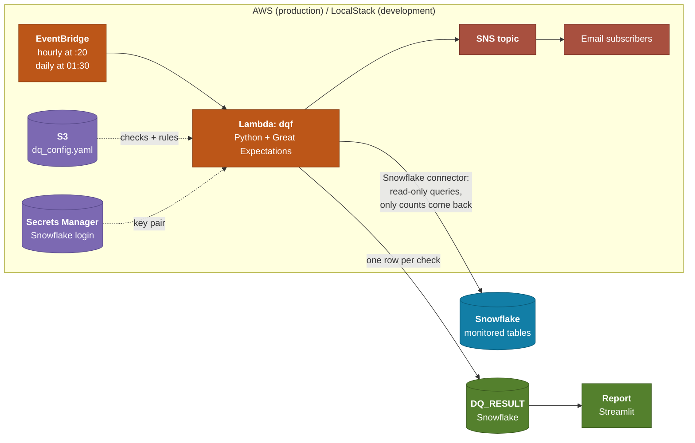
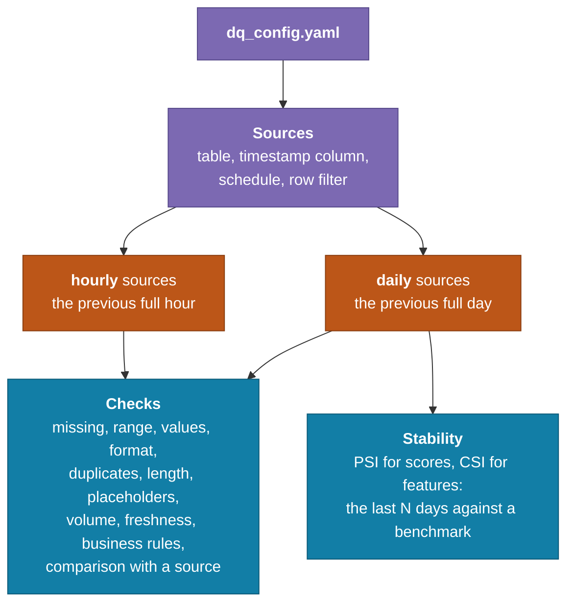

# The framework: design and status

The data quality framework is built from scratch in the **`dq-framework/`** folder. It serves both
**Underwriting** (hourly data checks on the A1 record) and **feature and score monitoring**, including
the **Risk Monitoring feature store** (daily PSI / CSI drift). It runs as an **AWS Lambda**; during
development, the AWS side runs on your machine in **LocalStack**, and Snowflake is always the real
account.

This page summarises the design and the status. For the details, see
[DQ Framework: How It Works](../dq-guide/index.md) (setup, configuration, running, each module) and
[Lift & Shift to AWS](../dq-aws/index.md).

## What runs where

| Piece | Production (AWS) | Development (your machine) |
| --- | --- | --- |
| Lambda | Container image from ECR | LocalStack Lambda, code folder mounted (LocalStack's free edition has no ECR) |
| Schedules | EventBridge rules, hourly and daily | The same rules, off by default; invoked by hand |
| Configuration (`dq_config.yaml`) | S3 bucket created by the stack | The same, in LocalStack's S3 |
| Snowflake login | Secrets Manager | The same, in LocalStack's Secrets Manager, filled from `.env` |
| Alerts | SNS topic, email subscribers | LocalStack's SNS (readable from a queue) and email to a local inbox |
| Snowflake | The real account | **The real account** |
| Infrastructure | `infra/cloudformation.yaml`, `Target=aws` | **The same template**, `Target=localstack` |

One template and one code package serve both. Only `Target` changes, so what is tested locally is
what goes to AWS.

## Why LocalStack 4.9

| Option | Outcome |
| --- | --- |
| LocalStack, current release (2026.10) | Refuses to start without an account token. Its free plan is for non-commercial use only |
| **LocalStack 4.9**, the last open-source community release | Starts without an account; Apache 2.0 licence, so work use is allowed; has Lambda, S3, SNS, SQS, Secrets Manager, EventBridge and CloudFormation. **Chosen** |
| What 4.9 lacks | ECR, so container-image Lambdas. Locally the Lambda runs from a mounted folder; in AWS it is an image |

The image is needed in AWS anyway: the dependencies (Great Expectations, the Snowflake connector,
pandas, pyarrow) are about 490 MB installed, above Lambda's 250 MB limit for zip packages.

## Two schedules, two kinds of check

| Use | Source schedule | Typical checks |
| --- | --- | --- |
| Underwriting input (A1 record) | hourly | Missing and invalid values, data-source hit rates (`'CY'`), the `SSN_TAX_ID_MATCH` derivation, no-activity |
| Underwriting output | hourly, with `ROW_FILTER` = scored population | Scores 300–900, decision consistent with score, model used consistent with available data |
| Payload against raw data | hourly | `SOURCE_COVERAGE`, `MATCHES_SOURCE`, `LOST_IN_MAPPING` |
| Score and feature drift | daily | PSI per score, CSI per feature, against a benchmark period |
| Risk Monitoring feature store | daily, on each model's feature view | Merchants per day, today's load arrived, missing features, CSI per top feature |

**PSI / CSI.** Numeric fields are cut into bins at the benchmark's quantiles; categorical fields use
the benchmark's most common values plus "other"; missing values get their own bin. The index is
`Σ (active share − benchmark share) × ln(active share ÷ benchmark share)`. It is computed in Snowflake,
and Great Expectations judges it against the limits: **WARN** at 0.10 (shown in the report), **FAIL**
at 0.25 (alerts). The SQL was checked against an independent numpy calculation and gives the same
numbers.

## Great Expectations' own report (Data Docs)

Every run also writes GX's standard HTML report: an index of runs, and a page per group of checks
showing each expectation, its result and the measured value. On a laptop it goes to
`build/data_docs/site/index.html` (`make docs` serves it at <http://localhost:8777/index.html>); the
Lambda writes it to the stack's S3 bucket under `data_docs/` (`make local-docs` prints the LocalStack
URL). Example bad values are removed, so no customer data ends up in the report: only counts.

## The sample table

`sql/02_sample_table.sql` creates **one** table, `DQF_DB.DQF.UW_A1_RECORD`, shaped like the A1 record
in the [Implementation Support Document](implementation-support-doc.md): application fields, the
inquiry status of each data source, model features, exclusions, and the model output. It holds 60 days
of made-up data, so the drift checks have a benchmark period. Problems are planted in known hours
(missing values, a wrong `SSN_TAX_ID_MATCH`, an Experian outage, duplicates, three silent hours, scores
out of range) and drift in the last week (score, ticket size, channel mix). `make test-snowflake`
checks that each one is caught by the right check and by nothing else.

## Status

| Part | Status |
| --- | --- |
| Code, configuration reader (YAML, Excel, CSV), business rules, check planning, alert logic | Unit-tested |
| PSI / CSI calculation | Checked against numpy |
| The CloudFormation template on LocalStack | Deployed and run: the Lambda sent a test alert through SNS and by email |
| The AWS container image | Built and invoked locally |
| Your Snowflake account | **Run** (2026-10-17): key-pair login; hourly (23 checks) and daily (8 checks, PSI / CSI) runs; 12 of 14 planted-problem tests passed, the 2 misses were a sample-data bug, since fixed |
| The Lambda in LocalStack against your Snowflake | **Run**: secret from Secrets Manager, configuration from S3, results in Snowflake, alert through SNS and email |
| GX's own HTML report (Data Docs) | **Run**: written locally and, from the Lambda in LocalStack, to S3 |
| A real AWS deployment | **Not done.** No AWS access yet; `infra/deploy.sh` with the same template. Plan: [Lift & Shift to AWS](../dq-aws/index.md) |

The earlier `dq-poc` code, which [POC: getting started](poc-getting-started.md) describes, is
replaced by this framework.
