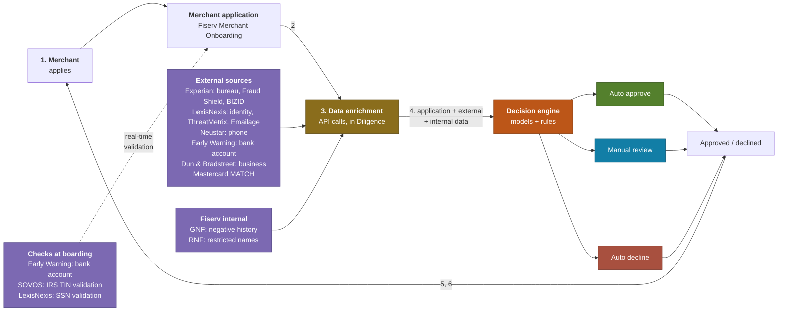
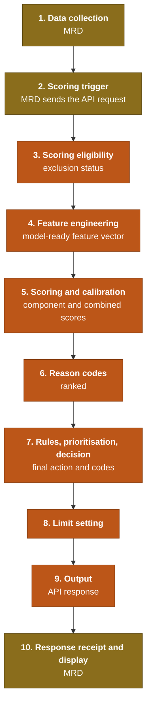
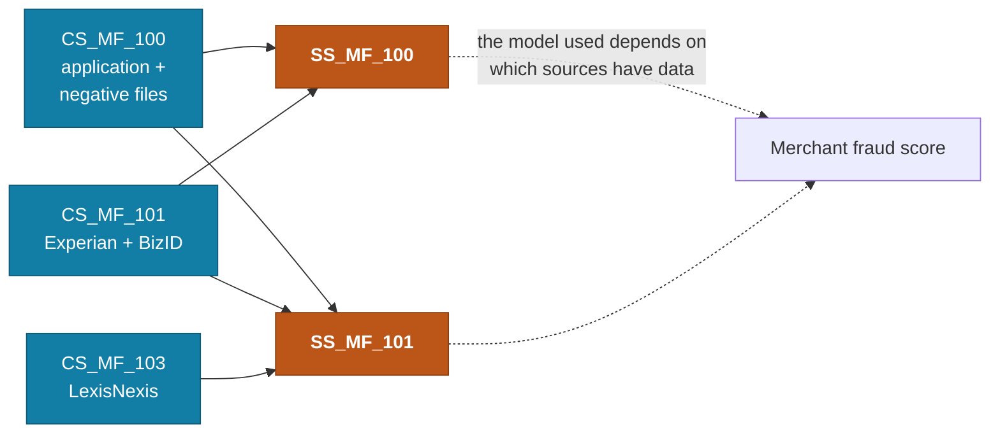

# Implementation Support Document: UW US V2

The **Model Implementation Support Document** for the Underwriting US V2 release, the two field
**mapping spreadsheets** it links to, and the **Merchant Underwriting Workflow** slide describe the new
models end to end: where the data comes from, what the model service does with it, what it returns,
and how the release must be tested and signed off.

This page summarises them and draws out what they mean for data quality monitoring.

!!! info "Source and labels"
    Based on photos of the documents (a draft dated 9-7-2026, 28 pages, marked *Fiserv Restricted*)
    and of the spreadsheets and slide. Some sections are still templates with placeholders. Anything
    worked out rather than stated is marked **(inferred)**. Keep this site internal.

## In one paragraph

Version 2.0 releases three model suites (**Merchant Fraud**, **Identity Theft**, **Credit Risk**) and
a new framework on **AWS and Snowflake**. MRD collects the application and every third-party and
internal source, then calls the model service. The model service checks eligibility, builds
features, scores **component models** per data source, combines them into **score-of-scores** models,
calibrates to a **300–900** score, generates reason codes, applies the rules and returns a decision.
**Day 1 (15 October 2026)** runs on the existing **A1** record with **56 added input fields** and
**11 new output fields**; **Day 2 (January 2027)** moves to the **A2** record carrying the full
response from each source. The document ends with testing and release sign-off requirements, which
include **monitoring and alerting being operational**.

## The document at a glance

| Field | Value |
| --- | --- |
| Title | Model Implementation Support Document: production implementation specifications, code exhibits, testing evidence, and release support |
| Solution / program | Underwriting US Models and Framework |
| Model release | Version 2.0: models (Merchant Fraud, Identity Theft, Credit Risk). Version 2.0: framework |
| Target platform | AWS and Snowflake |
| Document owner | **Srayasee Chakraborty** |
| Technical owner | **Ameya Jadhavar** |
| Status | Draft, 9-7-2026 |
| Approval references | Model validation, change ticket, release approval (placeholders) |

| Section | What it covers |
| --- | --- |
| 0. Tech dependencies | The 10-step process flow and the data sources MRD collects |
| 1. API call: scoring trigger | The A1 and A2 input and output records, the Day 1 and Day 2 timeline, the mapping spreadsheets |
| 2. Model information | Eligibility and exclusions, features, segmentation, component models, score of scores, calibration |
| 3. Codes and platform lists | Legacy-to-new code mapping (template) and the platform lists workbook |
| 4. Testing | Integration test cases, a 10,000-record statistical dataset, non-functional requirements |
| Artifact register, release readiness | What must exist before release, and who signs off |

## The business workflow

The slide shows the whole merchant underwriting journey. The model service is the **Decision
Engine** box.

The slide calls the enrichment stage "Data Enrichment and Auto-decisioning in **Diligence**". The
implementation document says **MRD** collects all the sources. They are most likely the same stage
**(inferred)**: MRD is the system that runs the enrichment and calls the model service.

## The process flow (section 0)

Ten steps, from the scoring trigger to the response on screen.

| Step | Stage | Input | Output | Owner | On failure |
| --- | --- | --- | --- | --- | --- |
| 1 | Data collection | | | MRD | See the MRD strategy |
| 2 | Scoring trigger | API request | | MRD | Retry |
| 3 | Population scoring eligibility | A2 record | Exclusion status | Model service | Route to DR, retry |
| 4 | Feature engineering | A2 record | Model-ready feature vector | Model service | Route to DR, retry |
| 5 | Model scoring and calibration | A2 record | Component and combined scores | Model service | Route to DR, retry |
| 6 | Reason codes | A2 record | Ranked reason codes | Model service | Route to DR, retry |
| 7 | Rules, prioritisation, decision | A2 record | Final action and codes | Model service | Route to DR, retry |
| 8 | Limit setting | A2 record | | Model service | Route to DR, retry |
| 9 | Output | A2 record | API response | Model service | |
| 10 | Response receipt and display | A2 output | API response | MRD | |

"Route to DR" most likely means failing over to the disaster-recovery deployment **(inferred)**.
Steps 3 to 8 are the Step Functions flow already documented in
[Inside the state machine](../state-machine.md).

## The data sources (section 0)

MRD calls and collects every source. Full responses are to be linked from Confluence (not yet filled
in).

| Group | Source | Notes |
| --- | --- | --- |
| **Onboarding system** | Application data | All channels |
| | TINCheck | All channels |
| **Fiserv internal** | GNF: Global Negative File | Negative history on merchant accounts |
| | RNF: Restricted Name File | Restricted names and phrases |
| | Mastercard MATCH (TMF) | Collected by MRD, all channels |
| **Third party** | LexisNexis: base record, Emailage, ThreatMetrix | ThreatMetrix only for the merchant's device; no device, no ThreatMetrix request |
| | Neustar | Phone verification |
| | Experian: bureau data | **To be replaced by Equifax** |
| | Experian: BIZ ID | Business identity verification |

A "Glo" source appears in the table with no system or channel yet.

## Input and output records (section 1)

| Record | Where | When | Notes |
| --- | --- | --- | --- |
| **A1 output** | API output to MRD | **Day 1: 15 Oct 2026** | Includes 11 new fields |
| **A1 output** | **Snowflake table** | **Day 1: 15 Oct 2026** | Includes 11 new fields |
| **Full response** | **Snowflake table** | **Day 1** | |
| A2 output | API output to MRD | Day 2: Jan 2027 | |
| A2 output | Snowflake table | Day 2: Jan 2027 | |

### Day 1: the A1 input record

To make Day 1 easier to deploy, the new models use the existing **A1** input record, with **56
fields added**. They are listed in **`AWS_US_INPUT_MAPPING_NEW_UW_MODEL_DEVELOPMENT_V6.xlsx`**, tab
*Main*, rows 377–432.

One field is derived: **`SSN_TAX_ID_MATCH`**, from the first principal's application data.

| SSN | Tax ID | `SSN_TAX_ID_MATCH` |
| --- | --- | --- |
| Present | Present, identical | `"1"` |
| Present | Present, different | `"0"` |
| Missing | or missing | `"Z"` |

### Day 1: the A1 output record and the display

- Output fields: **`AWS_US_OUTPUT_MAPPING_NEW_UW_MODEL_DEVELOPMENT_V1.xlsx`**.
- An extra display of **auto-approval reason codes and actions**, one line per control group:
  *Policy and Business*, *AML (KYC principal)*, *AML (KYC secondary)*, *AML (KYB)*, with "Passed" or
  "Not passed" and the negative reasons (for example `22A` LexisNexis consumer verification,
  `32A` Neustar phone not linked to the business, `33A` EWS bank account not verified). On Day 1 the
  codes alone, without descriptions, are enough.
- Client routing: **`US_UW_Model_Routing.xlsx`**.

### Day 2: the full input record

The API call will carry the **full payload response from each source plus a header record**. The
layout is in **`New Model Service Output Structure V0.1.xlsx`** (Decision Science SharePoint, *Data
Layouts and Dictionaries*).

### The mapping spreadsheets

**Input mapping** (`AWS_US_INPUT_MAPPING_NEW_UW_MODEL_DEVELOPMENT`, tabs *Main* and *Audit Log*): one
row per model field, with where its value comes from.

| # | SAS / model field name | Source | Raw field name | Raw file / path |
| --- | --- | --- | --- | --- |
| 1 | `addrmatchflag` | LexisNexis BIID2.0 | `CLN_ADDR_MATCH_FLAG` | LN CBSUM |
| 3 | `cnamematchflag` | LexisNexis BIID2.0 | `CLN_COMPANY_NAME_MATCH_FLAG` | LN CBSUM |
| 4 | `feinmatchflag` | LexisNexis BIID2.0 | `CLN_FEIN_MATCH_FLAG` | LN CBSUM |
| 6 | `residential_bus_indicator` | LexisNexis BIID2.0 | `CLN_residential_bus_indicator` | LNSUM |

**Output mapping** (`AWS_US_OUTPUT_MAPPING_NEW_UW_MODEL_DEVELOPMENT`, tab *consolidated vars*): one row
per output field, with its usage (storage, display), its type, and a description. For example
`RULE_REASONS_SUMMARY` and `RULE_REASONS_NEG_G0` to `G9`, the negative reasons per control group:

| Group | Controls |
| --- | --- |
| G0 | Policy and business |
| G1 | AML (KYC principal) |
| G2 | AML (KYC secondary principals) |
| G3 | AML (KYB) |
| G4 | Negative and restricted: GNF |
| G5 | Negative and restricted: other |
| G6 | Identity theft |
| G7 | Fraud |
| G8 | Credit |
| G9 | Bespoke for SMS / banking partners |

The output column is headed "Actimize Derived Field Name". Actimize is presumably the platform these
fields were first derived in **(inferred)**.

## The models (section 2)

### Who is scored

- **Excluded:** additional outlets, and WISO. The A1 model is not called for them; a separate
  framework decides them. On Day 2 the team may move all auto-decisions into the A1 framework.
- The score choices are configurable.

### Segmentation, components and score of scores

- **No segmentation:** one model per suite (Merchant Fraud, Identity Theft, Credit Risk).
- **Component models** (`CS_…`) score one data source each, but only when that source has enough data:

| Source | Minimum data needed to score |
| --- | --- |
| Application and GNF | None |
| Experian and BizID | bureau inquiry status = `CY` **and** BizID inquiry status = `CY` |
| LexisNexis / Neustar | CLN inquiry status = `CY` **and** NEU inquiry status = `CY` |
| ThreatMetrix | request ID present and not `ZZ`, **and** request result = `success` |

- **Score-of-scores models** (`SS_…`) combine the component scores that are available. Component scores
  are calibrated before they are combined.

| Component | Purpose | Artifact |
| --- | --- | --- |
| `CS_MF_100` | Merchant fraud: application and negative files | Non-prod S3 (`us-uw-models`) |
| `CS_MF_101` | Merchant fraud: Experian and BizID | Non-prod S3 |
| `CS_MF_102` | Merchant fraud: Equifax | To be built |
| `CS_MF_103` | Merchant fraud (LexisNexis, **inferred** from the score-of-scores inputs) | Non-prod S3 |
| `CS_CR_104` | Credit risk: Equifax with VantageScore | To be built |

The Identity Theft suite follows the same pattern (`SS_IT_100` to `SS_IT_105`, from `CS_IT_100` to
`CS_IT_104`, with ThreatMetrix and Equifax combinations). Score-of-scores models **with Equifax FICO or
VantageScore** still have to be added for all three suites.

This is the logic already seen in the MF Aggregate code: `MODEL_DICT` picks an `SS_MF_…` model from the
combination of sources available.

### Calibration and alignment

| Parameter | Value |
| --- | --- |
| Base score | 600 |
| Base odds | 20 |
| PDO (points to double the odds) | 20 |
| Score range | 300 to 900 |
| Higher score means | Lower risk |

Each component model has **alignment** parameters, a multiplier and an additive factor, configurable
through a platform list and expected to change about once a year. The defaults are multiplier **1** and
additive **0**, and the aligned score is truncated. This is the **`MODEL_ALIGNMENT`** lookup table that
Aryan's change to the MF Aggregate Lambda reads from S3.

### Features

`all_model_final_features.xlsx` (work in progress) lists every model feature with its type (raw,
binned, percentile, derived flag, new calculation), how often it refreshes (never or monthly) and the
code that builds it. Examples: `AAPBIZ_SCORE_PRIN` (raw), `AAPDAT_ZIP_MATCH` (derived),
`AAPVAL_EXACT_TMF_PASSED` (derived flag), `ABA_NATG_AND_APPS_COMBINED` (binned, monthly),
`TXN_PER_DAY_PERCENTILE` (percentile, monthly). A comment on this section is assigned to Aryan Patel.

## Testing and release (sections 4 onwards)

| Part | Requirement |
| --- | --- |
| **Every test** | Record the environment, build, artifact checksum, data version, who ran it, when, evidence, defects, fixes, retests, approval. Entry and exit criteria are set before running |
| **4a. Integration test cases** (for TCOE) | Positive, negative, boundary, **null**, **malformed**, **duplicate**, timing, segmentation, threshold, rule-conflict, calibration, reason-code, **mapping**, replay and failure-recovery cases. Every requirement maps to at least one case |
| **4b. Statistical dataset** | A frozen set of **10,000 records** with all production inputs and precomputed expected outputs, covering the full population, exclusions, rules, score tails, thresholds, missing-value handling and reason codes. Masked or synthetic. Recorded so far: *Normalizer*, 10,000 records, "99,992 matched" on 9-30-2026 (as written; likely 9,992); *Feature*, 150,000 records, no result yet |
| **4c. Non-functional** | Latency (p50 / p95 / p99), throughput, scalability, availability and resilience, restart and replay, and more, each with a target and evidence |
| **Artifact register** | Process flow, input schema and mapping, feature code, model artifacts with checksums, calibration, reason codes, rules and configuration: each with a location, owner and status |
| **Release readiness** | Artifacts approved and versioned; production matches the approved versions; tests pass; **monitoring, alerting**, support ownership, replay, rollback and change control **operational**; downstream consumers validated; sign-off by business, technology, QA, model development, **model risk management**, information security, privacy and operations |

## What it means for data quality monitoring

| Finding | What it changes |
| --- | --- |
| **Day 1 went live on 15 October 2026**, on the A1 record | Monitoring is now needed for live data, not only for January. The A1 tables are the first real target |
| The **A1 output Snowflake table** and a **Full response Snowflake table** exist from Day 1 | The first real tables to point the template at. The full-response table is most likely the **raw data** Michelle wants compared with the payload **(inferred)** |
| The **input mapping spreadsheet** lists model field, source, raw field name and raw file | This is the **mapping sheet** the comparison checks (`MATCHES_SOURCE`, `LOST_IN_MAPPING`) need. Its rows translate almost directly into template rows |
| **56 new A1 input fields** (rows 377–432) | The first fields to put under input checks: they are new, so most likely to arrive empty or mis-mapped |
| **`SSN_TAX_ID_MATCH`** has three valid values | An `ACCEPTED_VALUES` check (`'1','0','Z'`), and a business rule that recomputes it from SSN and Tax ID |
| **Minimum data criteria** per source (`CY` statuses, ThreatMetrix request result) | A **hit rate per source**: the share of applications where each source had enough data to be scored. A drop is the "provider stopped returning data" signal |
| **Exclusions** (additional outlets, WISO) are not scored by A1 | Checks on scored data must leave them out, or volume and missing-value checks will mis-fire |
| **Scores are 300–900**, higher is lower risk | The existing `FINAL_SCORE_IN_RANGE` rule matches. The same range applies to component and aligned scores |
| **Alignment** defaults are multiplier 1, additive 0 | A check on `MODEL_ALIGNMENT`: values present for every model, client and channel in use, and within sensible bounds |
| **Reason-code groups G0–G9** | Output monitoring (Phase 2): how often each group fires, per hour or day |
| **Experian bureau will be replaced by Equifax** | Expect volume and missing-value changes on bureau fields; plan the switch in the template |
| Release readiness requires **monitoring and alerting to be operational** | The DQ framework is part of what the release is signed off on, not an extra |
| Test types include null, malformed, duplicate and mapping cases | The same check types run in production by the DQ framework; its results can serve as evidence |

## Questions this raises

| # | Question | For |
| --- | --- | --- |
| 1 | What are the Snowflake paths of the **A1 output** table and the **full response** table, and their timestamp columns? | Ameya Jadhavar / data owner |
| 2 | Is the full-response table the "raw data" in Michelle's email? | Michelle Davis |
| 3 | Can we have read access to the input and output mapping spreadsheets, to generate the comparison rows? | Srayasee Chakraborty |
| 4 | Which A1 field marks an application as excluded (additional outlet, WISO)? | Model team |
| 5 | Where do the inquiry statuses (`CY`) and the ThreatMetrix request result live in the A1 record? | Model team |
| 6 | Is "Normalizer: 99,992 matched" of 10,000 a typo for 9,992? | Document owner |
| 7 | Should the DQ framework be listed in the artifact register and the release sign-off as the monitoring and alerting component? | Manager |
