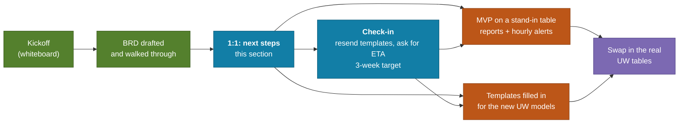
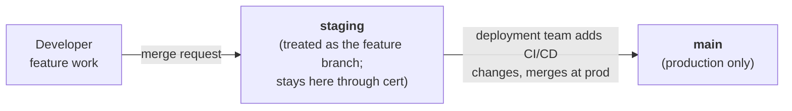

# After the BRD: overview

This section covers a **1:1 with the manager** held the day after the BRD walkthrough. The meeting
answers the question *"the BRD is written, what happens now?"* It turns the proposal into concrete
next steps: who to email, what ticket to raise, which table to build on, what the reports must look
like, and how the hourly alerts get sent.

!!! info "Source and labels"
    This section is based on an automatic speech-to-text transcript, which garbles names and table
    names. Spellings I'm unsure of are marked **(spelling uncertain)**. Anything I've worked out rather
    than heard is marked **(inferred)**. See [Transcript corrections](#transcript-corrections).

## The meeting in one paragraph

The team has a lot of model deployments in the next ~45 days, and **deployments remain the priority
for the next couple of weeks**. Monitoring continues **in parallel**. On monitoring, the manager wants
three things now:

1. **Socialise the BRD.** Send the two templates to everyone and raise a Jira ticket so the modelling
   team fills them in for the new Underwriting models.
2. **Don't wait for them.** Build the whole thing **end to end** on a stand-in table that already
   refreshes every 15 minutes.
3. **Make it real.** Turn the filled-in Excel template into running checks. Produce clean,
   fixed-layout reports, and send **hourly email alerts from AWS** (Lambda + SNS).

The first review is on **Friday, 12:30–1:00 pm**.

!!! warning "Updated by the Implementation Support Document"
    The model team's implementation document for UW US V2 gives the go-live dates (**A1: 15 October
    2026**, A2: January 2027), names the Day 1 Snowflake tables, and links a field mapping sheet the
    comparison checks need. See [Implementation Support Document](implementation-support-doc.md).

!!! warning "Updated by a stakeholder email"
    An email from Michelle Davis sets the first focus (the **A2 input**, from January; **A1** today)
    and adds two requirements: **compare raw data with the payload**, and **alert when a dataset gets
    no activity**. See [Requirements update](requirements-update.md).

!!! tip "Updated by a later check-in"
    A follow-up conversation changed how to ask for the templates, added a test plan for the alerting,
    and set a target: **fully automated in about three weeks**. See
    [Check-in: templates, test plan & timeline](check-in.md).

## Where this sits in the project

## What was agreed

| # | Topic | What the manager said | Details |
| --- | --- | --- | --- |
| 1 | **Priority** | Deployments come first for the next 2 weeks; monitoring runs in parallel | [Deployment context](#deployment-context) |
| 2 | **Socialise the BRD** | Reply to the kickoff invite with both templates, invite new check types, tag the modelling contact | [Emails, Jira & review](communications.md) |
| 3 | **Jira ticket** | Raise one for Underwriting asking for both templates to be filled in, **for the new UW models only** | [Emails, Jira & review](communications.md#jira-ticket) |
| 4 | **What to monitor in UW** | **Not** the config tables. The **API request table** (input) and the **full output, 5c** (output) | [What to monitor](what-to-monitor.md) |
| 5 | **Start now on a stand-in** | A table that refreshes **every 15 minutes**, ~800 columns, holding the **manual-review status** of applications. Pick ~10 variables | [What to monitor](what-to-monitor.md#the-stand-in-table) |
| 6 | **Template → code** | The code takes the filled-in templates as **data frames**, parses the criteria (`<=`, `>=`, quotes) and runs them | [Building the MVP](mvp-build.md#from-template-to-checks) |
| 7 | **Reports** | Two reports (input, and features/rules/scores). Fixed pages: **summary → main report → drill-downs**. Only flag what matters | [Building the MVP](mvp-build.md#the-reports) |
| 8 | **Format** | HTML, Excel or Power BI are all fine. Most team reporting is in **Power BI** | [Building the MVP](mvp-build.md#choosing-the-output-format) |
| 9 | **Hourly alerts** | A **Lambda** that queries Snowflake and sends email through **SNS**. Find out what approvals and connectors are needed | [Building the MVP](mvp-build.md#hourly-alerting-on-aws) |
| 10 | **Access** | Anyone can read the sandbox tables. **Scheduled jobs need a service account** | [Building the MVP](mvp-build.md#access-and-approvals) |
| 11 | **Next review** | Friday 12:30–1:00 pm. The manager will try to fill in the template for the stand-in table before then | [Emails, Jira & review](communications.md#friday-review) |

## Action items

| # | Action | Owner | When |
| --- | --- | --- | --- |
| A1 | Reply to the kickoff invite with both templates; ask for extra check types; tag the modelling contact | You | Today / by Friday |
| A2 | Raise a **Jira ticket** for Underwriting: fill both templates for every table of the new UW models; attach the BRD (Word) | You | Today / by Friday |
| A3 | Confirm the **stand-in table's** full Snowflake path from the link the manager sent; choose ~10 variables | You | Before Friday |
| A4 | Fill in the template for the stand-in table | Manager | Before Friday |
| A5 | Build the parser: template → data frame → checks → results | You | MVP |
| A6 | Rework the existing HTML into the fixed page layout (summary, main report, drill-downs) | You | MVP |
| A7 | Prototype the hourly Lambda → SNS email; list the approvals needed (service account, network path, secrets) | You | MVP |
| A8 | Keep shadowing deployments; check the staging → main flow with Amok | You | Ongoing |
| A9 | Book the leave for **Monday 19 October** in the system | You | This week |

## Changes to the blueprint

The [DQ Framework Blueprint](../dq-framework/index.md) was written before this meeting. These points
change it:

| Blueprint said | Now | Updated in |
| --- | --- | --- |
| Runner on a **GitLab schedule** (MVP), then **ECS Fargate** | **AWS Lambda** on an hourly schedule, emailing through **SNS**, as the manager directed | [Architecture → runtime](../dq-framework/architecture.md#runtime-and-deployment), [Roadmap D2](../dq-framework/roadmap.md#open-decisions) |
| Alerts by email to a distribution list | Same, delivered through an **SNS topic**. The team already has a Lambda that sends email; only its **trigger** changes | [Operations](../dq-framework/operations.md#severity-and-routing) |
| On-demand report in **Streamlit** | **HTML, Excel or Power BI**. Power BI is what the team already uses | [Roadmap D6](../dq-framework/roadmap.md#open-decisions) |
| Checks authored as **YAML in Git** | Stakeholders fill in the **Excel template**. The code reads it as a data frame. YAML in Git can still hold the reviewed copy | [Building the MVP](mvp-build.md#excel-template-vs-yaml-config) |
| Day 1 source: **A1** | UW: the **API request table** + the **5c output table**. Until those are confirmed, build on the **15-minute stand-in table** | [What to monitor](what-to-monitor.md) |

## Deployment context { #deployment-context }

The first part of the 1:1 was about deployments. It explains why monitoring is "in parallel" rather
than the main job for now.

- **Upcoming work in ~45 days:** the lift-and-shift model, a new EWS solution, new models, and GNF.
  The manager is worried about becoming a bottleneck.
- **Primitive models:** you have already deployed, merged and tested them, including checking the
  outputs on AWS. The composite models come next (RN is finishing other work first).
- **Learning goal:** shadow Amok and Austin on every deployment. The aim is to deploy with RN alone if
  both are out, "not day one, but pretty soon". Long term, everyone should deploy and support **both**
  real-time and batch.
- **Branching, as the manager understands it (confirm with Amok):**

Developers merge into **staging**. The deployment team handles **staging → main**, adding what CI/CD
needs before the merge. While a model is in **cert**, it stays in staging; **main is only touched for
production**.

## Transcript corrections { #transcript-corrections }

| Transcript says | Probably means |
| --- | --- |
| "lifted shift model" | the **lift-and-shift** model |
| "Amok", "Omok", "Abhok", "Amur" | one deployment teammate: **Amok** (spelling uncertain) |
| "sure see", "Shriyashi", "Shreya", "Shrissy", "Tracy" | the **modelling contact** for the new UW models: **Srayasee Chakraborty**, as spelled in Michelle's email and in the implementation document, where they are the document owner. That this is who the transcripts mean is inferred, but strongly |
| "upper sandbox" | the team's **AP sandbox** (as in `AP_SBX_GBSRISK_AUTO`) **(inferred)** |
| "CRR NA", "CIRR NA", "CRPD", "GBS Pro", "CIO Analytics", "your pals" | database and schema names browsed during the call. Too garbled to reconstruct; use the link the manager sent |
| ".pt file", "this year be table" | the **manual-review status table** the manager sent **(inferred)** |
| "Virgil" | unclear; read as the Friday review |

## Pages in this section

- [What to monitor](what-to-monitor.md): which UW tables to monitor and which not to, plus the stand-in table.
- [Building the MVP](mvp-build.md): template → checks → reports → hourly alerts, end to end.
- [Requirements update](requirements-update.md): an email that explains the upstream flow (MRD, A1, A2) and adds two requirements: compare raw data with the payload, and alert on no activity.
- [The framework: design and status](dq-framework-build.md): the data quality framework in `dq-framework/`: AWS Lambda, LocalStack for development, Snowflake, PSI / CSI drift, and its test status.
- [Implementation Support Document](implementation-support-doc.md): the UW US V2 model spec. Process flow, data sources, A1/A2 records and dates, mapping sheets, models, testing and sign-off, and what it means for monitoring.
- [Emails, Jira & review](communications.md): ready-to-edit drafts and the Friday review agenda.
- [POC: getting started](poc-getting-started.md): the shortest path to a demo. GX checks in Lambda, results in Snowflake, a Streamlit app on top.
- [Check-in: templates, test plan & timeline](check-in.md): the follow-up. Resend the templates, test the alerting, three-week target.
