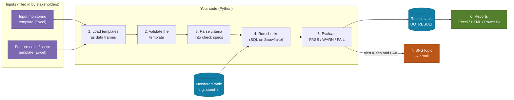
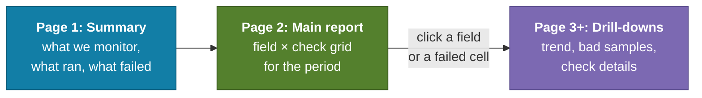
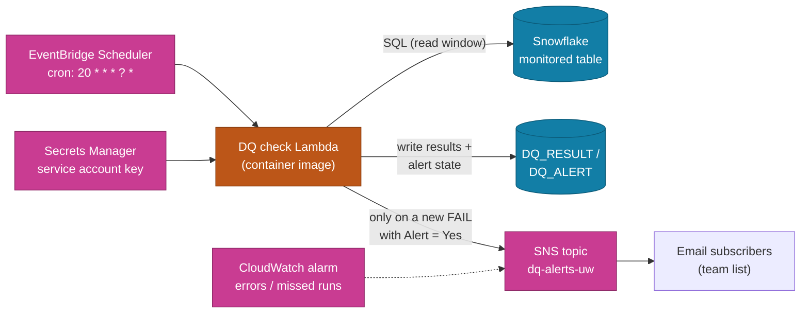
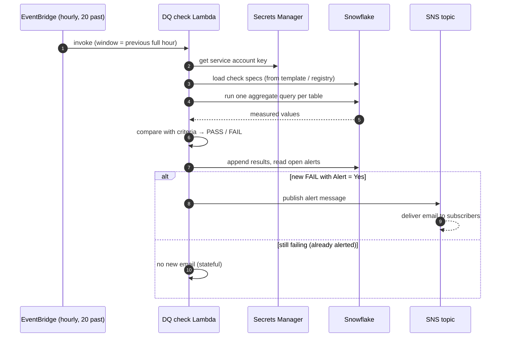
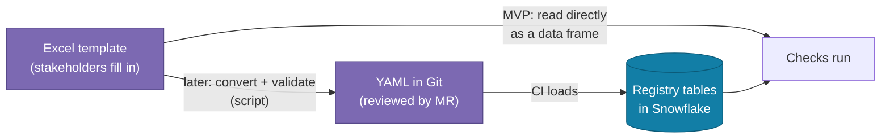

# Building the MVP, end to end

The manager's ask: **"take in the input as a data frame, those parameters, and create a report"**, then
send **hourly alerts** from AWS. This page breaks that into parts you can build and demo, starting
with the [stand-in table](what-to-monitor.md#the-stand-in-table).

## The whole pipeline



There are **two runs of the same code**, one per template: the **input monitoring report** and the
**feature / rule / score monitoring report**. Each produces its own report. Both share the results
table and the alerting.

## From template to checks { #from-template-to-checks }

### Step 1: load and reshape

The [BRD template](../data-quality/input-monitoring.md#the-variable-matrix-as-drafted) is a **wide**
grid: one row per variable, three columns per check type (*Check?*, *Criteria*, *Alert?*). Code
works better with a **long** list, with one row per *(variable, check)*:

| Template (wide) | | | | | → | Check specs (long) | | | |
| --- | --- | --- | --- | --- | --- | --- | --- | --- | --- |
| **Variable** | **Missing Values** | **Criteria** | **Alert?** | … | | **Variable** | **Check type** | **Criteria** | **Alert** |
| Avg Ticket | Yes | > 30% | Yes | | | Avg Ticket | MISSING_VALUES | > 30% | Yes |
| Avg Ticket | | | | | | Avg Ticket | ACCEPTABLE_RANGE | (<=$0 >=$10000) | No |

Rows where *Check?* is **No** are dropped.

### Step 2: validate the template ("cross-validation")

The manager asked you to *"make sure everything is covered"*. Validate the template **before**
running anything, and send the problems back to whoever filled it in:

| Validation | Example problem caught |
| --- | --- |
| The table (Snowflake path) exists and you can read it | Typo in the path; missing grant |
| Every variable exists as a column in that table | `AVG_TCKET` instead of `AVG_TICKET` |
| The check type is a known one | "Missing" instead of "Missing Values" |
| The criteria can be parsed (Step 3) | `>= 30` with no `%` on a percentage check |
| The criteria fit the column type | A numeric range on a text column |
| *Check? = Yes* has criteria; *Alert? = Yes* has *Check? = Yes* | Alert switched on for a check that doesn't run |
| No duplicate *(variable, check)* rows | The same check entered twice with different thresholds |
| Coverage | "50 fields identified, 12 have no checks" (this goes on the summary page) |

The validation result is itself a deliverable. It is what the **summary page** reports as "what we
started with".

### Step 3: parse the criteria

The criteria are free text, written by people. The manager called out the hard parts:
**"less than equal, greater than equal, single quotes, double quotes"**. Define a small, strict
grammar, and reject anything outside it with a clear message (rather than guessing).

| Written in template | Means | Parsed to |
| --- | --- | --- |
| `> 30%` | FAIL if more than 30% of rows | `{op: ">", value: 0.30, unit: "pct"}` |
| `< 70%` | FAIL if less than 70% | `{op: "<", value: 0.70, unit: "pct"}` |
| `(<=0 >=15)` | FAIL if a value is ≤ 0 **or** ≥ 15 (outside the allowed range) | `{fail_le: 0, fail_ge: 15}` |
| `(<=$0 >=$10000)` | Same, with currency symbols | `{fail_le: 0, fail_ge: 10000}` |
| `('01','02','03')` or `("01","02","03")` | Allowed values. Quotes keep `01` as text, not the number 1 | `{allowed: ["01","02","03"]}` |
| `≠ 8 char` / `= 8` | Length must be 8 | `{length: 8}` |
| `^\d{8}$` | Must match this pattern | `{regex: "^\\d{8}$"}` |

```python
import re

NUM = r"\$?(-?[\d,]+(?:\.\d+)?)"

def parse_criteria(check_type: str, text: str) -> dict:
    t = text.strip().replace("≤", "<=").replace("≥", ">=")
    if check_type in {"MISSING_VALUES", "FIELD_POPULATION", "PLACEHOLDER", "DUPLICATE_VALUES"}:
        m = re.fullmatch(r"(<=|>=|<|>)\s*" + NUM + r"\s*(%?)", t)
        if not m:
            raise ValueError(f"{check_type}: expected e.g. '> 30%', got {text!r}")
        op, num, pct = m.groups()
        value = float(num.replace(",", ""))
        return {"op": op, "value": value / 100 if pct else value, "unit": "pct" if pct else "abs"}
    if check_type == "ACCEPTABLE_RANGE":
        bounds = dict(re.findall(r"(<=|>=)\s*" + NUM, t))   # {'<=': '0', '>=': '10000'}
        if not bounds:
            raise ValueError(f"ACCEPTABLE_RANGE: expected e.g. '(<=0 >=15)', got {text!r}")
        return {"fail_le": _num(bounds.get("<=")), "fail_ge": _num(bounds.get(">="))}
    if check_type == "ACCEPTED_VALUES":
        # 'A' or "A" quoted items; fall back to bare comma-separated tokens
        items = re.findall(r"'([^']*)'|\"([^\"]*)\"", t)
        values = [a or b for a, b in items] or [v.strip() for v in t.strip("()").split(",")]
        return {"allowed": values}
    if check_type == "VALUE_LENGTH":
        m = re.search(r"\d+", t)
        return {"length": int(m.group())}
    if check_type == "EXPECTED_FORMAT":
        re.compile(t)                                       # fail now if the regex is invalid
        return {"regex": t}
    raise ValueError(f"Unknown check type {check_type!r}")

def _num(s):
    return None if s is None else float(s.replace(",", ""))
```

!!! tip "Unit-test the parser with every string in the real templates"
    Each new template will contain new ways of writing the same thing. Keep a test file of *(input
    text → expected spec)* pairs. Add every surprise to it. This is the most fragile part of the
    pipeline.

### Step 4–5: run and evaluate

Each check becomes one aggregate expression. All checks on one table run as **one query per window**,
so the cost stays low:

```sql
-- generated for the stand-in table, window 09:00–10:00
select
    count(*)                                                     as n_rows,
    avg(iff(AVG_TICKET is null, 1, 0))                           as AVG_TICKET__MISSING_VALUES,
    avg(iff(AVG_TICKET <= 0 or AVG_TICKET >= 10000, 1, 0))       as AVG_TICKET__ACCEPTABLE_RANGE,
    avg(iff(FINAL_STATUS not in ('01','02','03','13'), 1, 0))    as FINAL_STATUS__ACCEPTED_VALUES
from <DATABASE>.<SCHEMA>.<STAND_IN_TABLE>
where LAST_UPDATED_TS >= '2026-10-09 09:00' and LAST_UPDATED_TS < '2026-10-09 10:00';
```

Comparing each measured value with its parsed criteria gives **PASS / FAIL** (add WARN later). Every
result is appended to a results table, so the reports and the trend history read from one place. The
[blueprint](../dq-framework/phase-1-input.md#how-a-result-becomes-a-status) runs the same logic
through Great Expectations. The parser output feeds either engine.

## The reports { #the-reports }

The manager's main criticism of the current HTML: **"there's a lot going on there."** The report must
**call attention to the few things that matter**, and let people drill in for the rest. The layout is
**fixed**: the same pages, in the same order, every time.



### Page 1: Summary

```text
┌──────────────────────── INPUT MONITORING · Stand-in table · week of 05 Oct ───────────────────────┐
│  Source:   <DATABASE>.<SCHEMA>.<STAND_IN_TABLE>        Refresh: every 15 min    Checks run: hourly │
│                                                                                                    │
│   Fields in template   Fields with checks   Checks configured   Checks run   Failed   Alerts sent │
│          50                   38                   112             18,816        41          3     │
│                                                                                                    │
│   ● 3 need attention  ── FINAL_STATUS new value 'X9' (since Tue 14:00)                             │
│                       ── AVG_TICKET missing 33% (limit 30%) · 4 of the last 6 hours                │
│                       ── Table not updated for 45 min (Wed 02:00–02:45) · resolved                 │
│                                                                                                    │
│   Template issues: 2 variables not found in the table (see appendix)                               │
└────────────────────────────────────────────────────────────────────────────────────────────────────┘
```

What we started with (from the template), what ran, what failed, and **at most a handful** of
call-outs. Most readers stop here.

### Page 2: Main report

One row per field, one column per check type. **Healthy cells are plain**; only WARN and FAIL are
coloured; failing fields sort to the top; a filter offers **"show only issues"**. A 50–60 field table
scrolls but stays readable.

```text
 Field          Missing   Population   Range     Accepted   Format   Duplicates   Length   Placeholder
 ─────────────  ────────  ───────────  ────────  ─────────  ───────  ───────────  ───────  ───────────
 AVG_TICKET     ✖ 33%     ✖ 60%        ✖ 3 rows      ·          ·         ·          ·       ▲ 7%
 FINAL_STATUS     0%        ·            ·       ✖ 'X9'         ·         ·          ·         ·
 APPLICATION_ID   0%        ·            ·           ·        ✔         ✔ 0         ✔         ·
 …              (healthy rows below, collapsed by default)
```

**Decision for you:** fields as rows (shown above) or check types as rows. The manager said either
is fine. **Recommendation:** fields as rows. People ask about a field ("is `AVG_TICKET` OK?") more
often than about a check type, and it fits the template's layout.

### Page 3+: Drill-downs

Open only when someone clicks:

- **Field history:** the measured value per hour for the last 7–30 days, with the threshold line.
  It shows whether a failure is new or chronic.
- **Sample bad values:** a few example rows that failed (masking any PII).
- **Check details:** the template row, the parsed criteria, the SQL that ran, the alert state.

### The second report: features, rules and scores

Same three-page structure, different content on page 2:

| Page 2 section | Shows |
| --- | --- |
| Score stability | PSI per final and component score, benchmark vs active ([how PSI works](../data-quality/feature-score-monitoring.md#how-csi-and-psi-are-calculated)) |
| Feature stability | CSI for the top features |
| Rule activity | Hit rate per rule against its normal level |
| Decision mix | Share approved / declined / manual review |

On the stand-in table there are no model scores. Demo this report with the **final status mix** and
one or two numeric fields treated as "scores", so the layout is ready when the real 5c output arrives.

## Choosing the output format { #choosing-the-output-format }

| Format | Good for | Drawbacks |
| --- | --- | --- |
| **Excel** | Quick to produce from pandas; easy to email; people can filter | Not interactive across pages; files pile up |
| **HTML** (what you have now) | One file or one URL; can link pages and colour cells; easy to view | Needs hosting for a shared URL; you write the layout yourself |
| **Power BI** | **What the team already uses** for most reporting; drill-through between pages is built in; scheduled refresh; access control | Needs a workspace and a refresh connection to Snowflake; less control from code |

**Recommendation:** keep the **data** and the **presentation** separate. The run writes results to a
Snowflake table; each format just reads it.

1. **For Friday:** generate **HTML** (refining what you have) and an **Excel** export from the same
   results data frame. This is the fastest way to show the fixed pages.
2. **For production:** a **Power BI** report on the results table, with pages that match the fixed
   layout. This fits how the team already works and gives drill-through for free.

## Hourly alerting on AWS { #hourly-alerting-on-aws }

The manager's direction: **a Lambda that connects to Snowflake, runs the checks, and sends the alert
through SNS**, every hour.





| Topic | What to know |
| --- | --- |
| **"Constantly alive"** | A Lambda isn't a server that stays on. **EventBridge Scheduler** starts it every hour; it runs for seconds and stops. "Always on" means: the schedule is enabled, and a **CloudWatch alarm** tells you if a run fails or doesn't happen. |
| **Reuse what exists** | The manager said there **already is a Lambda that sends emails**. Only its **trigger** changes: for this use case, it fires when a **table-level threshold is breached**. Options: (a) your check Lambda publishes to SNS and the existing email path subscribes, or (b) your Lambda publishes straight to an SNS email subscription. **Austin owns it** ([check-in](check-in.md)): ask him whether to reuse it or build a new one. Either is fine. |
| **Connecting AWS → Snowflake** | The UW service already does this: the **AWS2SF Trans Log Pipe Lambda** writes to Snowflake. Copy its pattern (connector library, secret handling, network path) rather than inventing a new one. |
| **Package size** | GX + the Snowflake connector + pandas exceed the 250 MB zip limit. Deploy the Lambda as a **container image** (up to 10 GB). |
| **Time limit** | Lambda stops at **15 minutes**. One aggregate query per table finishes in seconds. Keep it that way: don't pull rows into Python. |
| **Don't spam** | While testing, keep the criteria **tight** so alerts are rare ([test plan](check-in.md#test-plan)). Email only when an alert **opens, escalates or resolves**, not every hour it is still failing ([alert lifecycle](../dq-framework/operations.md#alert-lifecycle)). Keep the open alerts in a Snowflake table. |
| **SNS email is plain text** | Fine for alerts. Put the link to the report in the message. If you need formatted HTML emails, use **SES** instead. |
| **Subscriptions** | Each SNS email subscriber must click a confirmation link once. Subscribe a **team distribution list**, not individuals. |

```python
# handler.py: sketch of the hourly check Lambda
import json, os, boto3
from datetime import datetime, timedelta, timezone
from dq import load_specs, run_checks, open_new_alerts, write_results, snowflake_conn

sns = boto3.client("sns")

def handler(event, context):
    end = datetime.now(timezone.utc).replace(minute=0, second=0, microsecond=0)
    start = end - timedelta(hours=1)
    with snowflake_conn(secret_id=os.environ["SF_SECRET_ID"]) as conn:
        specs = load_specs(conn)                       # parsed template rows
        results = run_checks(conn, specs, start, end)  # one query per table
        write_results(conn, results)
        new_alerts = open_new_alerts(conn, results)    # FAIL + Alert=Yes + not already open
    for a in new_alerts:
        sns.publish(
            TopicArn=os.environ["ALERT_TOPIC_ARN"],
            Subject=f"[DQ][{a.severity}] {a.table} · {a.field} · {a.check_type}"[:100],
            Message=a.render_text(),                   # what, since when, threshold, report link
        )
    return {"window": f"{start:%H:%M}–{end:%H:%M}", "checks": len(results), "alerts": len(new_alerts)}
```

## Access and approvals { #access-and-approvals }

"Do you need to get some approvals? Do you need to have some pipes or connectors built?" Find out
early; this is where schedules slip.

| Need | Why | Ask |
| --- | --- | --- |
| **Snowflake service account** (key-pair) | "If you want to automate and schedule jobs, you need a service account." Your personal login can't run unattended | Snowflake / platform admins |
| Role with **read** on the monitored tables and **write** on a DQ results schema | Lambda reads the data and stores results | Platform admins |
| A small **warehouse** for the checks | Cost tracking; doesn't compete with analysts | Platform admins |
| **AWS account and IAM role** for the Lambda | Where it runs; permissions for Secrets Manager, SNS, CloudWatch | Cloud / DevOps (Amok, Austin know the UW setup) |
| **Network path** from Lambda to Snowflake | A Lambda in a VPC needs NAT or PrivateLink to reach Snowflake. Snowflake may need the egress IPs on its network policy | Cloud team + Snowflake admins. **Check how AWS2SF does it** |
| **Secrets Manager** secret for the key | Never put keys in code or environment variables | Cloud team |
| **SNS topic** + team email list | Alert delivery | Cloud team; manager decides recipients |

!!! tip "No approvals needed to start"
    Everything up to and including the reports runs **from your machine** with your own sandbox
    access. Only the hourly AWS schedule needs the service account and approvals. Request them now,
    build the rest while you wait.

## Excel template vs YAML config { #excel-template-vs-yaml-config }

The [blueprint](../dq-framework/architecture.md#configuration-management) keeps check definitions as
YAML in Git. The manager's direction is that the **Excel template is the input**. The two fit
together:



- **MVP (now):** read the Excel template directly. It's what the manager asked for and what
  stakeholders know.
- **Production (later):** keep Excel as the **intake form**, but convert it into the reviewed
  config (YAML in Git → registry tables). The Lambda then reads the registry, never a file on
  someone's laptop. This keeps an audit trail of who changed a threshold and when.

## Build order to Friday

!!! tip "Target after the check-in"
    The [check-in](check-in.md#timeline) set the wider target: **fully automated in about three
    weeks**, tested with **one check of each type**. The steps below still apply; steps 8–9 move into
    weeks 1–2.

| # | Step | Done when |
| --- | --- | --- |
| 1 | Confirm the stand-in table's path; pick ~10 variables | You can `select` them in Snowflake |
| 2 | Draft the template rows yourself (don't wait for the manager's version) | 10 variables × several check types |
| 3 | Loader + validator + parser, with unit tests | All template rows parse or give a clear error |
| 4 | Query generator + evaluation for one window | Results data frame with PASS / FAIL |
| 5 | Loop over the last 7 days hourly; store the results | History for trends and the summary page |
| 6 | Page 1 + page 2 in HTML; Excel export | The fixed views to show on Friday |
| 7 | One drill-down (field history) | Click-through works for one field |
| 8 | Lambda + SNS prototype in a sandbox account, if access allows | A test email arrives |
| 9 | List of approvals requested and their status | Ready to discuss on Friday |
