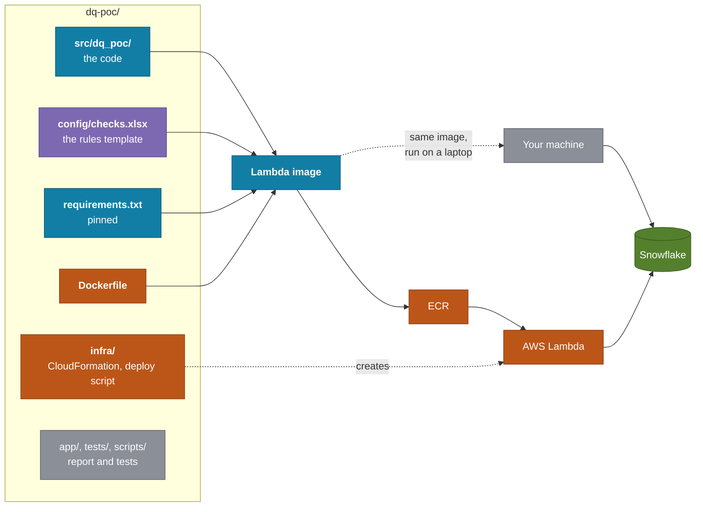
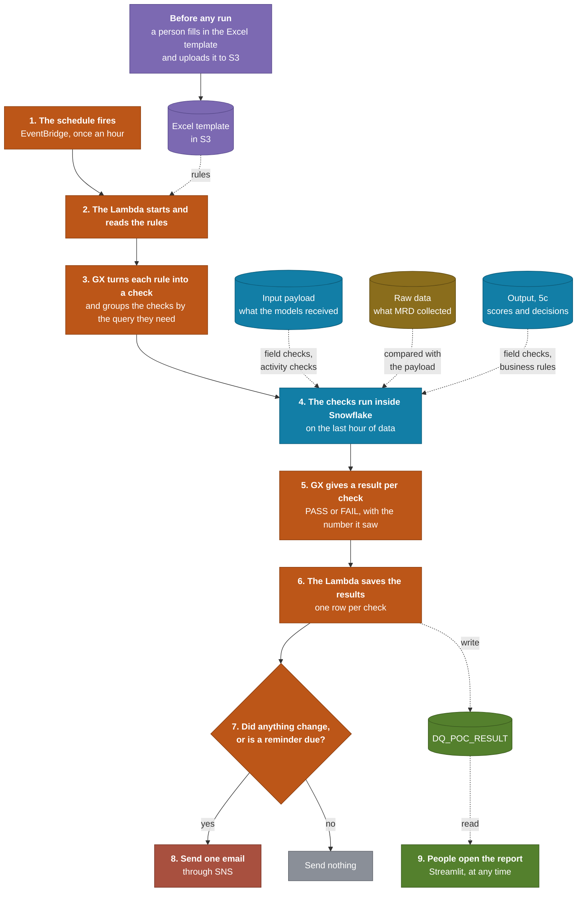
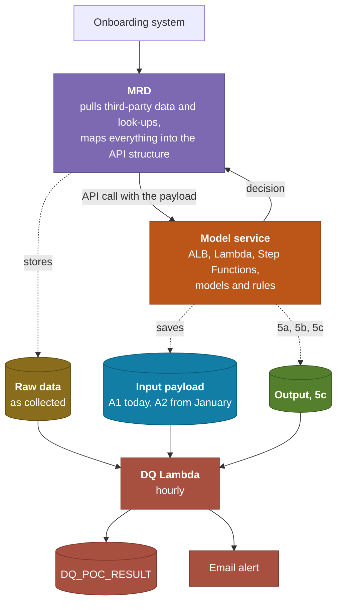
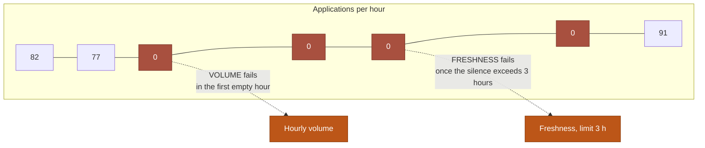
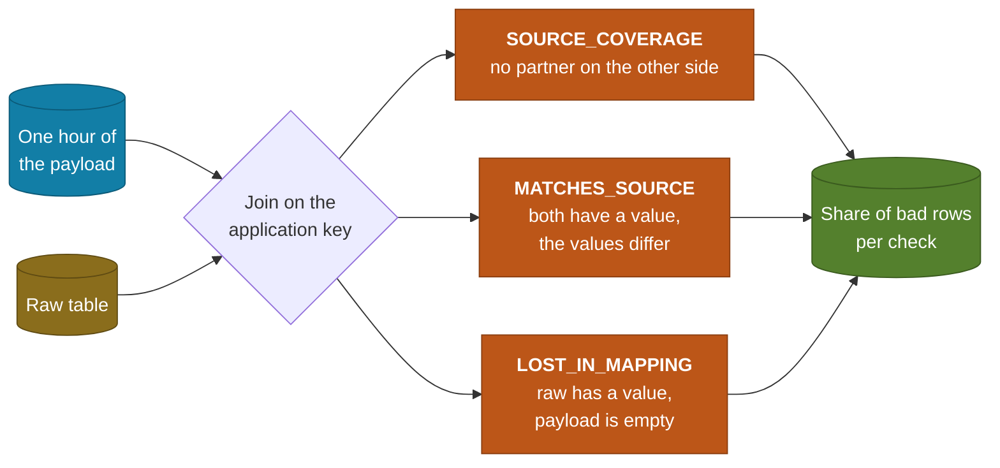
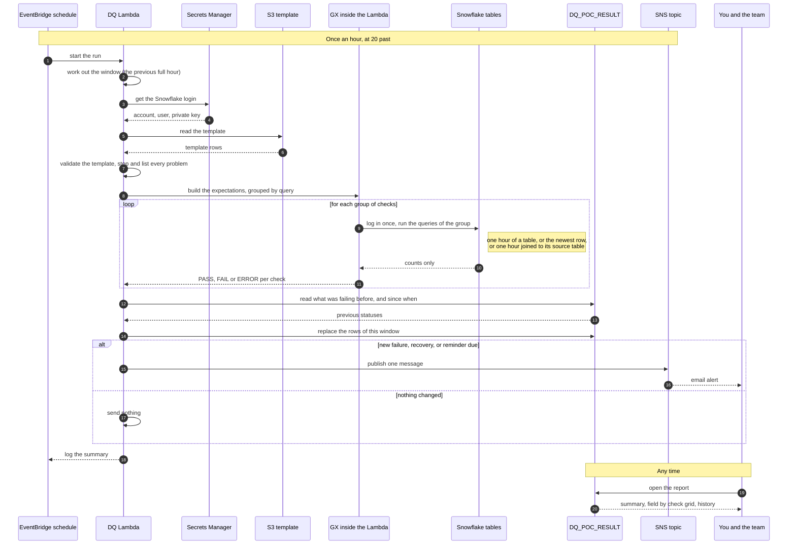
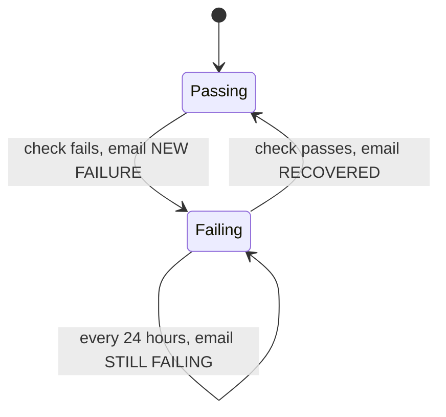
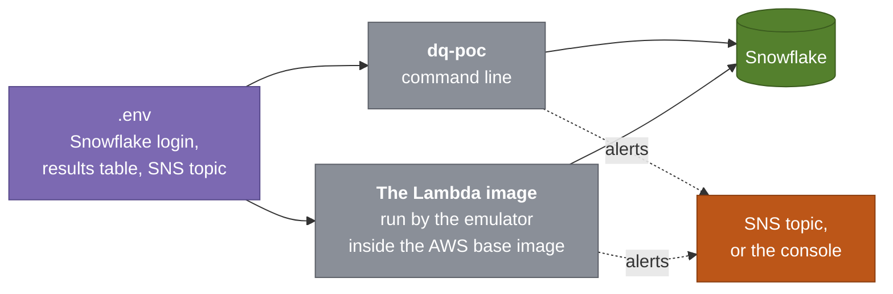

# POC: getting started

!!! warning "Replaced by the framework"
    The `dq-poc` code this page describes has been replaced by the data quality framework in
    `dq-framework/`, built from scratch for Underwriting and the Risk Monitoring feature store, with
    LocalStack for development. See [The framework: design and status](dq-framework-build.md). The
    explanations below (check types, comparison with the raw data, no-activity checks) still apply.


This page describes the **working proof of concept** for data quality monitoring on the Underwriting
(UW) models. Rules written in an Excel template are checked with **Great Expectations (GX)** on
**Snowflake** data once an hour, by an **AWS Lambda**. Results go to a **Snowflake table**, changes
raise an **alert**, and a **Streamlit report** shows the history.

The code is in the **`dq-poc/`** folder next to this docs site. Its `README.md` is the reference for
commands and settings; this page explains how it works.

!!! warning "Status"
    The code is built and unit-tested. It connects with the **Snowflake Python connector**. Alerts go
    by **email**: through **SNS** in AWS, or straight through an SMTP server from a laptop. It has
    **not yet run against the real Snowflake account**, a real SNS topic or a real mail server: that
    is the next step, once credentials are in place. The shipped rules template points at the one
    sample table built by `sql/e2e_test_data.sql`.

## The project { #the-code }

The `dq-poc/` folder is the whole deployable project: copy it, build the image, push it, create the
Lambda. The same code runs on a laptop and in Lambda; only the settings differ.



| In the folder | Goes into the Lambda image? |
| --- | --- |
| `src/dq_poc/` (the code), `config/` (the template), `requirements.txt` | **Yes**, and nothing else |
| `Dockerfile`, `.dockerignore` | They build the image |
| `infra/` | Creates the Lambda, schedule, SNS topic and alarm |
| `app/` (the report), `tests/`, `scripts/`, `.env` | **No** |

Automated tests check that the Dockerfile copies only the code, the template and the requirements,
and that no test or development package is in the image's requirements.

## The POC in one picture

Read it **top to bottom**. The numbered boxes are the steps, in the order they happen. The boxes at
the sides are what each step reads from or writes to.



Colours: **purple** is the template, **orange** runs in AWS, **blue** and **brown** are the UW data in
Snowflake, **green** is the DQ output, **red** is the alert. Solid arrows are the order of the steps.
Dotted arrows are data being read or written. Only counts come back from Snowflake; the rows stay
there.

## How it follows the UW flow { #uw-flow }

The business described the flow before the model service is called
([Requirements update](requirements-update.md)). The POC monitors the three places where that flow
leaves data in Snowflake.



| Question | Answer |
| --- | --- |
| **Which data is checked?** | The payload as the models received it, the raw data MRD stored, and the output |
| **When does a check run?** | Afterwards, once an hour, on the last hour of data. It is **not** in the request path |
| **Does it block a bad request?** | No. The request is still scored. The check reports that quality dropped |
| **Why look at the raw data too?** | A payload can look valid and still be wrong. Only a comparison with the raw data shows a mapping error |

### Which tables { #several-tables }

Several tables mean **more template rows, not more code**. The example template uses these names as
placeholders; the real table names are still to be confirmed.

| Example table | Stands for | Checked with |
| --- | --- | --- |
| `A1_INPUT_PAYLOAD` | The payload sent to the model service | Field checks, activity checks, comparison with the raw tables |
| `MRD_RAW_APPLICATION` | The application as MRD received it | Volume, and "did every application reach the payload?" |
| `MRD_RAW_EXPERIAN`, `MRD_RAW_LEXISNEXIS`, `MRD_RAW_TMX` | What each provider returned | Volume. They are the source side of the comparisons |
| `UW_OUTPUT_5C` | The decision | Field checks and business rules |

!!! warning "If the payload is stored as JSON"
    GX checks **columns**. If a table keeps the payload in one JSON (`VARIANT`) column, create a view
    that turns the monitored fields into columns, and put the **view** name in the template.

## The three kinds of check

| Kind | Question | Check types |
| --- | --- | --- |
| **Field checks** | Is the data in this table valid? | Missing values, range, accepted values, format, duplicates, length, placeholders, business rules |
| **Activity** | Is data still arriving? | `VOLUME`, `FRESHNESS` |
| **Compared with source** | Does the payload hold what the raw data says? | `SOURCE_COVERAGE`, `MATCHES_SOURCE`, `LOST_IN_MAPPING` |

### Field checks { #how-each-check-type-becomes-a-gx-expectation }

Each check type is a standard expectation from the
[GX Expectation Gallery](https://greatexpectations.io/expectations/). The limit comes from the
template row.

| Check type | GX expectation | Limit from the template |
| --- | --- | --- |
| Missing Values, Field Population | `ExpectColumnValuesToNotBeNull` | `MAX_BAD_PCT` |
| Acceptable Range | `ExpectColumnValuesToBeBetween` | `MIN`, `MAX`, `MAX_BAD_PCT` |
| Accepted Values | `ExpectColumnValuesToBeInSet` | `VALUES`, `MAX_BAD_PCT` |
| Expected Format | `ExpectColumnValuesToMatchRegex` | `REGEX`, `MAX_BAD_PCT` |
| Duplicate Values | `ExpectColumnValuesToBeUnique` | `MAX_BAD_PCT` |
| Value Length | `ExpectColumnValueLengthsToBeBetween` | `MIN`, `MAX`, `MAX_BAD_PCT` |
| Placeholder Value | `ExpectColumnValuesToNotBeInSet` | `VALUES`, `MAX_BAD_PCT` |

`MAX_BAD_PCT` is the one rule to remember: **the share of rows allowed to break the rule**. GX calls
the opposite `mostly`, the share that must pass. Confirm in the gallery that each expectation supports
Snowflake before relying on it.

### Activity checks { #no-activity }

These answer "is data still arriving?". The business asked for this after the A1 dataset received no
applications and nobody was told.

| Check type | Looks at | Fails when | Good for |
| --- | --- | --- | --- |
| `VOLUME` | The rows in **this hour** | The count is below `MIN` or above `MAX` | A source that should send something every hour |
| `FRESHNESS` | The newest row in the **whole table** | It is older than `MAX` hours | "Tell me when nothing arrives", with quiet hours allowed |



Use `VOLUME` where an empty hour is always wrong. Use `FRESHNESS` where quiet hours are normal (nights,
weekends): set `MAX` to the longest silence that is still acceptable.

A check that keeps failing is repeated as a **reminder** every 24 hours (configurable), so an outage
that lasts days is not forgotten after the first email.

### Compared with source { #reconciliation }

This compares **two copies of the same application's information**: the raw data MRD collected, and
the payload MRD built from it. The mapping between them is where mistakes have happened before.

Take one application, with made-up values:

| Information | Raw data | Payload | Result | Check that catches it |
| --- | --- | --- | --- | --- |
| Requested amount | 50,000 | 50,000 | Same | |
| ZIP code | 07302 | 7302 | **Different** | `MATCHES_SOURCE` |
| Channel | WEB | POS | **Different** | `MATCHES_SOURCE` |
| TMX score | 41 | *(empty)* | **Lost** | `LOST_IN_MAPPING` |
| The whole application | *(no record)* | present | **No partner** | `SOURCE_COVERAGE` |



| Check type | A row is bad when | Catches |
| --- | --- | --- |
| `SOURCE_COVERAGE` | It has **no partner** in the other table | Data that never made it across. Swap the two tables to check the other direction |
| `MATCHES_SOURCE` | Both sides have a value and they **differ** | A value in the wrong field, a changed code, a lost leading zero |
| `LOST_IN_MAPPING` | The raw side **has a value** and the payload is **empty** | A field dropped by the mapping |

The three never count the same row twice, so each number has one meaning. `MATCHES_SOURCE` compares in
one of three ways: `EXACT`, `TEXT` (ignores case and surrounding spaces) or `NUMERIC` (with a
tolerance).

**Why it matters.** A payload check alone cannot tell these apart:

| What happened | Missing-values check on the payload | `LOST_IN_MAPPING` | Who fixes it |
| --- | --- | --- | --- |
| The provider sent no score | Fails | **Passes** (the raw data is empty too) | The provider, or nobody |
| The provider sent a score and the mapping dropped it | Fails | **Fails** | MRD |
| The mapping wrote a valid but wrong value | **Passes** | n/a: `MATCHES_SOURCE` fails | MRD |

The unit tests check the SQL behind each of the three. Their behaviour on real data is checked on
the first Snowflake run.

!!! warning "Three things decide whether this works on real data"
    - **A shared key.** Both sides must carry the same application identifier.
    - **Timing.** If the raw data lands later than the payload, the newest hour shows false gaps.
    - **Intended transformations.** If MRD converts a value on purpose, the comparison must know.

    These are open questions for the MRD team ([list](requirements-update.md#questions-to-ask)).

### Business rules { #custom-rules }

A business rule is a check the gallery cannot express, such as a condition across several columns or
a lookup in a reference table. There are three ways to get an expectation, in the order to try them:

| Way | When | Example in the code |
| --- | --- | --- |
| **1. Gallery expectation, as is** | A standard check on one field | Every field check above |
| **2. A preset** of a gallery expectation | A fixed rule that deserves a name | "The final score is between 300 and 900" |
| **3. Custom SQL** (`UnexpectedRowsExpectation`) | Nothing in the gallery fits | "An approved application has a final score" |

For custom SQL, the query selects the rows that **break** the rule, and the check passes when it
returns none. The template picks a rule by name (`CHECK_TYPE = BUSINESS_RULE`, `RULE_NAME = …`). The
SQL lives in `src/dq_poc/business_rules.py`, where it is reviewed. Nobody types SQL into Excel.

Comparing with a source table does **not** need custom SQL: use the three check types above.

## The template

One row is one check. The stakeholder template is wide (one row per field); a reshape step turns it
into this long form ([template to checks](mvp-build.md#from-template-to-checks)).

| Column | Meaning |
| --- | --- |
| `TABLE`, `TS_COLUMN` | The table, and the timestamp column used to pick the hour |
| `FIELD` | Column to check. Empty for table-level checks |
| `CHECK_TYPE` | One of the check types above |
| `MIN`, `MAX`, `VALUES`, `REGEX`, `MAX_BAD_PCT` | The limits |
| `RULE_NAME` | For a business rule |
| `SOURCE_TABLE`, `SOURCE_FIELD`, `KEY`, `COMPARE`, `TOLERANCE` | For a comparison with a source table |
| `ALERT` | `Yes` sends an alert when the check starts failing |

Example rows, one of each kind:

| TABLE | FIELD | CHECK_TYPE | Limits | SOURCE_TABLE | KEY | ALERT |
| --- | --- | --- | --- | --- | --- | --- |
| `A1_INPUT_PAYLOAD` | `ZIP` | EXPECTED_FORMAT | `REGEX ^[0-9]{5}$`, `MAX_BAD_PCT 25` | | | Yes |
| `A1_INPUT_PAYLOAD` | | FRESHNESS | `MAX 3` (hours) | | | Yes |
| `A1_INPUT_PAYLOAD` | `ZIP` | MATCHES_SOURCE | `COMPARE TEXT`, `MAX_BAD_PCT 1` | `MRD_RAW_APPLICATION` | `APPLICATION_ID` | Yes |
| `A1_INPUT_PAYLOAD` | `TMX_SCORE` | LOST_IN_MAPPING | `MAX_BAD_PCT 2` | `MRD_RAW_TMX` | `APPLICATION_ID` | Yes |
| `UW_OUTPUT_5C` | | BUSINESS_RULE | `RULE_NAME APPROVED_HAS_FINAL_SCORE` | | | Yes |

The template is read on **every run**, and the GX expectations are built from it in memory. Changing
a limit, a field or a table needs no code change. A template with a problem stops the run and lists
**every** problem with its row number, before any check runs.

## One run, step by step { #one-run }



| Steps | What happens | Where in `src/dq_poc/` |
| --- | --- | --- |
| 1–2 | The schedule starts the Lambda, which picks the previous full hour | `lambda_handler.py`, `runner.py` |
| 3–4 | The Lambda gets the Snowflake login | `settings.py` |
| 5–7 | The Lambda reads and validates the template | `template.py` |
| 8 | Checks become expectations, grouped so each table is read as few times as possible | `expectations.py`, `sql.py` |
| 9–11 | GX runs each group. Only counts come back. A broken check becomes `ERROR` and the rest continue | `runner.py`, `store.py` |
| 12–14 | The Lambda compares with the previous run and stores the results | `store.py` |
| 15–17 | One message is sent only if something changed or a reminder is due | `alerts.py` |
| 18 | The run ends with one log line | `runner.py` |
| 19–20 | People read the results table through the report. This never touches GX or the Lambda | `app/streamlit_app.py` |

If a step fails, the place to look is:

| Fails at | Likely cause | Look in |
| --- | --- | --- |
| 3–4 | Missing secret or permission | Lambda logs in CloudWatch |
| 5–7 | Template missing in S3, or a problem in a row | Lambda logs: the error lists the rows |
| 9–10 | No network path to Snowflake, wrong table or column name | Lambda logs. A bad check is stored as `ERROR` with the message in `DETAILS` |
| 14 | No write access to the results table | Lambda logs |
| 15–16 | Email subscription not confirmed | SNS console |

## Results and alerts

**Results.** One row per check per window, in one flat table. Re-running a window replaces its rows.
The main columns are the window, the check, `STATUS` (`PASS`, `FAIL`, `ERROR`), the observed number
and what it means (`METRIC`: share of bad rows, row count, or hours since the newest row), and the
limit as text. Only counts are stored, never example values: UW data includes personal data.

**Alerts.** One message per run, for checks with `ALERT = Yes`:



## Before AWS: run it from your machine

The same code and the same image run on a laptop, against the real Snowflake account, before
anything is deployed.



```bash
cd dq-poc
make setup && cp .env.example .env    # then fill in .env (git-ignored)
make check                            # log in and show the account, role, warehouse
make init                             # create the results table, once
make run                              # check the last full hour
make app                              # the report at http://localhost:8501
make lambda-local                     # the Lambda image itself, on :9000
```

| Step | Proves |
| --- | --- |
| `make check` | The login works and lands on the right role, warehouse and database |
| `make run` | The template's tables and columns exist and every check can run |
| `make lambda-local` + `make lambda-invoke` | The image works with the same settings it will have in AWS |
| `make test-snowflake` | Login, results table round trip, no check returns `ERROR`, and every planted problem is caught by the right check |

**Alerts from your machine** go by email through an SMTP server (`DQ_ALERT_CHANNELS=log,email` and
the `DQ_SMTP_*` settings in `.env`), or through SNS with your AWS login. In AWS the Lambda uses SNS,
and the topic's email subscribers receive the alert.

**End-to-end test data.** `sql/e2e_test_data.sql` creates **one sample table**, `UW_SAMPLE_INPUT`,
shaped like the input data in the monitoring template (Merch ID, Enquiry Date, Avg Ticket, Client
ID, and a few more), with 24 hours of made-up applications. Some hours have a problem planted on
purpose: missing values, a placeholder, an unknown channel, malformed ZIP codes, duplicates, values
out of range, three hours with no applications at all. Run it in Snowsight, point `.env` at that
schema, and `make test-snowflake` checks that each problem is caught by the right check and by
nothing else. `drop schema DQ_POC_TEST` removes it.

## Deploy to AWS

| Piece | What it is |
| --- | --- |
| **Lambda** | A container image built from the `Dockerfile`: pinned requirements, `src/dq_poc` and `config/`. 2048 MB, 5-minute timeout |
| **Schedule** | EventBridge Scheduler, every hour at 20 past. The 20 minutes leave room for late-arriving data |
| **Rules** | The template inside the image, or in S3 so the rules can change without a rebuild |
| **Login** | A Secrets Manager secret holding the service account's key pair |
| **Alerts** | An SNS topic with email subscribers. Subscribe only yourself at first |
| **Did it run?** | A CloudWatch alarm on the Lambda's errors, so a broken run is noticed |
| **Network** | A path from the Lambda to Snowflake. Copy what the AWS2SF Lambda in the UW service uses |

`infra/cloudformation.yaml` and `infra/deploy.sh` create all of this; the README also lists the
console steps. They are a reference: if
the team deploys Lambdas through its own pipeline, keep the Dockerfile and the settings and use that
pipeline. What you need first is on [access and approvals](mvp-build.md#access-and-approvals).

## The report

`app/streamlit_app.py` reads only the results table. The same file runs on a laptop and inside
**Streamlit in Snowflake**, where it needs no hosting and uses Snowflake's own access control.

| Page | Shows |
| --- | --- |
| **Summary** | Checks run, passed, failed. Counts by table and by kind of check. What needs attention |
| **Status by field** | For one table: a grid of field by check |
| **History of one check** | The observed number hour by hour, with the limit, and every past result |

These are the three fixed pages the manager asked for ([the reports](mvp-build.md#the-reports)). A
Snowsight dashboard on the same table is a fallback if Streamlit is not enabled.

## What you will demo

A 10-minute story:

1. **"Here are the rules."** The Excel template: one row per check, three kinds of check.
2. **"Here is the run."** One run on the real tables, with the observed number beside each limit.
3. **"Here is the alert."** The email for the check that just started failing.
4. **"Here is the history."** The report: summary, grid, and the trend for one check.
5. **"Here is the comparison with the raw data."** The share of applications where payload and raw
   data disagree, per field. A mapping error shows here even when every payload check passes.
6. **"Here is the no-activity alert."** The freshness check on the A1 dataset, and the reminder that
   repeats while it stays empty.

Then change one limit in the template, run again, and show the result change with no code change.

## From the POC to the real UW models

| Change | What you do |
| --- | --- |
| **Real tables** | Put the real table and column names in the template: the A1 payload now, A2 from January |
| **Real rules** | Replace the demo rows with the modelling team's filled-in templates |
| **Mapping sheet** | Get the list of payload field to raw field, and the key, from the MRD team |
| **Business rules** | Replace the example table and column names in `business_rules.py` |
| **Recipients** | Subscribe the team distribution list to the SNS topic |

### First run on real Snowflake { #first-real-run }

| Area | What to check |
| --- | --- |
| Login | Key pair (encrypted or not), password, or browser sign-on. `make check` shows where the login lands |
| Column names | Use the case Snowflake shows, normally upper case |
| Time zone | Windows are in UTC. Check what zone each timestamp column is stored in |
| Timestamp type | `FRESHNESS` assumes a `timestamp_ntz` column. Another type may need a view |
| Regex and comparisons | Test each pattern and one mismatch by hand |
| Each expectation | Confirm in the gallery that it supports Snowflake |

Run `make run` and `make test-snowflake` from your own machine against real tables before deploying
anything.

## What the POC leaves out

| Not in the POC | Where it is designed |
| --- | --- |
| Drift checks on features and scores (PSI / CSI) | [Phase 2](../dq-framework/phase-2-features-scores.md) |
| Daily volume compared with the usual volume for that weekday | [Phase 1](../dq-framework/phase-1-input.md#check-catalog). It needs a few weeks of history |
| WARN level, escalation, suppression windows | [Operations](../dq-framework/operations.md#alert-lifecycle) |
| Reviewed config in Git, registry tables, audit trail | [Architecture](../dq-framework/architecture.md#configuration-management) |
| Data Type checks | [Phase 1](../dq-framework/phase-1-input.md#check-catalog) |
| Power BI report | It reads the same results table, so it can be added without touching the checks |
