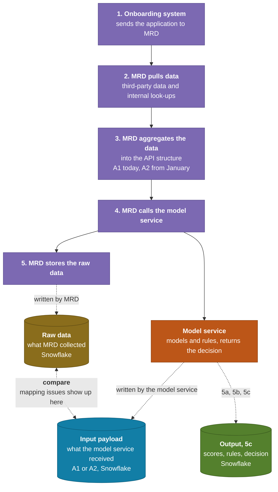
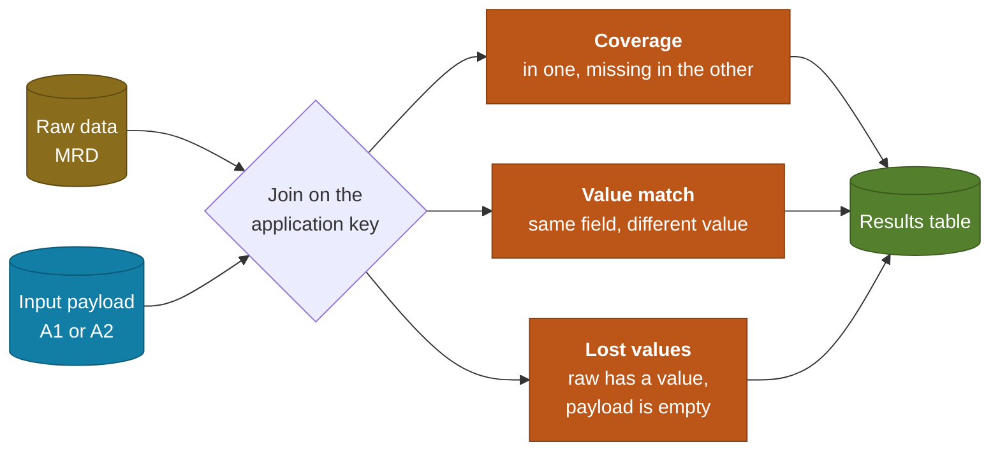

# Requirements update: upstream flow, reconciliation & no-activity alerts

An email from **Michelle Davis** (Sunday 11 October, to you and Srayasee Chakraborty) sets the first
focus for monitoring and adds **two requirements** the plan did not cover. It also explains the
upstream flow and what **A1** and **A2** are.

!!! info "Source and labels"
    This page is based on a photo of the email. Anything worked out rather than stated in the email
    is marked **(inferred)**. Your reply to the email (Monday 12 October) is not included here.

## The email in one paragraph

Monitoring should **first focus on the input into the Model Service**. That input is the **A2**
payload, sent through an API call **starting in the January timeframe**, and it will be saved into
Snowflake. Because there have been **mapping issues** before, the team wants to **compare the raw
data with the payload** that reaches the API. They also want an alert on the **absence of activity**:
the A1 analytic dataset received no applications from 10 October, and nobody was told.

## What it confirms, changes and adds

| | Point | Effect on the plan |
| --- | --- | --- |
| **Confirms** | Start with **input** monitoring | Same as Phase 1 of the [blueprint](../dq-framework/phase-1-input.md) |
| **Confirms** | The input payload **is saved into Snowflake** | The [working assumption](what-to-monitor.md) is right. Checks still run after the data lands |
| **Confirms** | **MRD** is the system that calls the model service | Already on the [architecture diagram](../data-flow.md) as an external service |
| **Changes** | **A1** is the API structure **today**. **A2** replaces it in the **January timeframe** | The new UW payload is A2 and does not exist yet. A1 is what can be monitored now |
| **Changes** | There are **two** kinds of input data in Snowflake: MRD's **raw data** and the **payload** | The "one request table per source" assumption is refined, see [below](#what-to-monitor-now) |
| **Adds** | **Compare raw data with the payload** | New capability: [reconciliation](#reconciliation). Not in the blueprint or the POC |
| **Adds** | **Alert on no activity** | In the blueprint as *Freshness*, but **left out of the POC**. See [no-activity alerts](#no-activity) |

## The upstream flow

The email gives the steps before the model service is called. This is the part the
[UW architecture diagram](../data-flow.md) shows only as "External service (MRD, RASI, …)".

The **mapping** happens in step 3. If MRD puts a value in the wrong field, drops a field, or changes
its format, the model service still gets a valid-looking payload. A check on the payload alone may
pass. Only a comparison with the raw data shows that the value is wrong.

### A1 and A2 { #a1-and-a2 }

| | A1 | A2 |
| --- | --- | --- |
| What it is | The API structure MRD sends **today** | The API structure for the new models |
| When | Live now. The new models went live on it on **15 Oct 2026** (Day 1), with 56 added input fields | **January 2027** (Day 2) |
| In Snowflake | An **A1 analytic dataset** exists now. It received no applications from 10 October | The payload **will be** saved |
| Role in monitoring | The dataset to monitor **now** | The dataset to monitor **from go-live** |

The [Implementation Support Document](implementation-support-doc.md#input-and-output-records-section-1)
adds that an **A1 output** Snowflake table and a **full response** Snowflake table exist from Day 1.
The full-response table is most likely the raw data this email refers to **(inferred)**, and the
document's **input mapping spreadsheet** (model field, source, raw field) is the mapping sheet the
comparison needs.

This answers the open question from the 1:1, "is A1 the same as the UW API request table?". They are
the same **kind** of thing: the model service's input payload. A1 is the current version and A2 is
the next one. The [kickoff](../kickoff/whiteboard.md) named A1 as the Day 1 source, and that still
holds.

!!! warning "Two timelines to reconcile"
    The manager said Underwriting is "the first one that's going to go live this year". This email
    says the A2 input arrives through the API "starting in Jan timeframe". Both can be true (for
    example, a deployment this year and live traffic in January), but confirm it. It decides when
    real A2 data exists to test on.

## What to monitor now { #what-to-monitor-now }

| # | Data | Written by | Monitoring | When |
| --- | --- | --- | --- | --- |
| 1 | **A1 analytic dataset** | Exists today **(layout to be confirmed)** | Input checks, and the **no-activity alert** | **Now.** It is real and has a real, recent problem |
| 2 | **Raw data** | MRD | **Reconciliation** against the payload | Once the tables and the key are known |
| 3 | **A2 input payload** | Model service | Input checks, reconciliation, no-activity alert | From the January timeframe |
| 4 | **Output, 5c** | Model service | Feature, score and rule monitoring | Phase 2, unchanged |

Earlier pages assumed the payload is stored as **one table per source**. The email does not say how
either data set is laid out. A better reading **(inferred)**: the **raw data** may be split by source
(it is what MRD pulled from each provider), and the **payload** is one aggregated structure. Both
layouts work with the POC: a table is a set of template rows.

## New requirement 1: compare raw data with the payload { #reconciliation }

> "Could we build a capability to compare data across sources: the raw data to our input payload?"

This is **reconciliation**: for the same application, does the payload hold what the raw data says?

### What is compared with what

There are **two copies** of each application's information, both in Snowflake.

| | Copy 1: the raw data | Copy 2: the payload |
| --- | --- | --- |
| What it is | Everything MRD gathered, **as it was gathered** | The same information, **rearranged** into the layout the model service expects |
| It includes | The application from the onboarding system, what each third-party provider returned, MRD's internal look-ups | One record per application with the fields the models use (A1 today, A2 from January) |
| Written by | MRD | The model service saves what it received |
| Used by | Nobody downstream: it is the record of what was collected | The models. This is what gets scored |

MRD builds copy 2 **from** copy 1. That step is the *mapping*, and it is where mistakes have happened
before. Comparing the copies checks that nothing was lost or changed on the way.

**An example**, with made-up values, for one application `APP-123`:

| Information | Raw data | Payload | Result |
| --- | --- | --- | --- |
| Requested amount | 50,000 | 50,000 | Same |
| ZIP code | 07302 | 7302 | **Different**: the leading zero was lost |
| Channel | WEB | POS | **Different**: the wrong value was mapped |
| Experian score | 712 | *(empty)* | **Lost**: the provider sent it, but it never reached the payload |

The comparison does this for every application in the hour and every mapped field, and reports **how
often** the two copies disagree. It works on two levels:

1. **The keys.** Is the application present on both sides?
2. **The data.** For each mapped field, does the payload value equal the raw value?

!!! note "What 'raw' means is an assumption"
    The email says only "MRD stores the raw data into Snowflake". These pages read that as the data
    **before** MRD's mapping. Whether it is the providers' untouched responses or something MRD has
    already partly processed is not stated, and it decides how much the comparison can prove.

### The three checks

| Check | Question | Typical mapping issue it catches |
| --- | --- | --- |
| **Coverage** | Does every application in the payload have raw data, and the reverse? | A source's data never reached the payload, or raw data was not stored |
| **Value match** | For a mapped field, is the payload value equal to the raw value? | A value mapped to the wrong field, a unit or code changed, truncation |
| **Lost values** | Is the payload field empty where the raw field has a value? | A field dropped in the mapping. The payload looks "missing", but the provider did send it |

The third check matters most for the existing **Missing Values** checks. A missing score in the
payload can mean "the provider had no data" or "the mapping lost it". Only the raw data tells them
apart, and the two need different people to fix them.

### What it needs

A **mapping sheet**, one row per field to compare. This is a third template next to the two that
already exist.

| Column | Meaning | Example **(inferred)** |
| --- | --- | --- |
| `PAYLOAD_TABLE`, `PAYLOAD_FIELD` | The field as the model service received it | `<A2_PAYLOAD>`, `EXPERIAN_SCORE` |
| `RAW_TABLE`, `RAW_FIELD` | The same value as MRD stored it | `<MRD_RAW_EXPERIAN>`, `SCORE` |
| `KEY` | The column that identifies one application in both | `APPLICATION_ID` |
| `COMPARE` | How to compare: exact, numeric with a tolerance, or text ignoring case and spaces | `NUMERIC` |
| `MAX_BAD_PCT` | Share of applications allowed to differ | `0` |
| `ALERT` | Send an alert when it starts failing | `Yes` |

### How it is built in the POC

It is built, and it needed no new engine. The mapping columns went into the **same template** as the
other checks, as three check types ([details](poc-getting-started.md#reconciliation)):

| Check type | Level | A row is bad when |
| --- | --- | --- |
| `SOURCE_COVERAGE` | Keys | It has no partner in the other table |
| `MATCHES_SOURCE` | Data | Both sides have a value and the values differ |
| `LOST_IN_MAPPING` | Data | The raw side has a value and the payload is empty |

One query joins an hour of the payload to the raw table and marks each row 0 or 1 per check. A
standard GX expectation then measures the share of 1s, so every comparison reports a percentage.
Results, alerts and the report needed no change: a comparison is one more row per window.

!!! warning "Three things decide whether this works"
    - **A shared key.** Both sides must carry the same application identifier.
    - **Timing.** MRD stores the raw data at the end of its flow. If it lands later than the payload,
      comparing the newest hour reports false gaps. Compare a window that ended an hour or more ago.
    - **Intended transformations.** If MRD converts a value on purpose (units, codes, rounding), the
      comparison must apply the same rule, or every row "differs". The mapping owner has to state
      these.

## New requirement 2: alert on the absence of activity { #no-activity }

> "Our A1 analytic dataset did not get any applications from 10-10-2026. Could we make sure we get
> alerted to this?"

This is a real incident that monitoring would have caught. It is also the strongest case for the
framework so far: a dataset went quiet and nobody noticed for at least a day.

### Does the POC catch it today?

Partly. Three gaps:

| Gap | Why it matters here |
| --- | --- |
| The POC's `VOLUME` check counts rows in **one hour** | A dataset that normally has quiet hours (nights, weekends) fails every quiet hour, or the limit is set so low it catches nothing |
| **Freshness was left out** of the POC | "How long since the last application?" is the direct question, and it has no check type yet |
| An alert is sent **once**, when a check starts failing | A dataset that stays empty for three days sends one email on day one, then nothing. The problem can be forgotten |

10 October 2026 was a **Saturday**, which makes the first gap concrete: a rule must know whether a
quiet weekend is normal for this dataset.

### What to add

| Check | Rule | Catches | In the POC |
| --- | --- | --- | --- |
| **No activity (freshness)** | Fail if the newest application is older than N hours. Looks at the **whole table**, not one hour | The 10 October case: nothing arriving at all | Yes |
| **Reminder** | While an alert stays open, send it again every 24 hours | The alert being sent once and forgotten | Yes |
| **Daily volume against normal** | Fail if a day's count is far below the usual count for that weekday | A partial drop: one channel or client stops, the rest continue | Not yet |

| Decision needed | Why |
| --- | --- |
| How long without applications is **too long**? | Sets N. It may differ for weekdays and weekends |
| Is a quiet **weekend or holiday** normal for A1? | Avoids a false alert every Saturday |
| **Who** gets this alert? | An empty input is usually an upstream (MRD or pipeline) problem, not a modelling one |
| Did the applications **not arrive**, or did they arrive and **not load** into the dataset? | "From 10-10-2026" may mean "since" or "for" that date. Comparing with the raw data answers which side failed |

The blueprint already describes both checks
([Phase 1 check catalog](../dq-framework/phase-1-input.md#check-catalog): Freshness, and Volume
against the trailing median for the same hour of the week). **Freshness and the reminder are now in
the POC** ([details](poc-getting-started.md#no-activity)). The daily-volume comparison is not: it
needs a few weeks of history first.

!!! tip "A quick win"
    A1 exists today and has a current problem. A **no-activity alert on the A1 analytic dataset** is
    a small, real first delivery: one table, one timestamp column, one rule. It needs only the A1
    table path and the answer to "how long is too long".

## Effect on the POC code

Most of what the email calls for is now built in `dq-poc/`. It is unit-tested; it has not yet run
against the real Snowflake account.

| # | Addition | Status |
| --- | --- | --- |
| 1 | `FRESHNESS` check type: hours since the newest row, on the whole table | **Built**, unit-tested |
| 2 | Reminder: repeat an open alert every 24 hours (configurable) | **Built**, unit-tested |
| 3 | `SOURCE_COVERAGE`, `MATCHES_SOURCE`, `LOST_IN_MAPPING` and the mapping columns in the template | **Built**, unit-tested |
| 4 | Alerts through SNS | **Built**, not yet sent to a real topic |
| 5 | Daily volume compared with the same weekday in past weeks | Not built. Needs a few weeks of history |
| 6 | First real run on the **A1 analytic dataset** | Not done. Needs the Snowflake login, the A1 path and its timestamp column |
| 7 | Reconciliation on real data | Not done. Needs the raw table layout, the field mapping and the key |

## Questions to ask

| # | Question | For |
| --- | --- | --- |
| 1 | What is the Snowflake path of the **A1 analytic dataset**, and which column is the application timestamp? | Michelle / data owner |
| 2 | Where does MRD store the **raw data**: which tables, one per source or one combined? | MRD team |
| 3 | Which **key** links a raw record to a payload record? | MRD team |
| 4 | Does MRD **transform** values on purpose when it builds the payload (units, codes, rounding)? Is there a mapping document? | MRD team |
| 5 | How soon after the API call is the **raw data** stored, and the **payload**? | MRD team / model service |
| 6 | For "no activity": how long is too long, and are quiet weekends normal? | Michelle |
| 7 | On 10 October, did applications not arrive, or not load? Has it been fixed? | Michelle |
| 8 | Is the **A2** structure final, and where will its payload be saved? | Model service team |
| 9 | Which fields had **mapping issues** before? They are the first rows of the mapping sheet | Michelle |

## Corrections to earlier pages

| Earlier | Now |
| --- | --- |
| "Shreya (spelling uncertain)", the modelling contact | **Srayasee Chakraborty**, as spelled in the email and in the implementation document (document owner). That this is the same person is **inferred** from the transcripts ("Shriyashi", "Shrassir") |
| "Is A1 the same as the UW API request table?" (open question) | Answered: A1 is today's API structure, A2 the January one. See [A1 and A2](#a1-and-a2) |
| The payload is stored as one table per source (assumption) | Not stated. More likely the **raw data** is per source and the **payload** is one structure **(inferred)** |
| Freshness left out of the POC because the volume check covers it | Not enough. Freshness and reminders are now built. See [no-activity alerts](#no-activity) |
