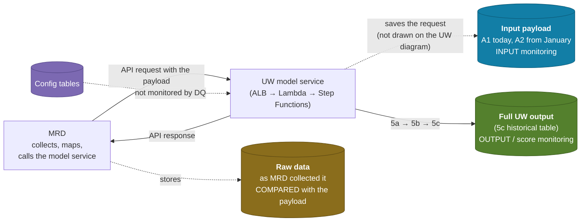
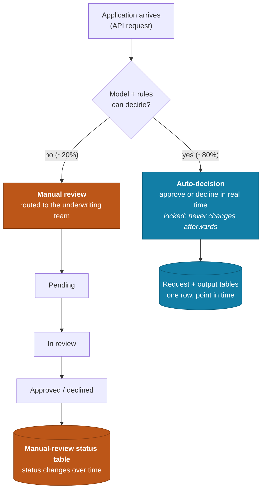

# What to monitor

In the 1:1, you asked where the Snowflake tables are in the [UW architecture](../data-flow.md). The
deployment work starts from the **config tables**, but the diagram shows no table for the request
data. The manager's answer settles **which tables input monitoring actually reads**.

## Not the config tables

The [config tables](../upstream-config.md) hold reference data: thresholds, MCC statistics, lookup
values. They change rarely, through a governed admin console. They are **not** what data quality
monitoring tracks.

!!! note "Config tables still need *some* care"
    The [support guide](../support-guide.md) notes that an empty or malformed config file can break
    every request. That is an **operational** check: did the config pipe run, is the S3 file valid. It
    belongs with deployment and support, not in the DQ input reports.

## The UW data to monitor

A [later email](requirements-update.md) added the **raw data** to this picture and named the caller
(MRD). The [Implementation Support Document](implementation-support-doc.md) names the Day 1 tables:
an **A1 output** Snowflake table and a **full response** Snowflake table, live since 15 October 2026. The table below is from the 1:1; "API request table" there is the **input payload**.

| Table | What's in it | Monitored by | Status |
| --- | --- | --- | --- |
| **API request table** | Every request from step 1 (the input fields the models use) | **Input monitoring** (Phase 1) | **Working assumption: it exists.** One row per request, holding the request and its payload data. The manager: "we are only writing it to a Snowflake table". It isn't drawn on the architecture diagram, and the path is a placeholder until confirmed |
| **Full UW output (5c)** | Every decision: component scores, final score, rule results, decision | **Feature, score & rule monitoring** (Phase 2) | Exists ([Band 3](../data-flow.md#band-3-asynchronous-transaction-logging-bottom)) |

!!! note "Working assumption"
    The docs now assume each API request is stored in Snowflake with its payload data, and that
    **input monitoring runs there**. The payload comes from several sources, so it is probably
    stored in **more than one table**, roughly one per source. On this page "the API request table"
    means that **set of tables**. Their paths are placeholders such as
    `<DB>.<SCHEMA>.<UW_REQ_APPLICATION>`. Replace them when the real names are known. Several tables
    need more template rows, not more code: see
    [More than one request table](poc-getting-started.md#several-tables).

    A later email refines this: the **raw data** stored by MRD may be split by source, and the
    **payload** is one aggregated structure (A1 today, A2 from January). See
    [Requirements update](requirements-update.md#what-to-monitor-now). The [POC](poc-getting-started.md#uw-flow) is built on
    this assumption.

The modelling contact (Srayasee Chakraborty) will list the exact tables and fields for the new models in the two
templates. That's what the [Jira ticket](communications.md#jira-ticket) asks for.

!!! success "Answered by a later email"
    **A1** is the API structure MRD sends **today**; **A2** replaces it in the **January timeframe**.
    Both are the model service's input payload. There is also MRD's **raw data** in Snowflake, to be
    compared with the payload. See [Requirements update](requirements-update.md#a1-and-a2). The tip
    below is kept for the record.

!!! tip "How this relates to A1"
    The [kickoff](../kickoff/whiteboard.md) named **A1**, a consolidated dataset, as the Day 1 source.
    For **Underwriting**, the 1:1 is more specific: the API request table is the input. Treat A1 as the
    general Day 1 idea and the request table as the UW answer. Confirm with the manager whether A1 and
    the request table are the same thing **(inferred: likely related)**.

## Auto-decisioned vs manually reviewed applications

The manager also explained a second kind of table, which the stand-in table belongs to.

| | Auto-decision | Manual review |
| --- | --- | --- |
| Share of applications | ~80% | ~20% (the share that "goes for manual review") |
| When decided | Real time, inside the API call | Later, by an underwriting analyst |
| Does the record change? | **No.** Locked at the point of decision | **Yes.** Status moves over time until approved or declined |
| Where it's stored | Request table (input) + 5c output | A separate status table |

The status table complements the auto-decision data. Without it, monitoring sees only the
applications the model decided. It still matters to track, so it isn't throwaway work.

## The stand-in table { #the-stand-in-table }

The real UW tables depend on Srayasee's input. So the manager picked a table to **start building on
now**: "I'd rather not have you wait."

| Property | Value |
| --- | --- |
| What it is | The **manual-review status** table described above **(inferred from the call)** |
| Where | The team's sandbox / analytics databases. The names are garbled in the transcript, so **use the link the manager sent** |
| Size | ~**800 columns**, including a final-status field |
| Refresh | **Every 15 minutes**. Not truly real time, but "good enough" for hourly alerts |
| Access | You already have access (your earlier access request was approved) |
| Scope for the MVP | **~10 variables**. The manager will try to fill in the template for them before Friday |

### Choosing the 10 variables

!!! tip "Simplified in the check-in"
    You don't need to find the important columns first. "Take a few columns" and write **one check of
    each type** with tight criteria. See the [test plan](check-in.md#test-plan).

Pick variables that exercise **every check type** in the template, so the MVP proves the whole parser,
not just one rule.

| Pick at least one… | Exercises | Likely candidate **(inferred)** |
| --- | --- | --- |
| Status field (categorical) | Accepted Values; new-value detection | Final status |
| Timestamp | Freshness (is the table still updating?); Expected Format | Last-updated / decision date |
| Application or merchant ID | Duplicate Values; Value Length; Expected Format | Application ID |
| Amount (numeric) | Acceptable Range; Placeholder Value (`-999`) | Requested amount / average ticket |
| Often-empty field | Missing Values; Field Population | Analyst comments / reason code |
| Field used by a model or rule | Proves the "monitor what matters" rule | Any score or bureau field present |

!!! warning "Watch the 15-minute refresh"
    A table that updates in place (status changes) behaves differently from an append-only log.
    - **Volume** checks should count rows **changed** in the window (by a last-updated timestamp), not
      rows **created**.
    - **Duplicate** checks must use the table's key (for example application ID + status timestamp),
      or every status change looks like a duplicate.
    - Expect up to a 15-minute lag. Run the hourly checks a little after the hour (for example at :20)
      and check the **previous** full hour.
