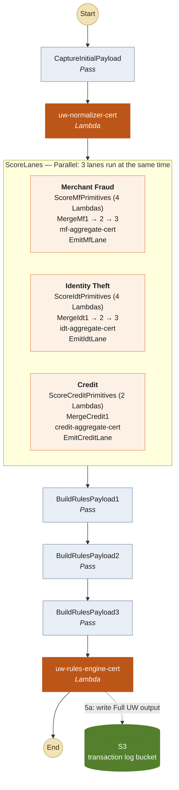
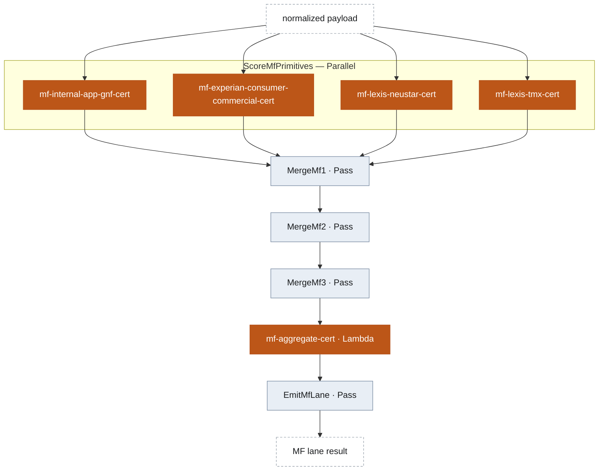
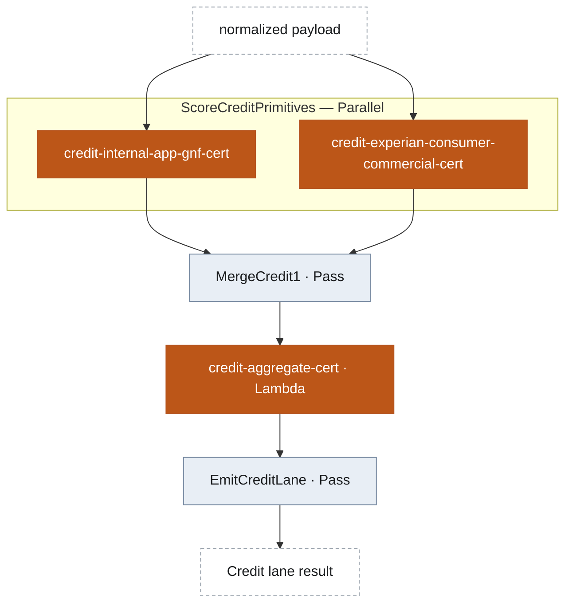
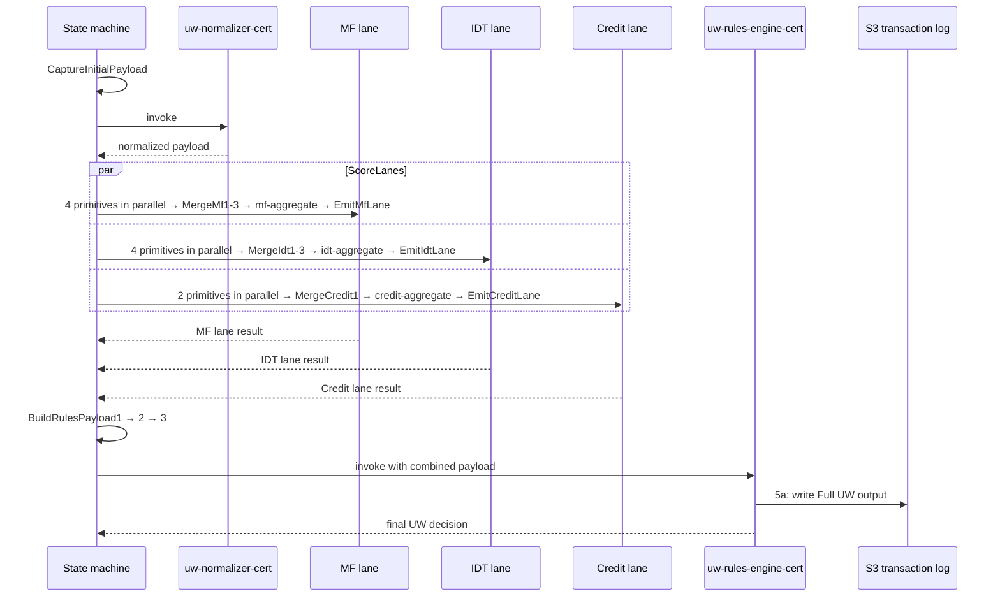

# Inside the state machine

This page walks through the **actual Step Functions definition** behind step 4 of the
[end-to-end flow](data-flow.md), state by state. It is taken from the state-machine graph in the AWS
console (CERT environment). The [lanes & layers](decisioning-lanes.md) page describes the same thing
conceptually; this page shows how it is really wired.

!!! info "What is confirmed vs inferred"
The state names, state types, Lambda function names and their order are read straight from the console
graph. **Why** a state exists (for example, why there are three `Merge` states) is my interpretation and
is marked **(inferred)**. The state-machine JSON (ASL) would confirm these.

## The whole state machine at a glance



The run has five phases:

| # | Phase                   | States                                                   | Layer                                   |
| - | ----------------------- | -------------------------------------------------------- | --------------------------------------- |
| 1 | Keep the request        | `CaptureInitialPayload`                                  | (setup)                                 |
| 2 | Normalize               | `uw-normalizer-cert`                                     | Normalization layer                     |
| 3 | Score the three lanes   | `ScoreLanes` and everything inside it                    | Primitive model + Composite model layers |
| 4 | Build the rules input   | `BuildRulesPayload1` → `2` → `3`                         | (glue)                                  |
| 5 | Decide                  | `uw-rules-engine-cert`                                   | Rules engine layer                      |

## The three state types you will see

| Type         | Icon in the console | What it does here                                                                 |
| ------------ | ------------------- | --------------------------------------------------------------------------------- |
| **Lambda: Invoke** | orange λ      | Runs a Lambda function: the normalizer, a model, an aggregate or the rules engine. All the real computation happens in these. |
| **Pass**     | split arrow         | Runs no code. It only reshapes the JSON passing between states: copies, merges or renames fields. |
| **Parallel** | fork                | Starts several branches at the same time and waits for **all** of them. Its output is an **array** with one element per branch. |

The last row matters most. Because a Parallel state returns an array, every Parallel state here is
followed by Pass states that flatten the array back into one object. That is what the `Merge*` and
`BuildRulesPayload*` states are for.

## Phase 1: `CaptureInitialPayload` (Pass)

The first state keeps a copy of the incoming request, as it arrived from the Post-ALB Lambda.

**Why (inferred):** each later state replaces its input with its output by default. Without a saved
copy, the original application data would be gone by the time the rules engine runs. The rules engine
needs both the scores **and** the original request fields, so the request is stashed at the start.

## Phase 2: `uw-normalizer-cert` (Lambda)

This is the **Normalization layer**. One Lambda cleans the request, scales values and builds the
features that are **shared** by every model and rule, so this work is done once rather than once per
model.

!!! note "Where the S3 reference data is read"
There is **no separate state** for step 3 of the end-to-end flow ("read reference data"). So the S3
reference cache must be read **inside the Lambdas**. The normalizer is the most likely reader, since it
builds the shared features (for example, mapping raw TMX codes to categories) **(inferred)**. Models with
their own lookups may read S3 too. To confirm which ones do, check the Lambda code or its CloudWatch logs.

## Phase 3: `ScoreLanes` (Parallel)

`ScoreLanes` starts **three branches at the same time**, one per lane. Each branch gets the normalizer's
output as its input. The state finishes only when **all three** branches have finished, so the slowest
lane sets the time for this phase.

Every lane has the same five-part shape:

1. **`Score<Lane>Primitives`** (Parallel): runs that lane's source models at the same time. This is the
   **Primitive model layer**.
2. **`Merge<Lane>1…n`** (Pass): flattens the array of model outputs into one object.
3. **`<lane>-aggregate-cert`** (Lambda): the lane's "score of scores". This is the **Composite model layer**.
4. **`Emit<Lane>Lane`** (Pass): shapes the lane's final result for the next phase.

So there are **two levels of Parallel**: lanes run at the same time as each other, and within each lane
the source models run at the same time too.

### Merchant Fraud lane



### Identity Theft lane

Same shape as Merchant Fraud: four sources, three merges.


### Credit lane

Only two sources, so only **one** merge.



### Why the number of Merge states matches the number of sources

Look at the counts: **4 sources → 3 merges** (MF, IDT) and **2 sources → 1 merge** (Credit). It is
always *sources − 1*.

That fits how Step Functions merges JSON. Its built-in merge function, `States.JsonMerge`, combines
**exactly two** objects at a time. Folding *n* results into one therefore takes *n − 1* merges
**(inferred from the counts; the ASL would confirm it)**:

```text
ScoreMfPrimitives output: an array, one element per branch
  [ {gnf result}, {experian result}, {neustar result}, {tmx result} ]

MergeMf1:  merge( [0], [1] )        → {gnf + experian}
MergeMf2:  merge( previous, [2] )   → {gnf + experian + neustar}
MergeMf3:  merge( previous, [3] )   → {gnf + experian + neustar + tmx}

mf-aggregate-cert receives ONE flat object holding all four primitive scores
```

The same reasoning explains **`BuildRulesPayload1–3`** in phase 4.

### What the `Emit*Lane` states do

`EmitMfLane`, `EmitIdtLane` and `EmitCreditLane` are the last state in each branch, so their output
becomes that lane's element in the `ScoreLanes` result. Most likely they wrap the lane's result under its
own key (for example `mf`, `idt`, `credit`). Then the three lanes can be merged in phase 4 without their
fields overwriting each other **(inferred)**.

## Phase 4: `BuildRulesPayload1` → `2` → `3` (Pass)

`ScoreLanes` returns an **array of three lane results**. The rules engine needs one object that holds
all three lane results **plus** the original request saved in phase 1. That is four pieces, which takes
three pairwise merges **(inferred)**:

```text
BuildRulesPayload1:  merge( lane result A, lane result B )
BuildRulesPayload2:  merge( previous, lane result C )
BuildRulesPayload3:  merge( previous, captured initial payload )   ← from CaptureInitialPayload
```

The exact order of the pieces may differ. Only the ASL can show it.

## Phase 5: `uw-rules-engine-cert` (Lambda), then End

The **Rules engine layer**. It receives the combined payload: all three lane aggregates, their primitive
scores and the original request. It applies the business rules and produces the **final UW decision**.

Two things happen here:

- It **writes the full UW output structure to the S3 transaction-log bucket** (step **5a**). This
  triggers the asynchronous logging to Snowflake (5b and 5c). See
  [Band 3](data-flow.md#band-3-asynchronous-transaction-logging-bottom).
- Its return value becomes the **state machine's output**. That goes back to the Post-ALB Lambda and on
  to the caller (steps 6 and 7).

It is the last state, so the execution reaches **End** right after it.

## How the data changes from state to state

What the JSON looks like after each phase (conceptual, **(inferred)**):

| After state                    | The data is…                                                                  |
| ------------------------------ | ----------------------------------------------------------------------------- |
| `CaptureInitialPayload`        | the original request, plus a saved copy of it                                  |
| `uw-normalizer-cert`           | the shared, normalized feature set                                             |
| `Score<Lane>Primitives`        | an **array** of that lane's model outputs, one per source                     |
| `Merge<Lane>n` (last)          | one **object** with all of that lane's primitive scores                       |
| `<lane>-aggregate-cert`        | the lane's composite ("score of scores") result                               |
| `Emit<Lane>Lane`               | the lane result under its lane key                                            |
| `ScoreLanes`                   | an **array** of 3 lane results                                                |
| `BuildRulesPayload3`           | one **object**: 3 lane results + the original request                         |
| `uw-rules-engine-cert`         | the final UW decision (also written to S3 as the full UW output)             |

Using **Merchant A** from the [worked example](worked-example.md) (**illustrative** values), the
rules-engine input would look roughly like this:

```json
{
  "mf":     { "aggregate_score": 0.11, "primitives": { "internal_app_gnf": "…", "experian": "…", "neustar": "…", "tmx": "…" } },
  "idt":    { "aggregate_score": 0.08, "primitives": { "…": "…" } },
  "credit": { "aggregate_score": 0.79, "primitives": { "internal_app_gnf": "…", "experian": "…" } },
  "request": { "merchant": "Downtown Coffee LLC", "mcc": "5812", "…": "…" }
}
```

The field names are invented to show the **shape**. They are not the real schema.

## Timing: what runs at the same time



**Rough latency:** normalizer + the **slowest lane** + rules engine. Within a lane, the slowest source
model sets the time, plus the merges and the aggregate. Pass states take almost no time.

## All the function names

Every Lambda follows `<lane>-<source>-<environment>`. The `-cert` suffix is the environment (CERT, the
certification / pre-production stage). In other environments the suffix is likely different, for
example `-prod` **(inferred)**.

| Source                         | Merchant Fraud                          | Identity Theft                           | Credit                                       |
| ------------------------------ | --------------------------------------- | ---------------------------------------- | -------------------------------------------- |
| Internal App GNF               | `mf-internal-app-gnf-cert`              | `idt-internal-app-gnf-cert`              | `credit-internal-app-gnf-cert`               |
| Experian Consumer / Commercial | `mf-experian-consumer-commercial-cert`  | `idt-experian-consumer-commercial-cert`  | `credit-experian-consumer-commercial-cert`   |
| Lexis Neustar                  | `mf-lexis-neustar-cert`                 | `idt-lexis-neustar-cert`                 | (none)                                       |
| Lexis TMX                      | `mf-lexis-tmx-cert`                     | `idt-lexis-tmx-cert`                     | (none)                                       |
| **Aggregate**                  | `mf-aggregate-cert`                     | `idt-aggregate-cert`                     | `credit-aggregate-cert`                      |

Shared across all lanes: **`uw-normalizer-cert`** (first) and **`uw-rules-engine-cert`** (last).

**Totals:** 15 Lambda functions, 4 Parallel states (`ScoreLanes` + 3 `Score*Primitives`), 14 Pass
states. 33 states in all.

## What this means for support

- **Every source model runs on every request.** There is no Choice state that skips a source. If a
  source has no data for a merchant (for example, TMX finds no device), its Lambda still runs and returns
  an empty or "no signal" result. The lane's aggregate then picks the right scenario model
  **(inferred)**.
- **One failing Lambda can fail the whole run.** In Step Functions, if any branch of a Parallel state
  fails, the whole Parallel state fails, unless the definition has `Retry` or `Catch` rules. The console
  graph does not show whether these exist. **Confirm this in the ASL**, because it decides whether, for
  example, a Neustar outage stops every decision.
- **Finding a failure:** open the execution in the Step Functions console. The failed state is marked in
  red, and you can see each state's input and output. If it failed inside a Lambda, the error is that
  function's (for example `idt-lexis-tmx-cert`), and its CloudWatch logs have the details.
- **Finding the slow part:** the execution timeline shows how long each state took. Look at the slowest
  lane, then the slowest primitive inside it.
- **Wrong reference data:** there is no separate read state, so check the logs of the Lambda that reads
  S3 (most likely the normalizer).

See also the [Support engineer guide](support-guide.md).
