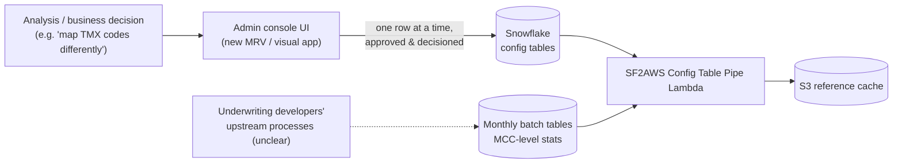
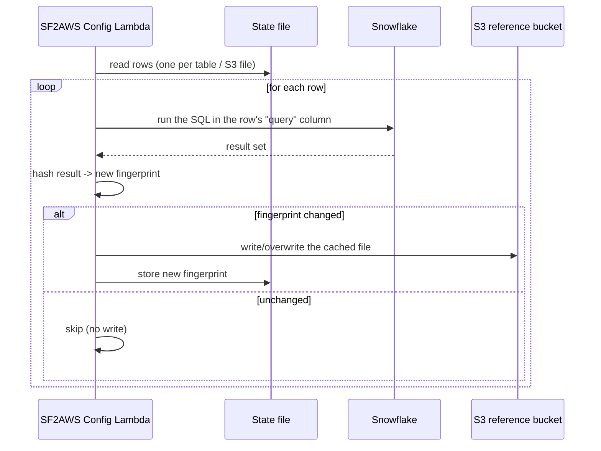

# Before the config tables

The architecture diagram starts at **Snowflake Config Tables**. The transcript answers the question
_"what is upstream of those tables?"_

## Short answer

For the true config tables, **nothing technical is upstream except people's decisions.** They are
parameters for the service: mappings, categories and lookups that the models and rules need. They are
entered through a governed **admin console UI**, not produced by a data pipeline.

## Step by step

### 1. Someone identifies a need for config

Example from the transcript: a data scientist (Arjen) identified that **three new config tables** were
needed for multiple models. The modelling team supplies the "starting place for the data", and the
engineering team puts it into Snowflake.

### 2. Config is defined in the admin console

In the admin console of the new app, each _true_ config table is a governed key/value view.
The example shown was **TMX code categories**:

| key        | value                   |
| ---------- | ----------------------- |
| a TMX code | the category it maps to |

Properties called out in the meeting:

- **Governed**: rows are _approved and decisioned_.
- **One row at a time**: you cannot bulk-update with a Snowflake process; each change is an ad-hoc,
  deliberate edit.
- **Relatively static**: changes over time, but not on a regular schedule.
- **Work in progress**: Sachin has been setting many of these up; most are still **empty** and need to be
  populated.

### 3. The tables live in Snowflake

Today the tables sit in a **config schema** in Snowflake. Over time they will migrate to the
UI-governed style (like TMX code categories).

### 4. Monthly batch tables (missing from the diagram)

The diagram only shows "config tables", but there is a second category:

- **Monthly batch tables** holding **MCC-level statistics** (MCC = Merchant Category Code).
- These _do_ have something upstream, owned by the underwriting developers; the full picture was not
  known in the meeting.
- For now they may be **updated manually**; a proper deployed process is planned later.

### 5. Cache to S3 (the "yellow dotted line")

The team's concern is simply: _whatever is in Snowflake must be cached to S3_. That is done by the
**SF2AWS Config Table Pipe Lambda** using a **state file**.

## How the caching job decides what to refresh

- Each row of the state file corresponds to **one file that lands in S3**.
- The row has a **query** column (the SQL to run) and a **fingerprint** (hash of the last result).
- Because config changes rarely, most runs are no-ops; S3 is only rewritten when the data really changed.

!!! tip "Why this matters for support"
If a config change made in the UI does not show up in decisions, the chain to check is:
UI row approved → Snowflake table updated → Lambda ran → fingerprint changed → S3 file updated →
state machine reading the new file. See the [support guide](support-guide.md).
