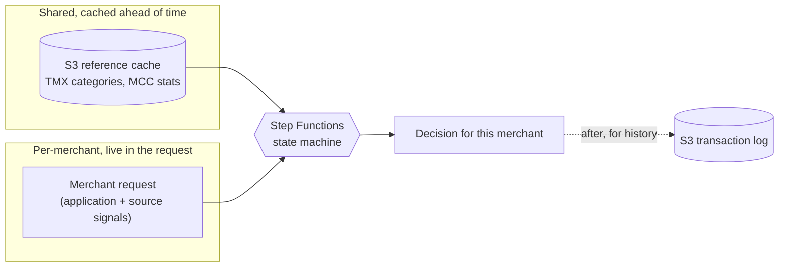
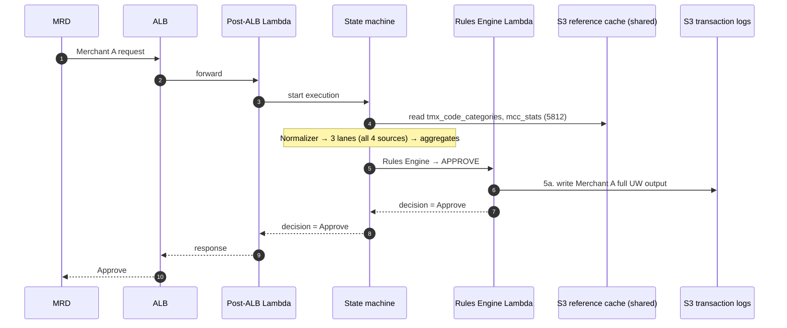
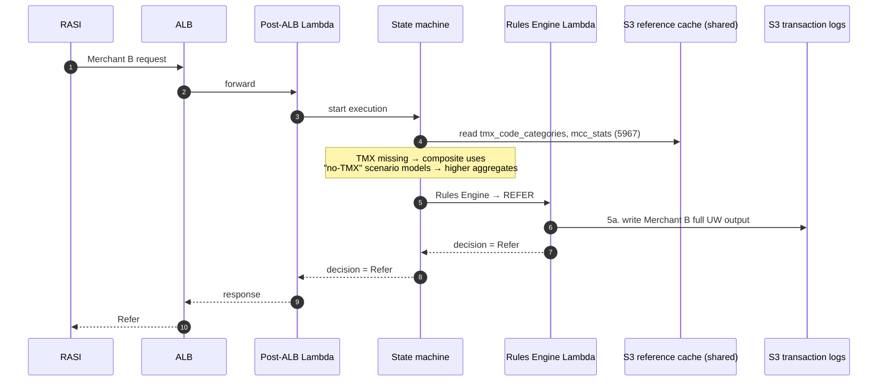

# Worked example: two merchants end to end

This page traces two underwriting requests through the whole service so you can see **what is shared**
and **what is per-merchant**. It is the best place to start if the data flow still feels abstract.

!!! warning "The merchant data and scores below are illustrative"
Nothing here is a real application or a real model output. The names, MCCs, device codes and scores are
invented to make the flow concrete. They are **(illustrative)**. Treat the *shape* of the flow as the
lesson, not the numbers.

## First, clear up one common misconception

A natural assumption is:

> "For each merchant run, the service retrieves that merchant's data, caches it in AWS, and the state
> machine reads it from there."

That is **not** how it works. There are two very different kinds of data, and only one of them is cached:

| Data                         | Example                                                              | Per-merchant? | Cached in S3?                                 | When it is fetched                           |
| ---------------------------- | ------------------------------------------------------------------- | :-----------: | --------------------------------------------- | -------------------------------------------- |
| **Reference / config data**  | TMX code categories, MCC-level stats, lookup mappings               |   ❌ shared   | ✅ yes — the **reference cache** bucket        | **Asynchronously**, long before any request  |
| **The merchant's own data**  | the application, the owner's details, source/bureau signals         |   ✅ per-run   | ❌ no — it flows through the request live       | **At decision time**, inside the request     |
| **The decision (output)**    | scores + final UW decision for this merchant                        |   ✅ per-run   | ✅ yes — the **transaction log** bucket (later) | **After** the decision, for history/analytics |

So:

- The **reference cache is the same for every merchant.** Merchant A and Merchant B read the *identical*
  cached files (same TMX category map, same MCC stats). It is refreshed on its own schedule by the
  [SF2AWS Config Lambda](upstream-config.md), not per request.
- The **merchant-specific data arrives in the API request** and is normalized and scored in real time.
  It is never pre-cached.
- The only per-merchant thing written to S3 is the **transaction log**, and that happens *after* the
  decision (steps 5a–5c), into a *different* bucket, purely for history — it is never fed back into the
  models for that same request.

## The two merchants at a glance (illustrative)

| Attribute                | Merchant A — _Downtown Coffee LLC_         | Merchant B — _QuickCash Online_                 |
| ------------------------ | ------------------------------------------ | ----------------------------------------------- |
| Comes in via             | MRD                                        | RASI                                            |
| MCC                      | 5812 (eating places)                       | 5967 (direct marketing / inbound teleservices)  |
| Internal App GNF         | ✅ present                                  | ✅ present                                        |
| Experian Cons/Comm       | ✅ returned                                 | ✅ returned                                       |
| Lexis Neustar            | ✅ returned                                 | ✅ returned                                       |
| Lexis TMX                | ✅ returned (device recognised)             | ⚠️ **no match / thin** → treated as missing      |
| Illustrative outcome     | **Approve**                                | **Refer** (manual review)                       |

The difference is deliberate: Merchant B is **missing one source (TMX)**, which is exactly the case the
[Composite Model Layer](decisioning-lanes.md) is designed to handle by picking a *scenario-specific*
model. Watch for that below.

---

## Merchant A — step by step

### 0. (Earlier, asynchronously) the reference cache is already warm

Long before Merchant A applies, the [SF2AWS Config Lambda](upstream-config.md) has already cached the
shared reference files into S3 — for example a `tmx_code_categories` file and an `mcc_stats` file. Nothing
about this step involves Merchant A; it would have happened anyway.

### 1. API request

MRD sends Merchant A's underwriting request to the **ALB**. The payload carries Merchant A's data
(business details, owner details, and the source signals the caller has — Internal App GNF, Experian,
Lexis Neustar, Lexis TMX). **(Exactly which signals are in the payload vs. fetched later is not stated in
the sources — inferred.)**

### 2. State machine invocation

The ALB forwards to the **Post-ALB Lambda**, which validates/shapes the payload **(inferred)** and starts
the **Step Functions state machine**.

### 3. Read reference data (the shared cache)

The state machine reads the **shared** cached files from S3 — the *same* files any other request uses:

- `tmx_code_categories` → used to turn Merchant A's raw TMX device code into a **category**. Say
  Merchant A's device code maps to category `trusted` _(illustrative)_.
- `mcc_stats` for **MCC 5812** → a low baseline-risk profile for eating places _(illustrative)_.

### 4. State machine runs (Normalizer → lanes → aggregates → Rules Engine)

Inside the state machine the [layers and lanes](decisioning-lanes.md) execute on Merchant A's data:

1. **Normalizer** cleans/scales Merchant A's features once (using shared reference data where needed).
2. **Primitive models** score each source. All four sources are present, so every lane runs its full set:
   - Merchant Fraud lane: GNF, Experian, Neustar, TMX → `MF Aggregate` = **0.11** _(illustrative, low)_.
   - Identity Theft lane: GNF, Experian, Neustar, TMX → `IDT Aggregate` = **0.08** _(illustrative, low)_.
   - Credit lane: GNF, Experian → `Credit Aggregate` = **0.79** _(illustrative, good)_.
3. **Composite models** roll each lane's primitive scores into that lane aggregate. Because *all* sources
   returned, the "all-sources" scenario model object is used _(inferred mechanism)_.
4. **Rules Engine** takes **all three** aggregates plus the data and renders the final decision →
   **Approve** _(illustrative)_.

### 5a–5c. Log the decision (asynchronous, after the fact)

The inputs, scores and the Approve decision are written to the **transaction log** bucket (5a). A
new-file event triggers the **AWS2SF Trans Log Lambda** (5b), which loads the record into the Snowflake
**historical table** (5c) for analytics and model retraining. This does **not** affect Merchant A's own
response — it already went out.

### 6–7. Response

The decision returns through the Post-ALB Lambda (6) and back out through the ALB to MRD (7): **Approve**.

---

## Merchant B — step by step (where it diverges)

Steps 1–3 look the same in shape: RASI sends the request, the Post-ALB Lambda starts the state machine,
and the state machine reads the **same shared** reference files. The differences start at the data itself.

### 3. Read reference data — same cache, different lookups hit

The state machine reads the **identical** cached files, but Merchant B's data lands on different entries:

- `mcc_stats` for **MCC 5967** → a **higher** baseline-risk profile _(illustrative)_.
- `tmx_code_categories` → Merchant B's TMX call returned **no recognised device** (thin signal), so there
  is effectively **no TMX source** to categorise.

### 4. State machine runs — the composite layer adapts

This is the key teaching point. One source (TMX) has no data, so the lanes that *use* TMX are missing one
input:

1. **Normalizer** runs on the data that *is* present.
2. **Primitive models**: all four MF and IDT source models **still run**. The state machine has no step
   that skips a source (see [Inside the state machine](state-machine.md#what-this-means-for-support)).
   But `mf-lexis-tmx-cert` and `idt-lexis-tmx-cert` have no device signal to score, so they return an
   empty or "no signal" result **(inferred)**. The Credit lane never used TMX, so it is unaffected.
3. **Composite models — scenario-specific**: because TMX is absent, each affected lane's composite picks
   the **model object trained for the "no-TMX" scenario** instead of the all-sources one. This is exactly
   the _"score of scores … depending on sources available"_ behaviour from the
   [Composite Model Layer](decisioning-lanes.md).
   - `MF Aggregate` = **0.63** _(illustrative, elevated)_.
   - `IDT Aggregate` = **0.41** _(illustrative, medium)_.
   - `Credit Aggregate` = **0.55** _(illustrative, thin-but-ok)_.
4. **Rules Engine** combines all aggregates + the higher-risk MCC profile and renders → **Refer** (send to
   a human) rather than an outright Approve/Decline _(illustrative; outcome values inferred)_.

### 5a–7. Log + response

Same as Merchant A: the decision and its scores are logged to S3 → Snowflake history (5a–5c), and
**Refer** is returned synchronously to RASI (6–7).

---

## Side-by-side: what actually differed

| Step                        | Merchant A                          | Merchant B                                              |
| --------------------------- | ----------------------------------- | ------------------------------------------------------- |
| Reference files read        | **Same shared cache**               | **Same shared cache**                                   |
| Which cache rows mattered   | MCC 5812 (low), TMX cat `trusted`   | MCC 5967 (higher), **no TMX category** (missing source) |
| Sources available           | All four                            | Three (no TMX)                                           |
| Composite model chosen      | "all-sources" scenario              | **"no-TMX" scenario** _(inferred)_                       |
| Final decision              | **Approve** _(illustrative)_        | **Refer** _(illustrative)_                               |
| Written to transaction log  | ✅ after decision                    | ✅ after decision                                        |

## Key takeaways

1. **The S3 cache is shared reference data, not per-merchant.** Both merchants read the exact same files;
   what differs is their own request data and *which* reference entries that data touches.
2. **Merchant data is live, not cached.** It enters with the request, is normalized and scored in the
   state machine, and the decision returns synchronously. The only per-merchant S3 write is the
   *after-the-fact* transaction log.
3. **The composite layer adapts to whatever sources returned.** Missing a source (like TMX for Merchant
   B) doesn't break the request — it selects a scenario-specific model instead, which is why two merchants
   can take structurally different paths through the *same* pipeline.

!!! note "Where this is inferred"
The step skeleton (1–7, 5a–5c), the three lanes, the four layers and the scenario-specific composite
behaviour come from the architecture diagram and transcript. The specific merchants, MCCs, device-code
categories, scores and the Approve/Refer outcomes are **illustrative** and the exact decision values are
**(inferred)** — confirm real thresholds and outcome labels with the team.
